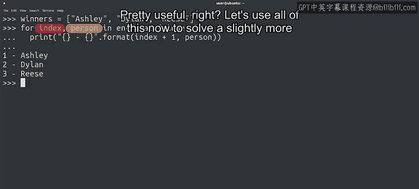
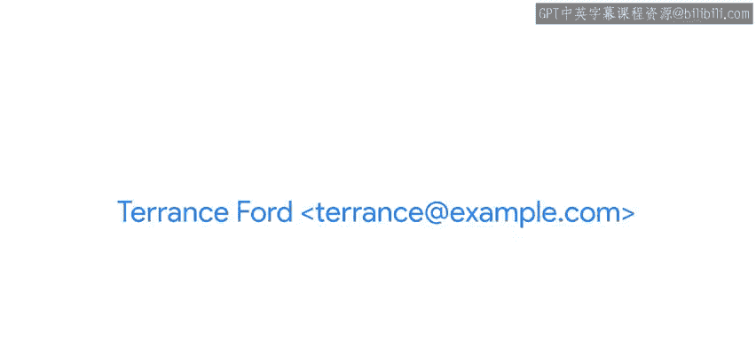
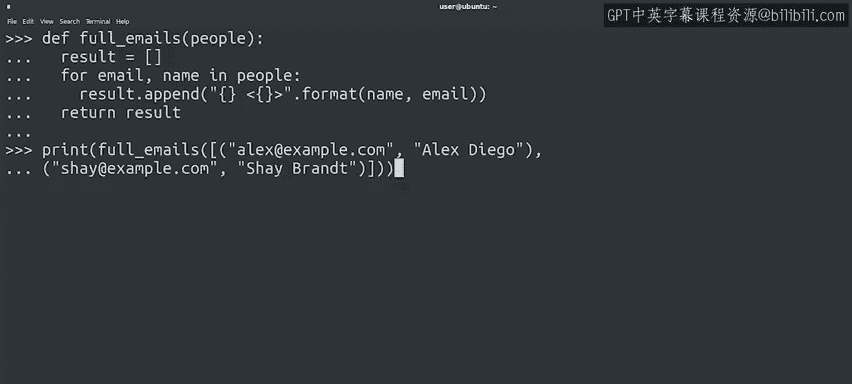

# 谷歌《用Python进行IT自动化办公1、2课（Python、控制操作系统）｜Google IT Automation with Python》中英字幕 - P58：57_遍历列表和元组.zh_en - GPT中英字幕课程资源 - BV1gw411E7E1

When we looked at four loops， we said they iterate over a sequence of elements。

 One of the examples we checked out was iterating over a list。

 Let's take a little trip to the zoo to see this in action。 Okay， so we will make a list of animals。

 so。😊，Animals equals， and since we're making a list， we'll start with a bracket。And we'll add lion。

Zbra？Dolphin。And monkey。And end the list with another bracket。Charles。Equals0。And we'll start a loop。

F animal in animals。Two spaces， chas。Plus， equals。Length。Of animals。Print。Total characters。

Average length。Dot format。Charles。Charles。Length。Animals。In this code。

 we're iterating over a list of strings for each of the strings。

 we get its length and add it to the total amount of characters。 At the end。

 we print the total and the average， which we get by dividing the total by the length of the list。😊。

You can see we're using the lens function twice once to get the length of the string and then again to get the amount of elements in the list。

What if you wanted to know the index of an element while going through the list。

 you could use the range function and then use indexing to access the elements at the index that range returned。

 You could use a range function and then use indexing to access the elements at the index that range just returned。

Or you could just use the enumerate function。Winners equals， will make a list。Ashley。Dylan。

And Greece。And close the list。For index。Person in。Enumerate。Winners。Print。Curly brackets。

Dash curly brackets。Dot。Format。Index plus one person。

The enumerate function returns a tuple for each element in the list。

 The first value in the tuple is the index of the element in the sequence。

 The second value in the tuple is the element in the sequence。

 You're the real winner with the enumerate function。 It does all the work for you。😊，Pretty useful。

 right？

Let's use all of this now to solve a slightly more interesting problem。

Say you have a list of tuples containing two strings each。 The first string is an email address。

 and the second is the full name of the person with that email address。

 You want to write a function that creates a new list containing one string per person。

 including their name and the email address between angled brackets。

 The format usually used in emails like this。

So。😡，What do we need to do？We'll start by defining a function that receives a list of people。Deaf。

Ful。Emails。Takes the argument， people。Remember， people is a list of tus where the first element is the email address。

 and the second one is the full name。 So in our function。

 we'll first create the variable that well use as a return value。

 which will be a list and will call it result。😊，Result equals empty list。

We'll then iterate over the list of people。 We know this list contains tus of two strings each。

 so we'll unpack the values directly when iterating in variables that we'll call email and name for email and name in people。

Now， our result variable is a list， and it should contain strings。

 so we'll append the resulting string to the results list。 Re dot append。

The string that will append will be formatted in the way we want to do that will'll use the format method with the two variables of our iteration。

 so。Curly brackets。Curly brackets。Dot format。Name。And email。Once we done with the iteration。

 well return the list， which should now contain all the necessary emails。Return results。

Will this work， What do you think， Let's try it out。Print full emails。Alex at example dot com。Alex。

 Diego。Sy at example。com is the email and we'll call Shey brand。As the name。

Yes， this work is expected。Before we move on， a quick word of caution about some common errors when dealing with lists in Python。

 because we use the range function so much with four loops。

 you might be tempted to use it for iterating over indexes of a list and then to access the elements through indexing。

 you could be particularly inclined to do this， if you're used to other programming languages before。

 because in some languages， the only way to access an element of a list is by using indexes。

 Real talk。 This works， but looks ugly。 It's more idiomatic in Python to iterate through the elements of the list directly or using enumerate when you need the indexes like we've done so far。

 There are some specific cases that do require us to iterate over the indexes。 For example。

 when we're trying to modify the elements of the list we're iterating。😊，By the way。

 if you're iterating through a list and you want to modify it at the same time。

 you need to be very careful。 If you remove elements from the list while iterating。

 you're likely to end up with an unexpected result。In this case。

 it might be better to use a copy of the list Instead。

 We've now seen a bunch of different things we can do with lists， and hopefully。

 you're starting to see how they can be a very powerful tool in your I T specialist tool kit。😊。

Next up， we're going to learn a powerful technique for creating lists。

