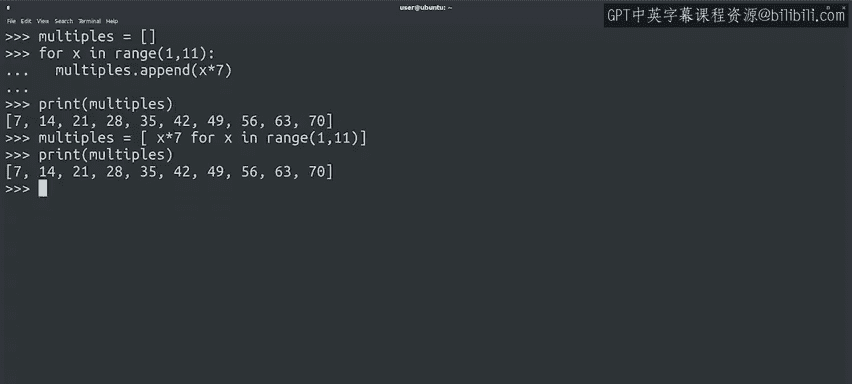
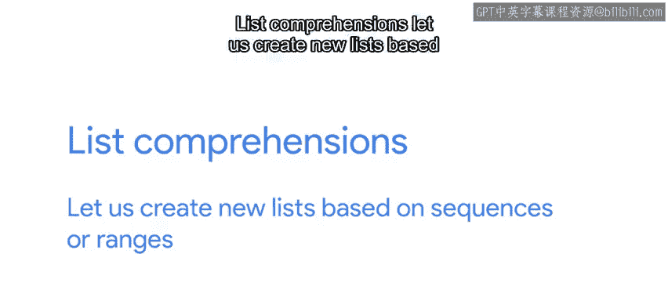
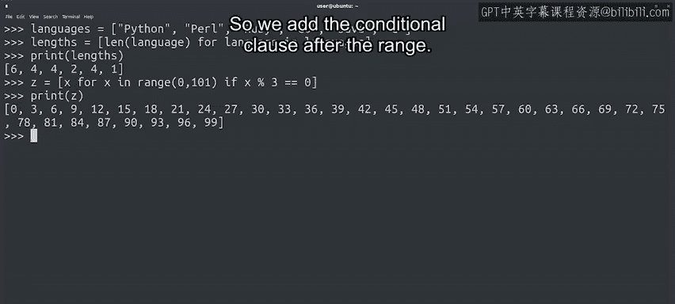

# 谷歌《用Python进行IT自动化办公1、2课（Python、控制操作系统）｜Google IT Automation with Python》中英字幕 - P59：58_列表推导式.zh_en - GPT中英字幕课程资源 - BV1gw411E7E1

We're almost done with our deep dive into Python lists。

 But before we continue to our next data structure， let's talk about creating lists in a shorter way。

Say we wanted to create a list with multiples of seven from 7 to 70， we could do it like this。

So we create a list called multiples。Then。For x in range1。To 11。Multiples dot append。X。Times 7。

Print multiples。This works fine and is a good way of solving it。

 But because creating lists based on sequences is such a common task。

 Python provides a technique called list comprehension that lets us do it in just one line。😊。

This is how we would do the same， with list comprehension。Multiples equals。We'll start the list。

 X times 7。For x in range1 to 11。And close the list。Print multiples。

It should be the same。List comprehensions let us create new lists based on sequences or ranges。

So we can use this technique whenever we want to create a list based on a range。

 like in this example， or based on the contents of a list， a tuple。

 a string or any other Python sequence。 The syntax tries to copy how you would express these concepts with natural language。

 although it can still be confusing sometimes。Let's check out a different example。

Say we have a list of strings with the names of programming languages like this one。

And we want to generate a list of the lengths of the strings。

 We could iterate over the list and add them using a pen like we did before。

 Or we could use a list comprehension like this。Length equals。Len language。4 language in languages。

Print length。List comprehensions also let us use a conditional clause。

 Say we wanted all the numbers that are divisible by 3 between 0 and 100。

We could create a list like this。 Z equals open list， X 4 x in range。Zero to 101。If X。Modulular 3。

Equals。0。Print。Z。😊，In this case， we just want the element X to be a part of the list。

 but we only want the numbers where the remainder of the division by 3 is 0。

 So we add the conditional clause after the range。

Using list comprehensions when programming in Python is totally optional。

 Sometimes it can make the code look nicer and more readable。 at other times。

 it can have the opposite effect， especially if we try to pack too much information together。

 In general， it's a good idea to know that list comprehensions exist。

 especially when you're trying to understand someone else's code。 All right。

 We've now seen a bunch of different methods we can use to operate with lists and tuples。

 And Python provides even more of them that we didn't get to talk about。 In our next reading。

 you'll find a list of the most common operations and links to the official documentation in case you want to learn more。

😊，After the reading， you can practice your new skills in the next quiz。😊。

