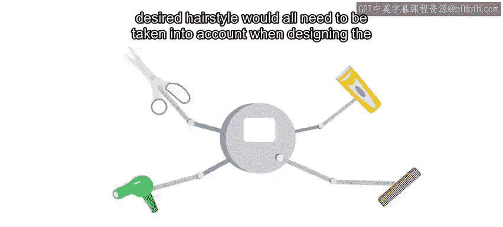

# 谷歌《用Python进行IT自动化办公1、2课（Python、控制操作系统）｜Google IT Automation with Python》中英字幕 - P5：4_什么是自动化.zh_en - GPT中英字幕课程资源 - BV1gw411E7E1

🎼Yeah。Although we might not realize it， we reap the benefits of automation all the time in our daily lives。

 Do you ever pay your bills with scheduled payments or use a self checkout at the grocery store。

I always set my coffee machine to start brewing before I've even gotten out of bed。

 The promise of fresh coffee makes early mornings wayazier。

 Automation is the process of replacing a manual step with one that happens automatically。

 Take a traffic light， for example， which continuously regulates the flow of vehicles at an intersection。

 A traffic light requires a human intervention only when it needs repairs or maintenance。

 The automatic regulation of traffic means that humans don't have to stand at the intersection。

 manually signaling when cars should stop or go。 Instead。

 people can concentrate on more complex creative or difficult tasks like focusing on where youre driving。

 What's more， traffic lights don't get tired bored or accidentally display a green light when they met red。

 This highlights another benefit of automation consistency。 Let's face it。

 us humans are flawed and sometimes we make mistakes。

 A human performing the same task hundreds of times will never be as consistent as a machine doing the same thing。

 but。😊，for all of its advantages， automation isn't a solution for every situation。

 Some tasks just aren't suited for automation。 For example。

 they may require a degree of creativity or flexibility that automatic systems can't provide or for more complicated or less frequently executed tasks。

 C the automation may actually be more effort or cost than it's worth。

 Think about when you get a haircut。 What would it take to automate the actions of cutting hair with a machine。

 The client's height， the shape of their head， their current hair length and desired hairstyle would all need to be taken into account when designing the automatic system。

 We need to replicate the creativity and skills of a trained specialist。

 along with extensive testing to ensure the client's safety and quality haircut。

 And if you've ever had a bad experience at a hair salon， you know， quality can be subjective。

 In this case， the cost and effort of automation just isn't worth the benefits of an automatic haircut would provide。

 which is why we don't have robot hairs stlist。

Not too complex， right？Automation is a powerful tool when used in the right place at the right moment。

 it can save time， reduceuce errors， increase consistency and provide a way to centralize solutions and mistakes。

 making them easier to fix throughout this course and in upcoming ones will be talking about when it makes sense to apply automation and exactly how you do it Eventually。

 knowing when and where to use automation will become automatic for you。😊。

