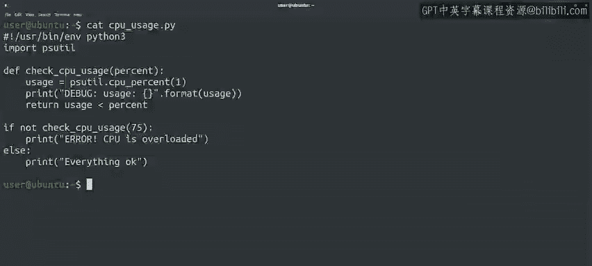

# 谷歌《用Python进行IT自动化办公3、4、5、6课（Git、debug、云端、实践）Google IT Automation with Python》中英字 - P5：4_应用更改.zh_en - GPT中英字幕课程资源 - BV1LW4y1F7XW

Imagine a colleague sent you a script of the bug and asked you to help fix the issue。

Once you understood what was wrong with the script。

 you could describe to them what they need to change something like， well。

 you can only return values and side functions。 I think you meant to use cysts exit instead。 Also。

 youre converting to gigabytes twice So your script will always fail。

 but this could still be hard for them to understand if the code was complex。

 to make the change clear。 you could send them a diff with the change so that they can see what the modified code looks like。

To do this， we typically use a command line like diF dash U， old file， new file。

Greater than change dot di。As a reminder， the greater than sign redirects the output of the diF command to a file。

 so with this command， we're generating a file called change do diff with the contents of DF dash U command。

By using the dash U flag， we include more context， which helps the person reading the file understand what's going on with the change。

 The generated file is usually referred to as a diff file， or sometimes a patch file。

It includes all the changes between the old file and the new one。

 plus the additional context needed to understand the changes and to apply those changes back to the original file。

Now， say you're the one receiving a def file with a change and you want to apply it to a script you wrote。

You could read the D file you receive carefully and then manually go through the file that needs to be changed and apply the modifications。

But that sounds like a lot of manual work that could be automated， don't you think？Well。

 it sure is there's a command called patchch to do exactly this。

Patch takes a file generated by di and applies the changes to the original file。

 Let's check this out in an example。 Say we have a small script that checks whether the computer is under too much load like this one。

This script uses the PSUT module to check the percentage of the CPU that's currently in use。

When the load is above a threshold， in this case，75%， it prints a message with an error。

When it's under the threshold， it says that everything's okay。 Now。

 we've shared this script with a few colleagues， and one of them tells us that the script doesn't work correctly。

Even if a computer is completely overloaded， the script will say that everything's okay。

 Our colleague is so helpful that they sent us a diff with the fix for our problem。

Let's check that one out。We can see that our colleague made two changes。

 they added a one as a parameter to the CPU percent function。

 and they added a bugging line that prints the value returned by the function。

 Our colleague explains that by calling the CPU percent function without a parameter。

 we were not averaging over a period of time and so the call always returned0。

So we have the D file and we want to apply it to our script， how do we do that？

We'll use the patch command， We'll pass the name of the file that we want to patch in this case。

 CPU usage that pi as the first parameter to the command。

And then we'll provide the DF file through standard input。Do you remember how to do that？

We'll use the less than symbol to redirect the contents of the file to standard input。

 Let's check this out。So we told Patch to apply the changes that come from CPUpuusage。diff。

To our CPU usage that pi file， we get one single line that says the file is patched。

 which means that we've successfully applied the changes。

Let's verify that by looking at the contents of our script。Nice。

 we see that our file was modified with the changes that we got from our colleague。

 The CPU percent function is being called with a parameter of one， and the debugging line is printed。

Once we're happy with the script， we could remove the debugging line， but for now。

 we'll leave it in there。 you might be wondering why go through all this trouble diffing and patching and not just send the whole file instead。

There are a few reasons for this。The main reason is that the original code could have changed。

In our example， it's possible that the code our colleague was using to prepare the fix wasn't the latest version。

By using a diff instead of the whole file， we can clearly see what they changed。

No matter which version they were using。The patchch command can detect that there are changes made to the file and will do its best to apply the diIF anyways。

It won't always succeed， but in many cases it will。Another reason is structure。In this case。

 we're patching a single small file。But sometimes you might be modifying a bunch of large files inside of a huge project。

 say you are changing four files in a project tree that contain 100 different files arranged in different directories。

 according to what they do。If you were to send the whole files。

You'd need to specify where those files were supposed to be placed。As we called out。

 we can diff whole directory structures， and in that case。

 the diff file can specify where each change file should be without us having to do any manual juggling cool。

 right？Okay， great work。 We've now seen how to generate diff files and how to apply their contents with the patch command In the next video。

 we'll put all this together to look at a real world example of how to use Dff and patch。😊。

