# 谷歌《用Python进行IT自动化办公3、4、5、6课（Git、debug、云端、实践）Google IT Automation with Python》中英字 - P60：2_什么是调试.zh_en - GPT中英字幕课程资源 - BV1LW4y1F7XW

🎼Yeah。

Throughout this course， we'll be talking about debugging and troubleshooting。

So what's the difference between them？We say that troubleshooting is the process of identifying。

 analyzing， and solving problems。

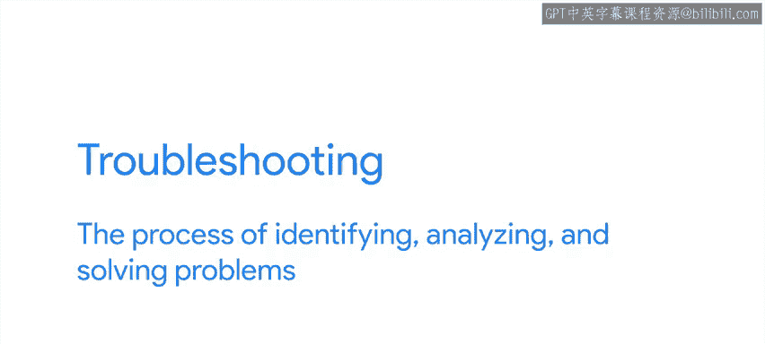

We can use the term troubleshooting to refer to solving any kind of problem In this course we'll focus on troubleshooting IT related problems。

 They could be problems caused by hardware， the operating system or applications running on the computer。

They could also be caused by the environment and configuration of the software。

 the services the application is interacting with or a wide range of other possible IT causes。

On the flip side， debugging is the process of identifying， analyzing， and removing bugs in a system。

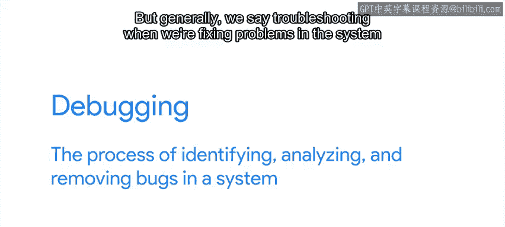

We sometimes use troubleshooting and debugging interchangeably， but generally。

 we say troubleshooting when we're fixing problems in the system running the application。

And debugging when we're fixing the bugs in the actual code of the application。

 there are lots of tools that we can use to get more information about the system and what the programs in our system are doing。

Tools like TCP dump and Wireshark can show us ongoing network connections and help us analyze the traffic going over our cables。

 To like PS， top or free can show us the number and types of resources used in the system。

 We can use a tool like Strace to look at the system calls made by a program or L tracece to look at the library calls made by the software。

Don't worry about memorizing them。 We'll talk about each in detail in our real worldor examples。

 When debugging the code of a program， we can combine these tools with specific debugging tools developed for the programming language used to write the application。

 debuggs Let us follow the code line by line。 Inpect changes in variable assignments。

 Inter the program when a specific condition is met and more。

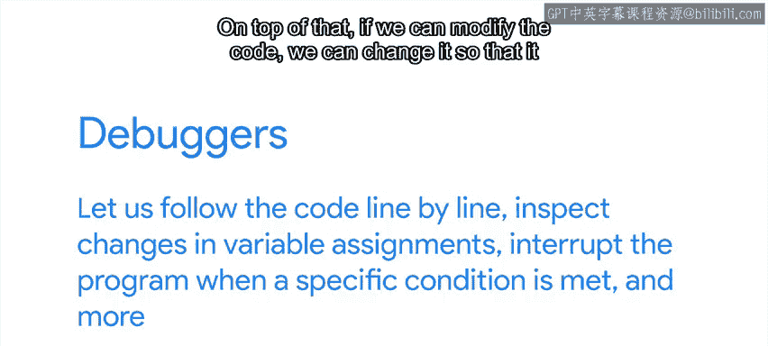

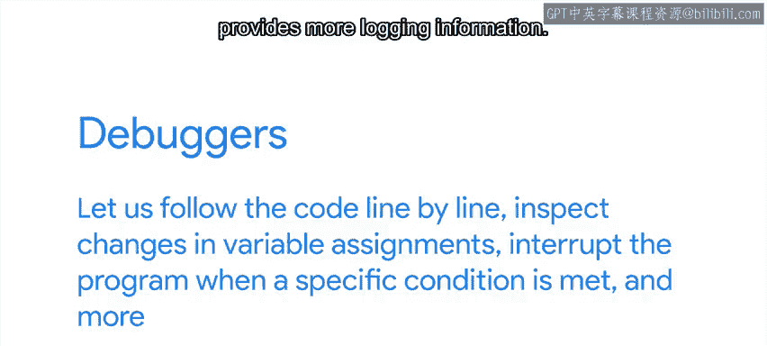

On top of that， if we can modify the code， we can change it so that it provides more logging information。

 this can help us understand what's going on behind the scenes both troubleshooting and debugging are a bit of an art。

In those fortunate cases， when you've seen the problem before。

 you might immediately know what the solution is， but usually figuring out the problem and its solution requires some creativity。

 we need to come up with new ideas of what could be failing and ways to check for that。

 and once we know what's failing， we need to imagine how to solve it。To take it a step further。

 once we've solved a problem， we can start thinking about how to prevent it from happening again。

I remember a tricky debugging session that I had on my last team。

We recently added integration tests to one of our pipelines to make sure the service worked correctly before automatically building and deploying a new version。

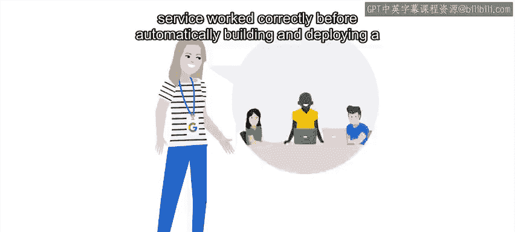

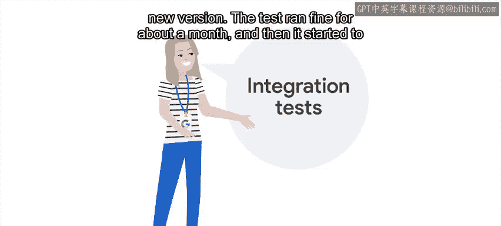

The test ran fine for about a month， and then it started to fail。

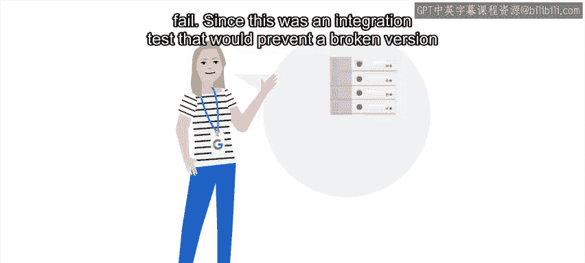

Since this was an integration test that would prevent a broken version from getting released。

 I was really surprised to discover that the broken code was actually already live in the production server。

 I looked at tons of logs and spent a long time following what the code did。

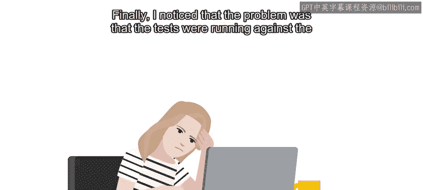

Finally， I noticed that the problem was that the tests were running against the production instance instead of the test instance。

 as we originally intended， in other words， the tests would pass as long as the production instance was working fine and would break when the production instance was broken。

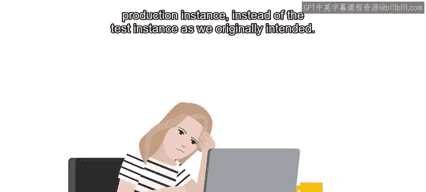

Not what we wanted at all to fix the problem， I had to figure out why the test code didn't connect to the test instance that we were creating inside the integration test。

 After a lot more investigation， I discovered that the test instance was failing to start because the execution path was incorrect。

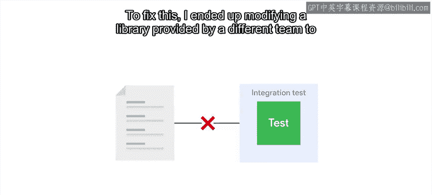

To fix this， I ended up modifying a library provided by a different team to pass the right parameter andvoa。

 the test started running against the code in the test instance， not the production instance anymore。

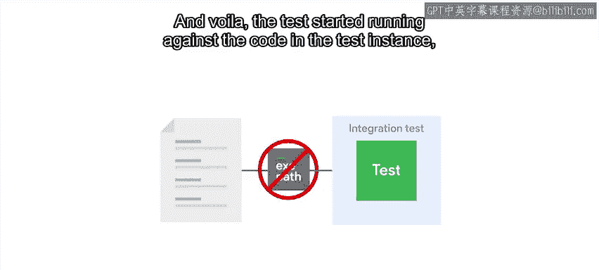

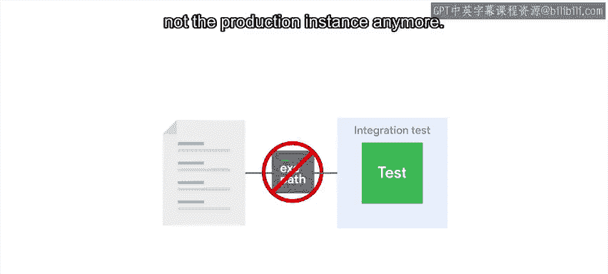

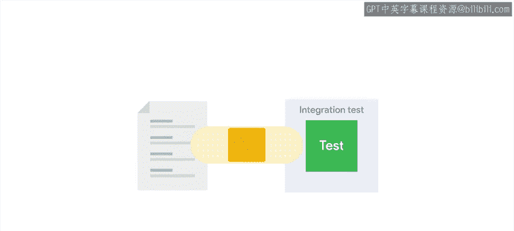

When troubleshooting or debugging， we come across surprising situations。

 Things aren't working as expected， and we need to understand why and figure out how to solve it。

As we called out， in this course， we'll look into a bunch of different techniques to understand and solve technical problems。

While we'll sometimes focus on system side and sometimes on the coding side。

 most of the techniques that we'll cover can help us solve any technical problem up next we'll talk about the steps we need to take to solve any kind of technical problem。

