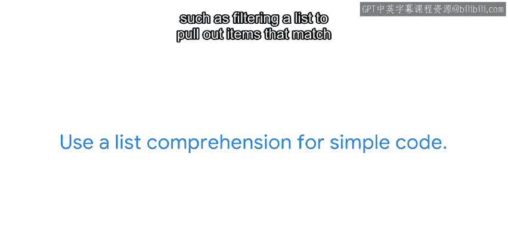
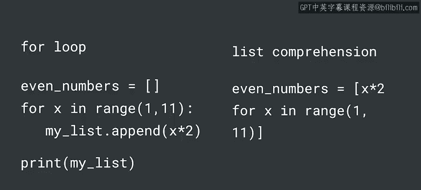
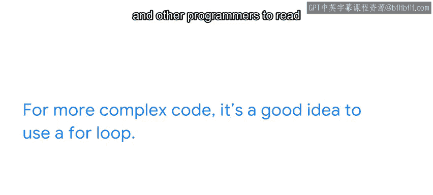
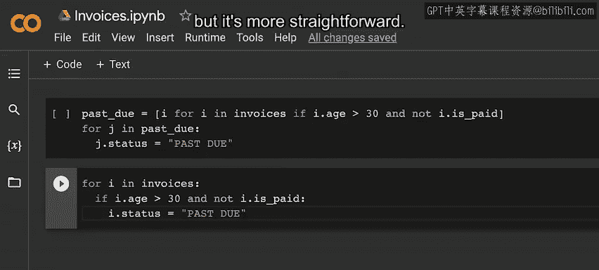
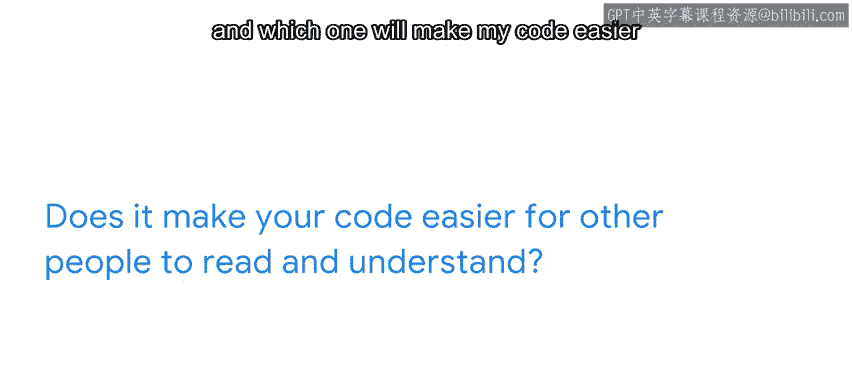

# 谷歌《用Python进行IT自动化办公1、2课（Python、控制操作系统）｜Google IT Automation with Python》中英字幕 - P60：59_列表推导式与 for 循环.zh_en - GPT中英字幕课程资源 - BV1gw411E7E1

Welcome back。 The first time we talked about list comprehensions。

 we showed you how to create a list using a for loop。

 Then we showed you how to create that same list using a list comprehension。

 If you're anything like me， you're probably wondering why there are two ways to do the same thing。

 So how do you know which one to use。😊，In this video。

 we're going to talk about when to use a for loop and when to use a list comprehension。 But first。

 a quick review。 We said a for loop iterates or repeats over a sequence of values like numbers。

 letters and so on。 A list comprehension lets us create new lists based on sequences or ranges。

 It's basically a shorthand way to build a new list based on the contents of an existing list。

 The list comprehension has the for loop。 the compilation and builds the list all in a single line of code。

 list comprehensions and for loops， both do the same thing。

 So when should you use which one The short answer is it's your call。

 Both methods are essentially interchangeable。 So there are no standards or best practices。

 deciding when to use a list comprehension instead of a for loop or vice versa is totally up to you。

 That said， there are considerations that many programmers make when deciding whether to use a list comprehension or a for loop。

😊，Programmers tend to use a list comprehension when it's fairly simple code。

 such as filtering a list to pull out items that match or capitalizing words in a list。

 If it can fit on a single line， I'd probably make it a list comprehension。

 which you can see in this example。

For more complex code， it's usually a good idea to use a for loop。

A four loop spells out the process better， which will make it easier for you and other programmers to read and maintain the code you write。

 For example， let's say you're working for a company that maintains a list of invoices。

 You need to calculate the sales tax and balance due for all the items on the list。

 You want to start with updating the status of past due invoices。

 You could accomplish this with a list comprehension。

 but it would be complicated and likely confusing to read and understand。

Let's go over an example of what the list comprehension would look like for updating the status of past due invoices。

In this code， we create a list called pastst do that contains all of the invoices in the Invoices list that are more than 30 days old and have not yet been paid。

I is used in the list comprehension to iterate over the invoices list。

Then4 J in past due iterates over the past due list and sets the status of each invoice to past due。

J is used in the for loop to iterate over the past due list。 In this case。

 a for loop would be preferable because it clearly lays out all the steps the code is going through so other programmers can read and understand it quickly。

Here's an example of what that looks like。 This for loop iterates over the invoices list and sets the attribute of each invoice to past due If the invoice is more than 30 days old and has not been paid yet。

This code will have the same result as the list comprehension we just went over。

 but it's more straightforward。 This makes it easier to code and understand。

So let's loop back to the question we asked earlier。

 when should you use a for loop and when should you use a list comprehension？

Here are some questions to ask yourself to guide your decision。

 Which one will make my code both clear and concise and which one will make my code easier for other people to read and understand。

It's important to keep in mind that most developers like their code short， sweet and to the point。

 Finally， remember that whatever code writing strategy you choose。

 use meaningful names for all your variables， data sets and lists。

 Always assume others will see your code。 And now that you're armed with the information to make the best decisions。

 you can continue building your knowledge and skills as you dive deeper into Python。😊。

