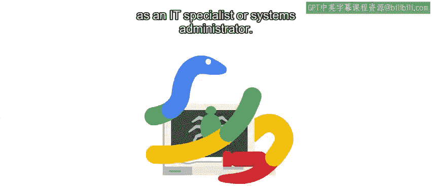
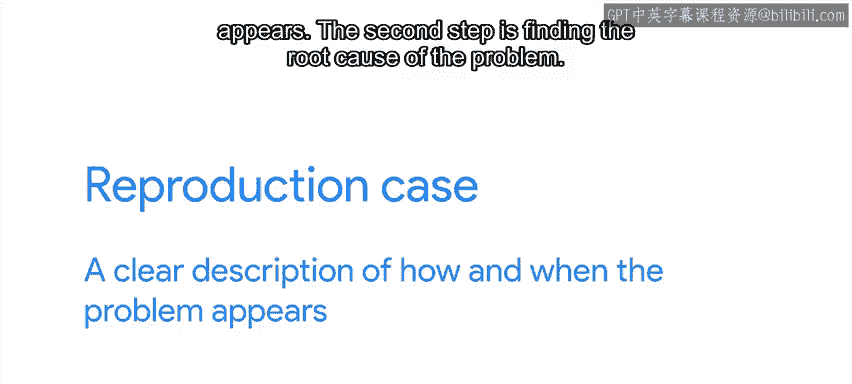
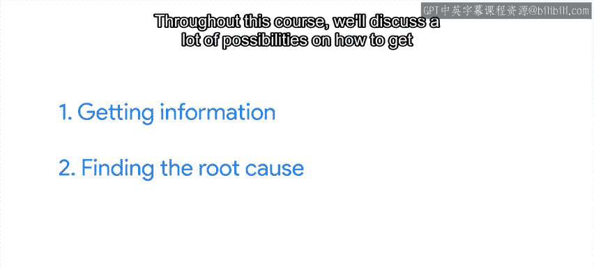
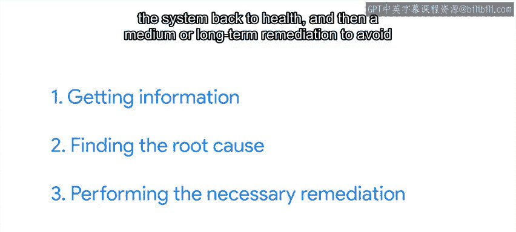

# 谷歌《用Python进行IT自动化办公3、4、5、6课（Git、debug、云端、实践）Google IT Automation with Python》中英字 - P61：3_解决问题的步骤.zh_en - GPT中英字幕课程资源 - BV1LW4y1F7XW

🎼Yeah。

There's a wide range of different technical problems that you might face as an I specialist or systems administrator。

 But fortunately， there's a set of steps that you can usually take to solve almost any technical problem。

 The first step is getting information。This means gathering as much information as we need about the current state of things。

 what the issue is， when it happens， and what the consequences are， for example。

 to get this information， we can use any existing documentation that might help。

This can be internal documentation， manual pages， or even questions asked on the internet one super important resource to solve a problem is the reproduction case。

 which is a clear description of how and when the problem appears。

The second step is finding the root cause of the problem。

This is usually the most difficult step， and throughout this course we'll discuss a lot of possibilities on how to get there。

 but the key here is to get to the bottom of what's going on。

 what triggered the problem and how we can change that The final step is performing the necessary remediation。

Depending on the problem， this might include an immediate remediation to get the system back to health and then a medium or long termm remediation to avoid the problem in the future。

 and while these are three basic steps of problem solving， they don't always happen sequentially。

 it's pretty common that while trying to find the root cause。

 we discover that we need even more info about the current state。

 so we gather more information until we find the answer we're looking for。

Or we could understand the problem just enough to create a workaround that lets our users get back to work quickly。

 but we'd still need more time to get to the root cause and prevent the problem from happening again。

Preventing the problem from occurring can sometimes feel like a hassle。

 but it can actually save us and our users a lot of valuable time。This way。

 we avoid having to solve the same problem over and over again throughout the whole process。

 it's important that we document what we do。We should note down the info that we get the different things we tested to try and figure out the root cause。

 And finally， the steps we took to fix the issue。 This documentation might prove invaluable next time a similar issue pops up。

Imagine a user asks you for your help because their computer is unexpectedly shutting down。

Computers shouldn't shut down on their own， but the problem could be a hardware issue。

 a software issue， or even a configuration issue so the first thing to do is to get more information。

You'll want to know things like when it happened， what the user was doing when it happened and how regularly it's happening。

 You'll also want to look at the computer logs to check if there are any interesting errors。

And if any aren't totally clear， you can look them up on the internet to see what they mean In our example。

 say you found a line in the logs that says the temperature threshold was exceeded。

 and so the computer shut down。That's useful information。 You know why the computer shut down。

But you don't know why it overheatated， so you'll need to keep investigating。

After not finding anything else interesting in the logs。

 you decide to check if it's a hardware issue。When you open up the computer。

 you find that the fan that's supposed to cool down the CPU is full of dirt。

 and so it isn't spinning properly， aha。That's the root cause of the problem。Now。

 the short term remediation is to clean up the fan so that it can spin again and the computer doesn't overheat。

But what's the long term remediation？In this case， it would be deploying monitoring on the computers to make sure you get notified early when they're overheating。

 Long term remediation would also include checking if you can reduce the amount of dust in the air so that there's less chance of this happening again。

 Up next， we'll put these steps to the test by applying them to solve a practical example。

