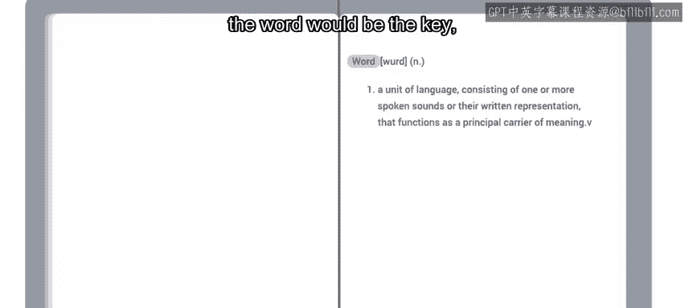
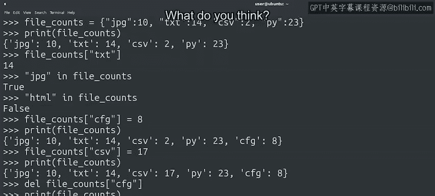

# 谷歌《用Python进行IT自动化办公1、2课（Python、控制操作系统）｜Google IT Automation with Python》中英字幕 - P61：60_什么是字典.zh_en - GPT中英字幕课程资源 - BV1gw411E7E1

How are you feeling so far。Lists and strings are pretty cool， right？

These tools let us do a ton of neat stuff in our code so they can be super fun to experiment with。

 We're now going to learn about another data type， dictionaries。😊，Like lists。

 dictionaries are used to organize elements into collections。Unlike lists。

 you don't access elements inside dictionaries using their position。Instead。

 the data inside dictionaries take the form of pairs of keys and values。To get a dictionary value。

 we use its corresponding key。 Another way these two vary is while in a list。

 the index must be a number in a dictionary， you can use a bunch of different data types as keys like strings。

 integers， floats， tus and more。 the name dictionaries comes from how they work in a similar way to human language dictionaries。

 in an English language dictionary。 The word comes with a definition。😊。

In the language of a Python dictionary， the word would be the key。

 and the definition would be the value。

Makes sense。 Let's check out an example。You can create an empty dictionary in a similar way to creating an empty list。

 except instead of square brackets， dictionaries use curly brackets to define their content。

 Once again， we can use the type function to check that the variable we've just created is a dictionary。

😊，X equals。Open brackets。Type X。Creating initialized dictionaries isn't too different from the syntax we used in earlier videos to create initialized lists or tus。

But instead of a series of slots with values in them， we have a series of keys that point at values。

 Okay， let's check out an example dictionary。We'll call it file counts。Equals。And then open bracket。

Jpeg。Ten。Text。14。Csv。2。And Py。23。Print。File counts。In this file counts dictionary。

 we've stored keys that are strings like Jpeg that point out integer values like 10。

 When creating the dictionary， we use colons in between the key and the value and separate each pair by commas。

In a dictionary， it's perfectly fine to mix and match the data types of keys and values like this and can be very useful。

 In this example， we're using a dictionary to store the number of files corresponding to each extension。

😊，It makes sense to encode the file extension formatting in a string while it's natural to represent a account as an integer number。

Let's say you want to find out how many text files there are in the dictionary To do this。

 you would use the key TXT to access its associated value。

The syntax to do this may look familiar since we use something similar in our examples of indexing strings。

 lists and tuples。File counts。Open bracket， T X T。You can also use the in keyword to check if a key is contained in a dictionary。

Let's try a couple of keys。Jpeg in file counts。True。HtML in。File counts。Fox。Dictionaries are mutable。

 You might remember what mutable means from an earlier video。 That's right。 It means we can add。

 remove， and replace entries。To add an entry in a dictionary。

 just use the square brackets to create the key and assign a new value to it。

Let's add a file count of8 for a new CFG file extension in our dictionary。File counts。Open bracket。

 add CFG， close bracket。Equals 8。And then， print。File counts。Oh。

 this brings up an interesting point about dictionaries。

 What do you think will happen if we try to add a key that already exists in the dictionary。

File counts， open bracket， C， SV。Close bracket。Equals 17。Print。File counts。

When you use a key that already exists to set a value。

 the value that was already paired with that key is replaced。As you can see in this example。

 the value associated with the CSV key used to be 2， but it's now 17。

The keys inside of a dictionary are unique。 If we try to store two different values for the same key。

 we'll just replace one with the other。Last off， we can delete elements from a dictionary with the Dell keyword by passing the dictionary and the key to the element as if we were trying to access it。

Dell。File counts。When bracket， CFG， close bracket。And print。File count。

What do you think dictionaries seem pretty useful， right？

We've now seen how to create a dictionary and how to add。

 modify and delete elements stored in the dictionary。 Up next。

 we'll discover some interesting things we can do with them。😊。

