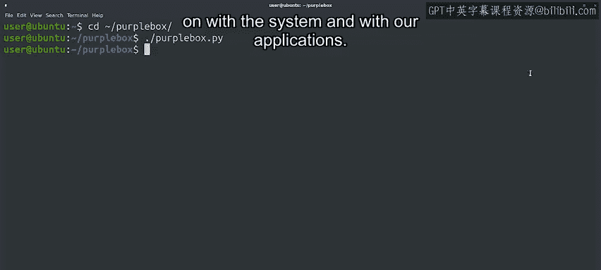
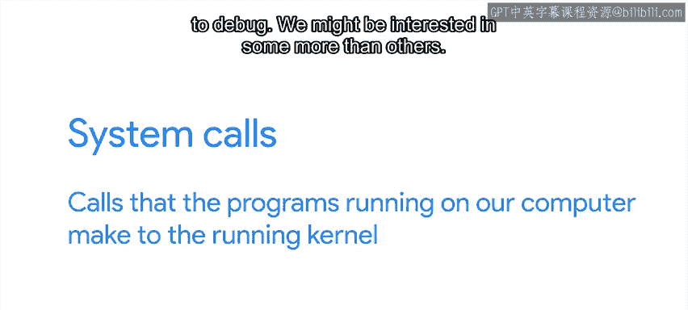
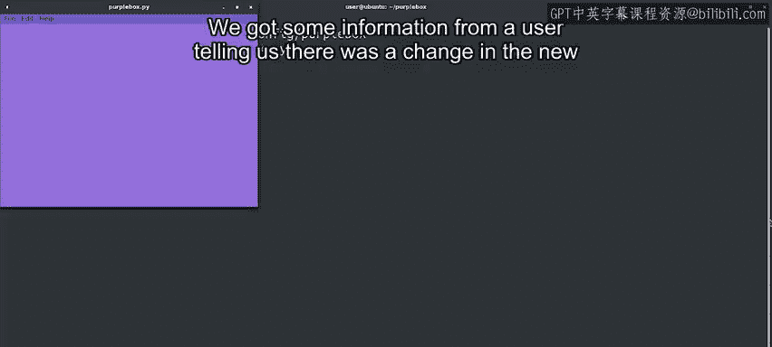

# 谷歌《用Python进行IT自动化办公3、4、5、6课（Git、debug、云端、实践）Google IT Automation with Python》中英字 - P62：4_无声崩溃应用程序.zh_en - GPT中英字幕课程资源 - BV1LW4y1F7XW

🎼Yeah。

Say a user contacts us to let us know that a certain application fails to open。

As we called out earlier， the first thing to do is to get more information about the conditions that cause the failure。

What the error is that the user is getting， and then check if we experience the same failure by asking for these details。

 we discover that a new version of the software was recently released。

 and when we upgrade to this new version， we can reproduce the problem on our own computer like this。

We see that when we try to run the program， it prints no error at all， it just exits immediately。

We need to figure out what's going on， even if there's no error message。

There are a bunch of tools that can help us better understand what's going on with the system and with our applications with the help of these tools。

 we can extend our knowledge of a particular problem。

 view the actions of the program from a different point of view and get the info we need Among these tools。

 Strace lets us look more deeply at what the program is doing It will trace the system calls made by the program and tell us what the result of each of these calls was。

 so to figure out what's up with our program that's failing to open。

 we'll Strace the failing application。Whoa， that's a lot of output the Ests command shows us all the system calls are program made。

System calls are the calls that the programs running on our computer make to the running kernel。

There are loads of different system calls， and depending on what we're trying to debug。

 we might be interested in some more than others。 if you want to understand what these system calls are。

 you can read more about each of them in the corresponding manual pages。

 but before we jump into that， let's make this output more manageable。

 we could pipe the output to the less command， which we could use to scroll through a lot of text。

 or we could use the dash O flag of the Strace command to store the output into a file and then browse the contents of that file。

The dash O flag lets us refer back to the file later if we need to， so let's go with that one。Okay。

 now we can read the generated file using whichever program we prefer。

 let's open it with less we'll go to the end of the file pressing Shi G。

 then scroll up to see if we find anything suspicious。All right， close to the end of the log。

 we can see that the application tries to open a directory called dotconfig Purple box。

 which doesn't exist。Let's look at this line in a bit more detail。

 The name of the system call is open at one of the calls used to open files or directories。

The content of the call shows the parameters past， including the path that's being opened and a bunch of flags。

 In particular， the o directory flag tells us that the program is trying to open this path as a directory。

 The number after the equal sign shows us the return code of the cis call。 In this case。

 its negative one。So the program is trying to open this directory， and it turns out it doesn't exist。

Since this is happening shortly before the program finishes。

 it's a likely candidate for the root cause of the issue。

Let's create the directory and try to start the program again。系。Confect。Ptable box。Success This time。

 the program works just fine。

Let's recap what we did。First， we got some information from a user telling us there was a change in the new version。

 which was causing a problem。To investigate this， we reproduce the problem on our own computer。

Then we got more information on what was going on by using the Strace tool。

 which lets us see the system calls made by a program。

 We found a suspicious error that said a directory didn't exist。

We created the directory to check out what would happen when it did exist and the program worked correctly。

 So we've identified the root cause of the problem， which is the missing directory。

Now we can go ahead and remediate the issue。 The immediate remediation is to tell the user to create the directory so that they can get back to work quickly。

The long termm remediation is to contact the developers of the software to let them know that the program will fail to start if the directory is missing this gives them a heads up about the problem so they can fix it in the next version。

And what about the documentation， we should note that this version of the software won't start if that directory doesn't exist。

That will help others facing the same issue to quickly find out the solution。In this example。

 we were able to use Stras and quickly identify what the problem was。

 but it won't always be this easy。 Through this course。

 we'll keep looking at more tools and more ideas to help us work through what's going on when it's not immediately obvious。

 Coming up。 We've got the first practice quiz of the course。

 These quizzes will help make sure that all the concepts that we've covered thus far makes sense。

 Remember， you can always review the content if it wasn't clear。 I'll meet you in the next video。😊。

