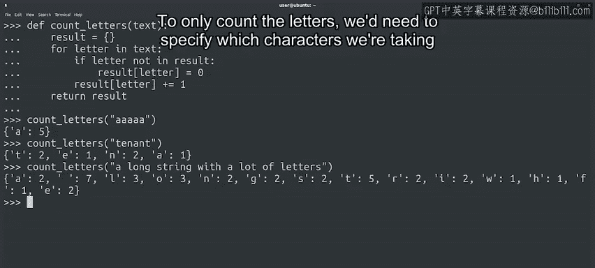

# 谷歌《用Python进行IT自动化办公1、2课（Python、控制操作系统）｜Google IT Automation with Python》中英字幕 - P62：61_遍历字典内容.zh_en - GPT中英字幕课程资源 - BV1gw411E7E1

It probably won't come as a surprise that just like with strings， lists and tuples。

 you can use four loops to iterate through the contents of a dictionary。

 Let's see how this looks in action。So file counts。Equals。Open bracket。JPg 10。Comma。Tx T。14， comma。

Csv。Qu。😔，Comma Py。23， and then close bracket。And then for extension in file counts。Two spaces。

 print extension。So if you use a dictionary in a for loop。

 the iteration variable will go through the keys in the dictionary。

 If you want to access the associated values， you can either use the keys as indexes of the dictionary。

 or you can use the items method， which returns a tuple for each element in the dictionary。

 The tuple's first element is the key。 Its second element is the value。

 Let's try that with our example dictionary。4 extension amount。In file， counts， dot items。Print。

There are and then brackets。Files with the dot brackets。Extension。Dot format。Amount。Extension。

Sometimes you might just be interested in the keys of a dictionary。 Other times。

 you might just want the values。 You can access both with their corresponding dictionary methods like this。

File counts， dot keys。File counts， dot values。These methods return special data types related to the dictionary。

 but you don't need to worry about what they are exactly。 You just need to iterate them。

 as you would， with any sequence。For value in file counts values。Print value。

So we can use items to get key value pairs。Keys to get the keys and values to get just the values。

 Not too hard， right。Because we know that each key can be present only once。

 Dictionaries are a great tool for counting elements and analyzing frequency。

 Let's check out a simple example of counting how many times each letter appears in a piece of text。

😊，In this code， we're first initializing an empty dictionary。

 then going through each letter in the given string for each letter。

 we check if it's not already in the dictionary。 And in that case。

 we initialize an entry in the dictionary with a value of 0。😊，Finally。

 we increment the count for that letter in the dictionary。To sum up。

 we've created a dictionary where the keys are each of the letters present in the string。

 and the values are how many times each letter is present。 Let's try out a few example strings。

Count letters。Let's say。A。Count letters。Tenant。Count letters。

 and this time we'll say a long string with a lot of letters。

Here you can see how the dictionary can have any number of entries。

 and the pairs of key values always count how many of each letter there are in the string。Also。

 do you see how our simple code doesn't distinguish between actual letters and special characters like a space to only count the letters we'd need to specify which characters we're taking into account？

This technique might seem simple at first， but it can be really useful in a lot of cases。 Let's say。

 for example， that you're analyzing logs in your server and you want to count how many times each type of error appears in the log file。

You could easily do this as a dictionary by using the type of error as the key and then incrementing the associated value each time you come across that error type。

 Are you starting to see how dictionaries can be a really useful tool in writing scripts。Coming up。

 we're going to learn how to tell when to use dictionaries and when to use lists。

