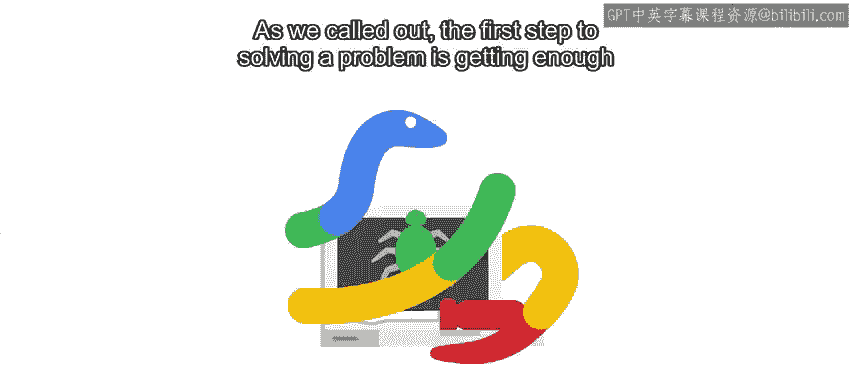
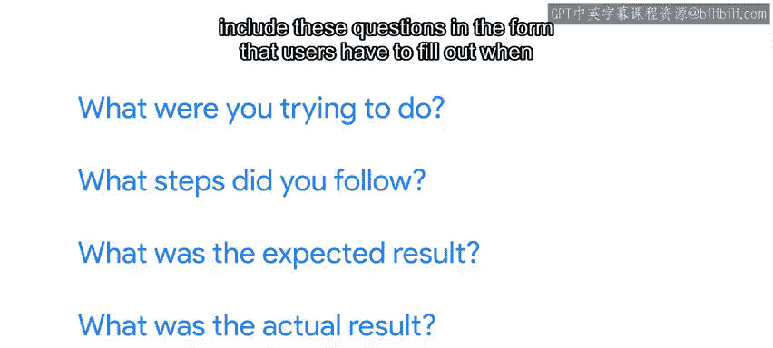
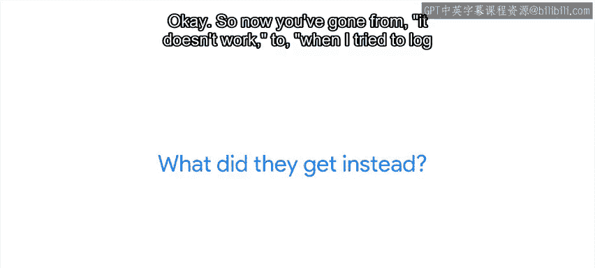
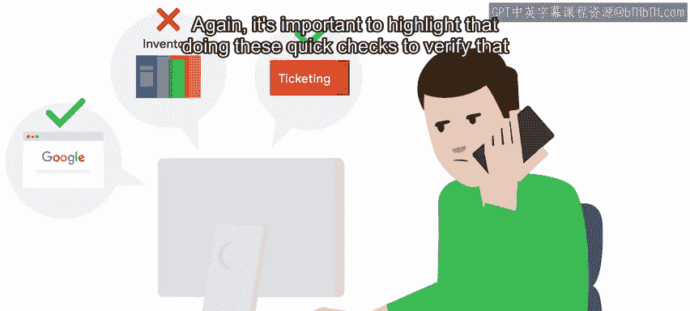
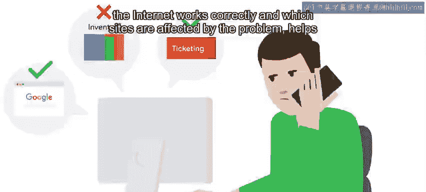
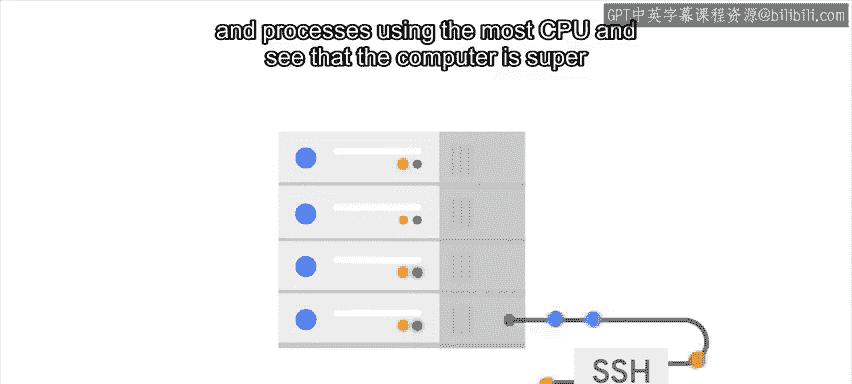
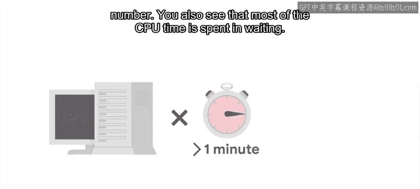
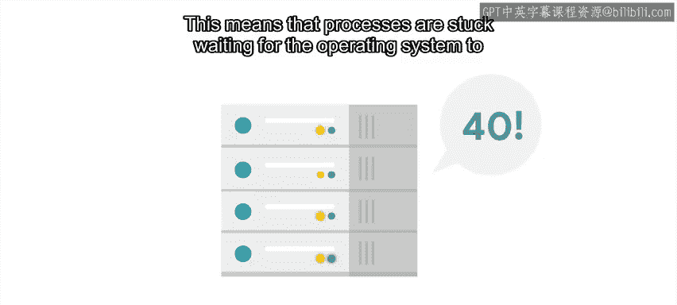
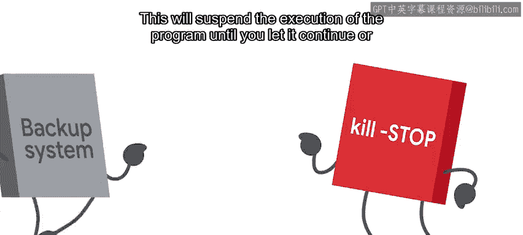
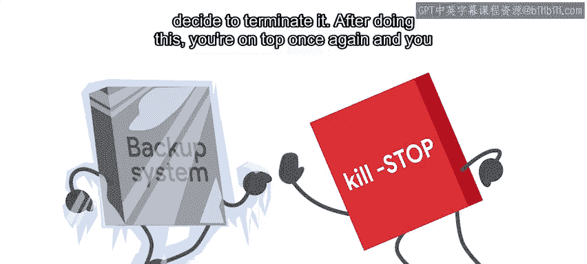

# 谷歌《用Python进行IT自动化办公3、4、5、6课（Git、debug、云端、实践）Google IT Automation with Python》中英字 - P63：5_^它不工作^.zh_en - GPT中英字幕课程资源 - BV1LW4y1F7XW

🎼Yeah。

As we called out， the first step to solving a problem is getting enough information so that we can understand the current state of things。

To do this， we'll need to know what the actual issue we're solving is。

 This starts when we first come across the issue， which can be through a report by a ticketing system or by encountering the problem ourselves when working with users。

 it's pretty common to receive reports of failures that just boil down to it doesn't work。

These reports usually don't include a lot of useful information。

 but it's still important that the problem gets reported and solved。

 which information is useful or not might depend on the problem。

But there are some common questions that we can ask a user that simply reports something doesn't work。

 What were you trying to do。What steps did you follow， What was the expected result。

 What was the actual result？

If the ticketing system your company uses allows this。

 it's a good idea to include these questions in the form that users have to fill out when reporting an issue。

 This way， we save time and can start asking more specific questions right away。 Otherwise。

 these are almost always going to be the first questions you ask。

 Another thing to keep in mind is that when debugging a problem。

 we want to consider the simplest explanations first。

 and avoid jumping into complex or time consuming solutions unless we really have to。

 That's why when a device doesn't turn on， we first check if it's correctly plugged in and that there's electricity coming from the plug before taking it apart or replacing it with a new device。

 say you at to call from a user that tells you the internal website used by the sales team to track customer interactions doesn't work。

The user is super stressed because they need to access the information on the website for a meeting happening in a few minutes。

 So you tell them that you'll look into the problem right away， but that you need more information。

 What were they trying to do。The user tells you that they're trying to access the website。

 what steps did they follow？They tell you that they opened the website URL and entered their credentials。

 What was the expected result。They expected to see the sale systems's landing page。

 What did they get instead。

The webpage just keeps loading。 It stays blank forever。

Okay， so now you've gone from， it doesn't work to when I try to log in。

 the page keeps loading and never shows the landing page。 That's great。

Now that you have a basic idea of what the problem is。

 it's time to start figuring out the root cause。For that。

 you'll apply a process of elimination starting with the simplest explanations first。

 and testing those until you can isolate the root cause。 For example。

 you check if you can reproduce the issue on your own computer。

So you navigate to the website enter your credentials， and sure enough， the page just keeps loading。

 never showing the landing page This is enough information that you can tell the user that you'll work on it and investigate on your own There's no need to keep them on the line by reproducing the problem on your computer you've taken a simple and quick action that rules out the user or the user's computer as the cause of the problem。

This cuts the troubleshooting process in half， since you now know there's a problem with the service。

 and you can focus on solving that before jumping into the server that's hosting the application。

 you run a few quick checks to verify if the problem is isolated to that specific website or not。

 You check if your Internet access is working successfully by accessing an external website which loads just fine。

And then you check if other internal websites like the inventory website or ticketing system are working okay。

Doing this， you discover that while the ticketing system loads with no issues。

 the inventory website never finishes loading。

It turns out both websites are hosted on the same server。

Again， it's important to highlight that doing these quick checks to verify that the internet works correctly and which sites are affected by the problem helps you isolate the root cause by looking at possible simple explanations first。

 you avoid losing time chasing the wrong problem。 At this point。

 you know that websites running on a specific server are failing to load while the rest of the systems and the Internet are working correctly。

Next up， you need to check what's going on on that server。

 The server running the websites is a Linux machine， so you'll connect to it using SSH。

 You run the top command， which shows the state of the computer and processor using the most CPU。

 and see that the computer is super overloaded。 The load average in the first lines says 40。

 The load average on Linux shows how much time a processor is busy in a given minute。

 with one meaning it was busy for the whole minute。

So normally， this number shouldn't be above the amount of processors in the computer。

A number higher than the amount of processors means the computer is overloaded。

You know this computer has four cores， so 40 is a really high number。

You also see that most of the CPU time is spent in waiting。This means that processes are stuck。

 waiting for the operating system to return from system calls。

This usually happens when processes get stuck gathering data from the hard drive or the network by looking at the list of processes。

 you realize that the backup system is currently running on the server。

 and it seems to be using a lot of processing time。

 Backing up the data on the system is super important， but currently the whole system is unusable。

 so you decide to stop the backup system by calling kill dash stop。

This will suspend the execution of the program until you let it continue or decide to terminate it。

After doing this， you run top once again and you see that the load is going down。

 and so processes are no longer stuck waiting for IO。Then you try logging into the website。

 and this time the landing page loads success。You let your user know that they can use the website once again。

At this point， you've applied the immediate remediation。

 We'll talk about long term remediation in a later video。

Before moving on to the next topic， imagine that the following week。

 another user calls you and tells you the sales website doesn't work。

Remembering the previous incident， you tell them you'll fix it right away。

 you SSH onto the server and try to find the backup process to stop it。But it's not running。Oops。

 you forgot to ask the user what they meant when they said it didn't work。

When you call back to ask them， they tell you that they're trying to generate a monthly sales report and they get an error saying the product category column doesn't exist。

Totally different problem， totally different actions to take。

 So remember to always have a clear picture of what the problem is before you start solving it。

Up next， we'll talk about what a reproduction case is and how to come up with it。

