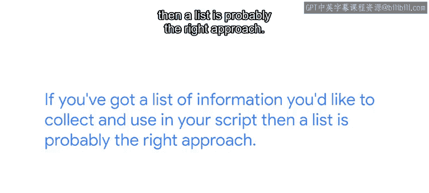
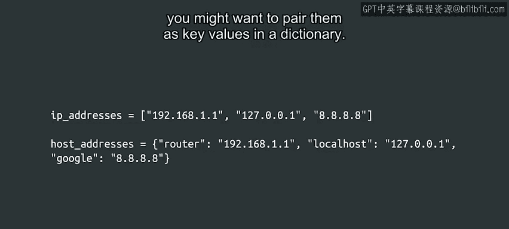
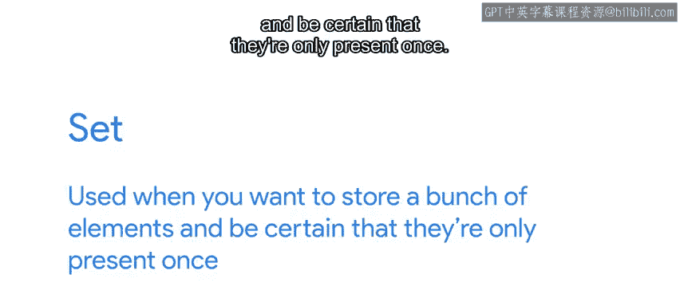

# 谷歌《用Python进行IT自动化办公1、2课（Python、控制操作系统）｜Google IT Automation with Python》中英字幕 - P63：62_字典与列表.zh_en - GPT中英字幕课程资源 - BV1gw411E7E1

Dictionaries and lists are both really useful， and each have strengths in different situations。

 So when is it best to use a list and when's a dictionary the way to go。

 Think about the kind of information you can represent in each data structure。

 if you've got a list of information you'd like to collect and use in your script。

 then a list is probably the right approach。 For example。

 if you want to store a series of I P addresses to ping。

 You could put them all into a list and iterate over them。

 Or if you had a list of host names and their corresponding I P addresses。

 you might want to pair them as key values in a dictionary。

Because of the way dictionaries work， it's super easy and fast to search for an element in them。

 Let's say you have a dictionary that has usernames as keys and the groups they belong to as values。

 It doesn't matter if you have 10 users or 10000 users accessing the entry for a given user will take the same time。

 Amazing。 But this isn't true for lists。 If you've got a list of 10 elements and you need to check if one element is in the list。

 it'll be a very fast check。 But if your list has 10000 elements。

 It'll take significantly longer to check if the element you're looking for is there。😊，So。

 in general， you want to use dictionaries when you plan on searching for a specific element。

Another interesting difference is the types of values that we can store in lists and dictionaries。

In lists， you can store any data type in dictionaries， we can store any data type for the values。

 but the keys are restricted to specific types。 The reasoning behind which types are allowed。

 can get complex。 and we don't want to bog you down with unnecessary details。 So as a rule of thumb。

 You can use any immutable data type numbersumb， Booleions。

 strings and tuples as dictionary keys on the flip side。 Like we said。

 the values associated with keys can be any type， including lists or even other dictionaries。

 You can use them to represent more complex data structures， like directory trees in a file system。

 Theres a ton of different key value pairs that we need to work with in system administration。

 So I use dictionaries all the time。 There are especially useful with large data sets when I need to write a script that get specific keys out of it to manipulate or modify the associated value。

But it doesn't always need to be that serious。 One time， just for fun。

 I wanted to be able to look up which Disney villain is associated with each protagonist。

 So I created a dictionary that stores a key like Snow White with the value evilvi queen。

 Pretty good， right？ Mirr， mirror on my screen。 Who's the best coder you've ever seen。😊。

There are even more data types available that we haven't checked out yet。

 One of these data types is a set， which is a bit like a cross between a list and a dictionary。

 A set is used when you want to store a bunch of elements and be certain that they're only present once。

Elements of a set must also be immutable。 You can think of this as the keys of a dictionary with no associated values。

 or you could see it as a list where what matters isn't the order of the elements。

 but whether an element is in the list or not。 Wow， we've covered a lot。

 and we've still only scratched the surface of what dictionaries can do in your scripts。

As you progress in your I T career， you'll come across a lot of situations where a dictionary is the easiest way to organize your data。

 If you're interested， you can learn more about dictionaries than the official documentation。

 You'll find links to this in the next reading。😊。