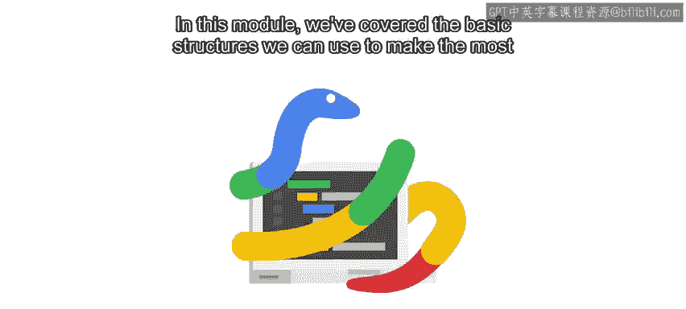

# 谷歌《用Python进行IT自动化办公1、2课（Python、控制操作系统）｜Google IT Automation with Python》中英字幕 - P64：63_基本结构总结.zh_en - GPT中英字幕课程资源 - BV1gw411E7E1

。

In this module， we've covered the basic structures we can use to make the most of our Python scripts。

 strings， lists and dictionaries。And we've also called out a couple of associated data types like two poles and sets。

Knowing your way around these structures lets you solve interesting problems with your programs。

 as we keep saying， the key to mastering them and knowing when to use one or the other is practice。

 The more you write scripts that use these concepts。

 the easier it'll become to pick the right one when you need it。 So how are you feeling。

 We just learned a lot of new concepts and it's totally normal to feel a little overwhelmed。

 If you're feeling confident， that's awesome。 And if you're starting to think this is too hard for me。

 I'll never get it。😊，That's also completely normal。

 We all felt like that at some point when learning how to code。 First off， you will get this。 Second。

 if you're feeling a little iffy on any of the content we've covered so far。

 now is the time to rewatch the videos。 Belve me， you'll be amazed by how much you've learned so far。

 And a second review is usually all you need to understand what might seem a little tricky right now。

 Jo in I T require problem solving and perseverance。 You wouldn't be here right now。

 if you didn't have the grit to learn how to script。 So stick with it。

 I promise you that it'll only get easier and easier。 to wrap up。

 We've got a graded assessment to help you put all your new knowledge to the test。

 take it once you feel ready to take your time and remember， you've got this。😊。

