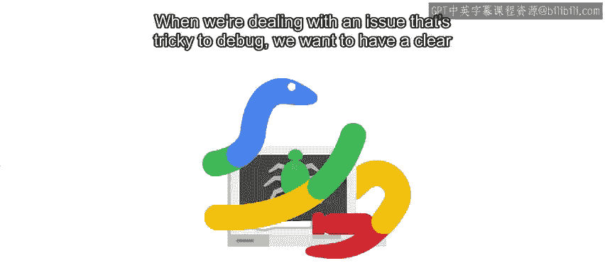
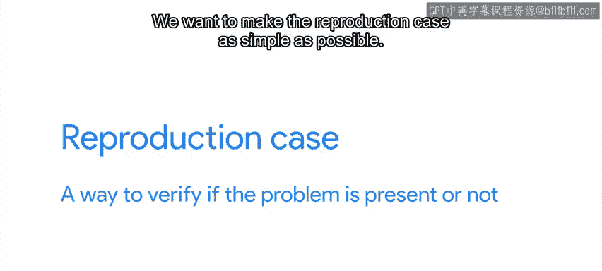
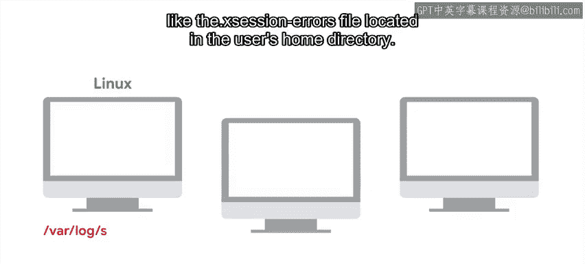
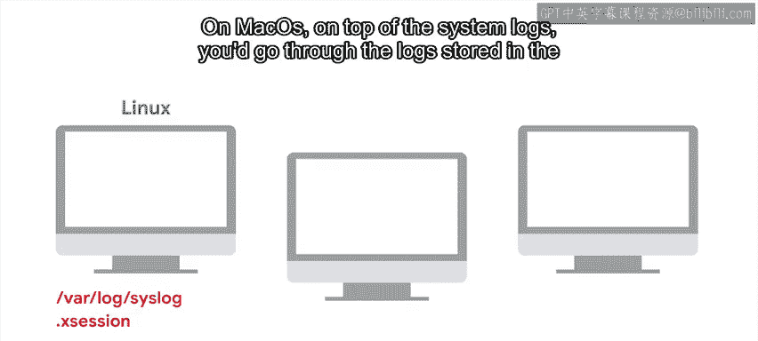
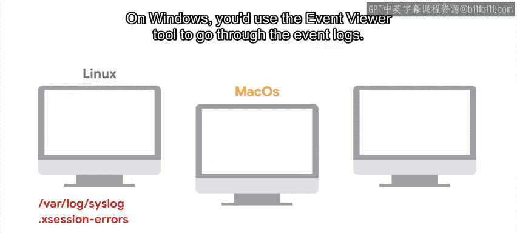
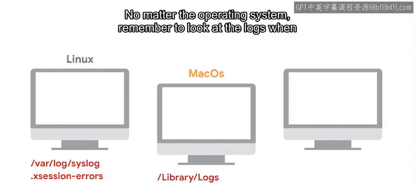

# 谷歌《用Python进行IT自动化办公3、4、5、6课（Git、debug、云端、实践）Google IT Automation with Python》中英字 - P64：6_创建复现案例.zh_en - GPT中英字幕课程资源 - BV1LW4y1F7XW

🎼Yeah。

When we're dealing with an issue that's tricky to debug。

 we'll want to have a clear reproduction case for the problem。

 A reproduction case is a way to verify if the problem is present or not。

We'll want to make the reproduction case as simple as possible that way。

 we can clearly understand when it happens， and it makes it really easy to check if the problem is fixed or not when we try to solve it Sometimes the reproduction case is pretty obvious in our example where the program failed to start because of a missing directory。

 the reproduction case was to open the program without that directory on the computer on our overloaded server example。

 the reproduction case for the failure was to try to log into the website and see the loading page。😊。

But sometimes the reproduction case might be much more complex to discover。

 Imagine you're trying to help a user with an application that won't start。

This time， when you run the same version of the application on your computer。

 the application starts just fine， so you suspect that the problem has to do with something in the user's environment or configuration。

 there could be a bunch of reasons why this could happen。

 it could be problems with the network routing， old configug files interfering with a new version of the program。

 a permissions problem blocking the user from accessing some required resource。

 or even some faulty piece of hardware acting up。So how can you figure out what's causing the problem。

 The first step is to read the logs available to you。

 which logs to read will depend on the operating system and the kind of application that you're trying to debug。

On Linux， you'd read system logs like V log， Ciyslog and user specific logs like the dot accessession errors file located in the user's home directory on Mac OS。

 on top of the system logs， you'd go through the logs stored in the library logs directory on Windows。

 you'd use the event viewer tool to go through the event logs。

No matter the operating system， remember to look at the logs when something isn't behaving as it should。

Lots of times， you'll find an error message that will help you understand what's going on。

 like unable to reach server in valid file format or permission denied。

But what if you're unlucky and there's no error message or if the error message is super unhelpful。

 like internal system error。 The next step is to try to isolate the conditions that trigger the issue。

 Do other users in the same office also experience the problem。

Does the same thing happen if the same user logs into a different computer？

Does the problem happen if the application's config directory is moved away。

 Let's say that it's the config directoryies fault。

 You ask the user to move it away without deleting it。And now the application starts correctly。

 so you ask the user to send you the contents of that directory。

 you copy them onto your computer and the program fails to start。

Binggo， you got your reproduction case。 It's starting the program with that config in place。

 Having a clear reproduction case lets you investigate the issue and quickly see what changes it。

 For example， does the problem go away if you revert the application to the previous version。

 Are there any differences in the S trace log or the L trace logs when running the application with the bad config and without it。

 on top of that， having a clear reproduction case， lets you share it with others when asking for help。

 As long as you aren't sharing any confidential information， Of course。

 you could use it to report a bug to the application developers to ask for help from a colleague or even to ask for help from an internet forum about the application。

 if it's publicly available。 So when trying to create a reproduction case。

 we want to find the actions that reproduce the issue。 and we want these to be as simple as possible。

 the smaller the change in the environment and the shorter the list of steps to follow。😊，The better。

To get there， we might need to dig deeper into the problem until we have a small enough set of instructions。

Once you have a reproduction case， you're ready to move on to the next step。Finding the root cause。

 We'll talk about that in our next video。