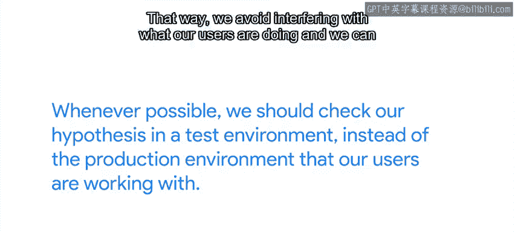
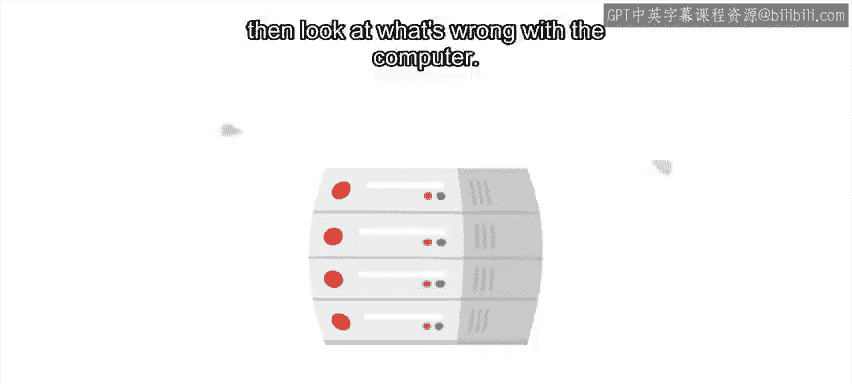
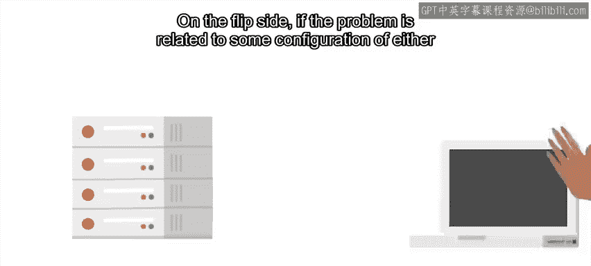
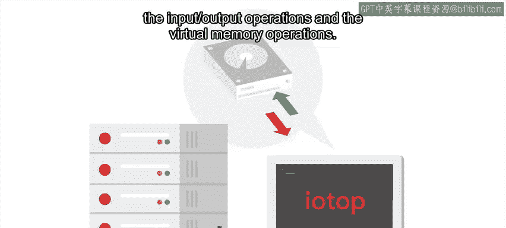
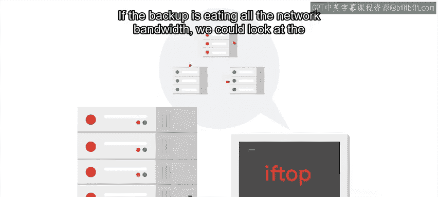
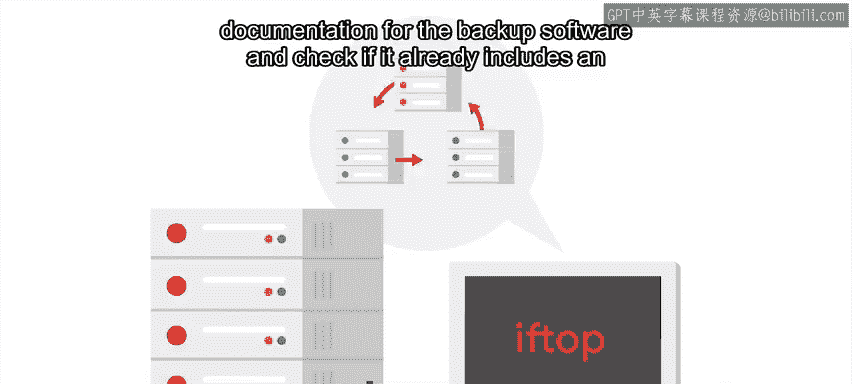
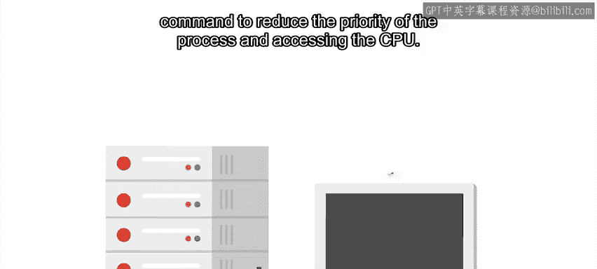
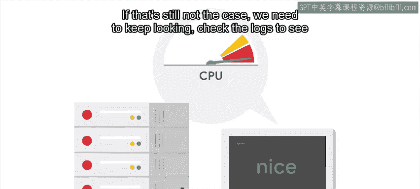

# 谷歌《用Python进行IT自动化办公3、4、5、6课（Git、debug、云端、实践）Google IT Automation with Python》中英字 - P65：7_找到根本原因.zh_en - GPT中英字幕课程资源 - BV1LW4y1F7XW

🎼Yeah。

When you first come across these concepts， it might seem that once you have a reproduction case。

 you already know the root cause of the problem， but more often than not。

 it's not true In our overloaded server example， we figured out that the backup system was blocking the websites from working。

 and so we mitigated that immediate problem to unblock the user。

 but we didn't really look into the root cause of our server being stuck。

 This could be because the network bandwidth is saturated。The disk transfer is too slow。

 The hard drive is faulty， or a bunch of other reasons。

 We also didn't do anything to make sure our backups could run successfully in the future。

 Understanding the root cause is essential for performing the long term remediation。

So how do we go about finding the actual root cause of the problem。

 We generally follow a cycle of looking at the information we have coming up with a hypothesis that could explain the problem。

And then， testing our hypothesis。If we confirm our theory， we've found the root cause。 If we don't。

 then we go back to the beginning and try a different possibility。

 This is where our problem solving creativity comes into play。

 We need to come up with an idea of a possible cause。 check if it's correct。 and if not。

 come up with a different idea until we find one that explains the problem。

Our ideas don't come out of a void to get inspired。

 We looked at information we currently have and gather more if we need。

 searching online for the error messages that we get or looking at the documentation of the applications involved can also help us imagine new possibilities of what might be at fault。

 wheneverever possible， we should check our hypothesis in a test environment。

 instead of the production environment that our users are working with。😊。

That way， we avoid interfering with what our users are doing。

 and we can tinker around without fear of breaking something important。

Depending on what you're trying to fix， this might mean we have to try our code in a newly installed machine。

 spinning up a test server， using test data and so on。 it can take some time to get this set up。

 but the extra safety is definitely worth it。Even when it seems that the error might be related to the specific production environment。

 it's always a good idea to check if we can reproduce the problem in a test environment before we modify production。

In our overloaded server example， if the problem is with the hardware。

 we wouldn't be able to replicate it with a test server in that case。

 we would need to either wait until the services aren't being used or bring up a secondary server。

 migrate the services there， and only then look at what's wrong with the computer。

On the flip side， if the problem is related to some configuration of either the web services or the backup service。

 we'd still see it in the test server。 So we'd always start by setting up the test instance of the service and checking if the problem replicates there before touching the production instance。

 So say we have a test server running the same websites。When we start the backup。

 we see that the website stop responding。 This is great because we have a reproduction case and we can debug it properly。

How do we find the root cause One possible culprit could be too much disk input and output to get more info on this。

 we could use IOtop， which is a tool similar to top that lets us see which processes are using the most input and output。

Other related tools are Iostat and VMtat。 These tools show statistics on the input output operations and the virtual memory operations。

 If the issue is that the process generates too much input or output we could use a command like IO nice to make our backup system reduce its priority to access the disk and let the web services use it too What if the input and output is not the issue。

 another option would be that the service is using too much network。

 because it's transmitting the data to be backed up to a central server and that transmission blocks everything else。

😊，We can check this using IFTOP， yet another tool similar to top that shows the current traffic on the network interfaces。

If the backup is eating all the network bandwidth， we could look at the documentation for the backup software and check if it already includes an option to limit the bandwidth。

The R syncnc command， which is often used for backing up data。

 includes a dash B W limit just for this purpose。 And if that option isn't available。

 we can use a program like trickle to limit the bandwidth being used。

 But what if the network isn't the issue either， Remember。

 we need to put our debugging creativity to work and come up with other possible reasons for why it's failing。

Another option could be that the compression algorithm selected is too aggressive。

 and compressing the backups is using all of the server's processing power。

 we could solve this by reducing the compression level or using the nice command to reduce the priority of the process in accessing the CPU。

And if that's still not the case， we need to keep looking。

 Check the logs to see if we find anything that we missed before。

 Maybe look online for other people dealing with similar problems related to interactions of the backing up software with the web serving software and keep doing this until we come up with something that could be causing our problem。

 I know this sounds like a lot of work。 but it's usually not that bad。 In general。

 by using the tools available to us。 we can find enough info to land on the right hypothesis after only a few tries。

 And with experience， we'll get better at picking up the most likely hypothesis the first time around。

 Up next， we'll talk about a tricky type of technical problem that we all have to face。

 intermittent issues。😊。