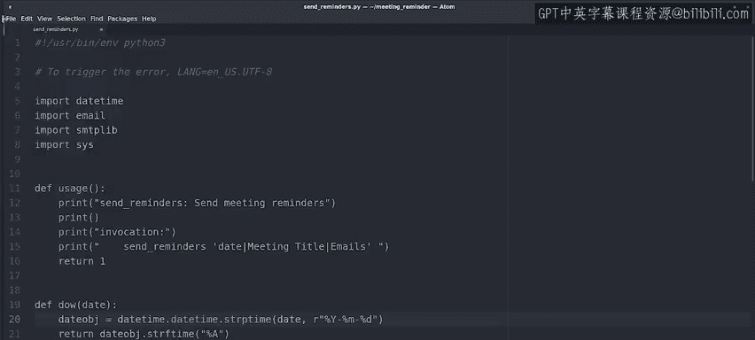

# 谷歌《用Python进行IT自动化办公3、4、5、6课（Git、debug、云端、实践）Google IT Automation with Python》中英字 - P67：9_间歇性失败的脚本.zh_en - GPT中英字幕课程资源 - BV1LW4y1F7XW

A colleague recently developed a small application to send meeting reminders to people in the company because someone kept forgetting to show up。

 The sales team was the first to test the app last week and it worked fine。

 but this week another user is trying to send a meeting reminder and the program keeps terminating with an error。

😊，Since the colleague that developed the app is on the other side of the Atlantic。

 the user is asking for a help to figure out what's going on。 First。

 let's try running the program ourselves and check if we can reproduce the problem。

We're presented with a window where we can enter the date for the meeting， the title of the meeting。

 and the people that we want to send the reminder to。

The meeting reminder that the user was trying to send was for January 13。

 and the title was production Review。 As we are trying things out and don't want to be mailing reminders out with our tests。

 I'll set this one to send the reminders to me。Oh oh， it failed to send the email。

 this means we've reproduced the issue。Let's try the reminder that the sales team sent last week。

 which had worked fine。In that case， the reminder had been sent for January 7th。

 and the title wasSaes All Hand Again， I'll send this to myself to avoid spanning people with test reminders。

Yes， in this case， the program successfully sent the reminder。

Which parameter do you think is at fault， the title or the date？It could be either。

But I'll bet it's the date。 Let's try once more with January 13th as the date and sales all hands as the title。

Another failure。 So we have a reproduction case。 When we try to send the meeting reminder for January 13。

 we get the failure message。 But if we try to send the same reminder for January 7， it works fine。

 Now， the next step is to find the root cause of the issue。

Why could our application work fine for January 7th， but fail for January 13th？

There could be a bunch of reasons， but in general， when dates are involved in a failure。

 the problem is due to how the dates are formatted in some countries。

 the dates are written with the month first and the day second while in other countries it's the other way around to figure out what's going on。

 let's add more debugging information to the program we'll open the meeting reminder to SH script。

 which is a script written in bash。We see that this script is calling a program calledZenityZenity is the application showing the window to select the date。

 title and emails， the output generated by Zenity is stored in a variable calledMeeting info。

 which is then passed as a parameter to the sendend reminderders。 pi Python3 script。

This script then sends the emails。To get more information about the output generated by zenity。

 we'd like to see the value of the meeting info variable before the Python script gets called let's add an echo statement to see that。

All right， let's save this and try again。 This time。

 we'll just use test as the meeting title as we know the problem is with the date。

We see that the information generated by zenity is split by pipes and that the date is formatted as month。

 day year。All right， that's already valuable information。Now。

 the next step is getting a more informative error。To do that。

 let's open the Python script that sends the reminders and see if we can make it print a better error。

The file is long， so it makes sense to start by looking at the main function that lists the core functionality of the program。

 We see that it splits the parameter received in three。

 then prepares the message to be sent and finally sends it。 If everything works fine。

 it prints a message saying that it was sent successfully。But if anything fails。

 it prints the error message that we've seen already。

But the error message is not very useful as it's hiding the reasons why things failed。

Let's make this error more helpful by also printing the exception that generated the failure。Okay。

 let's save and try again。Okay， this time we see that the problem is that the date format we are using is putting the month first。

 but the program is expecting to have the month second， and as there's no month 13。

 this is an invalid date。So we found the root cause of the problem。

 the program is trying to convert the date assuming one specific date format。

 but we're using a different format。And as we now know， once we know the root cause。

 the next step is to remediate the issue。 What can we do in this case to remediate the problem we could change the program to use our date format。

 but then the application would break for people running it in a different location what we need to do is make sure that no matter where we run the script。

 the date generated by zity matches the date expected by Python。Fortunately。

 Zenity includes a parameter to specify any format we want。

So we'll change the Shell script to use the dash dash forms date， format parameter。

 and set the format to percent Y percent M percent D。

 which is the international standard date format。All right， with that。

 senity will return the date in the international format。

Now we need to change the Python script to use the same format。

 we'll go to the function that has the format specified and change it to the same format。Great。

 now the date format generated by zenity should always match the one read by Python。

 and this script should work in our country and any others。

 Let's try it out and check if it's really fixed。

Yay， we've successfully fixed the issue。Let's quickly recap what we did。

We first reproduced the problem ourselves， then found which input triggered the issue and which one didn't。

We then added more debugging information to the scripts。

 which helped us find the root cause of the problem。

 a mismatch between the date formats used by the Zenity Invocation and the Python script。And finally。

 we fixed the issue by making sure that both were using the same date format up next。

 we've got another quiz to check that the concepts we covered in the last videos are all making sense。

😊。