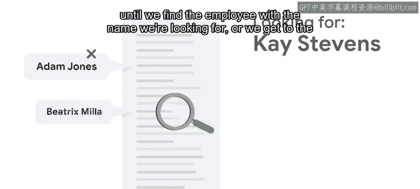
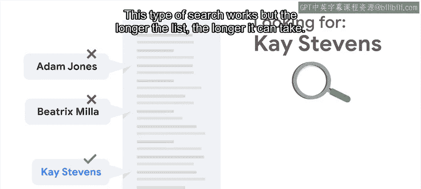
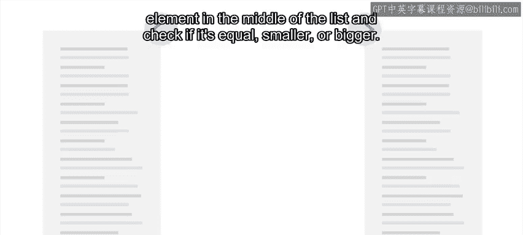
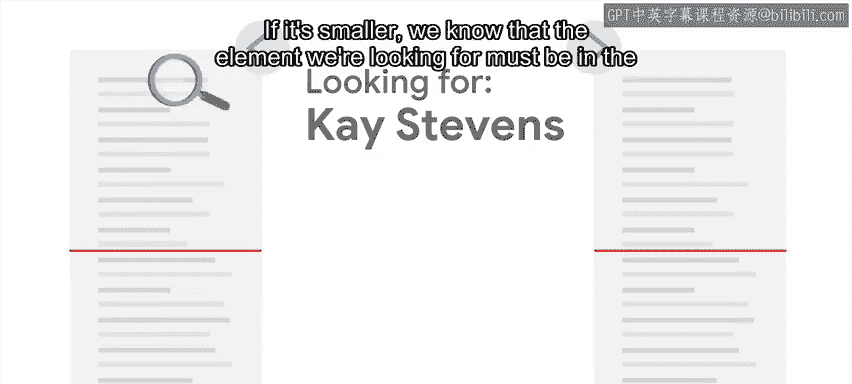
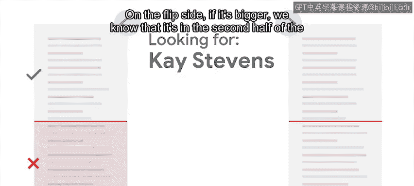
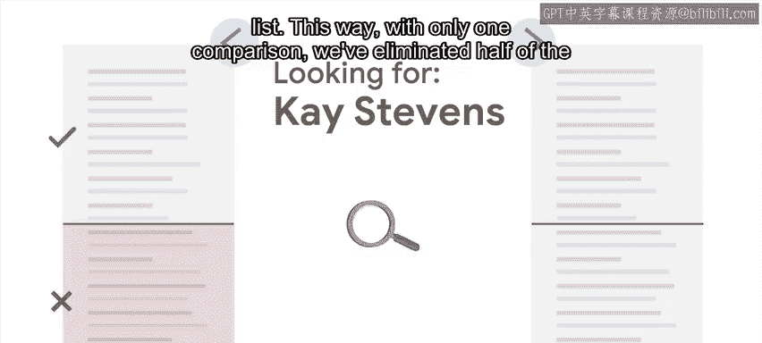
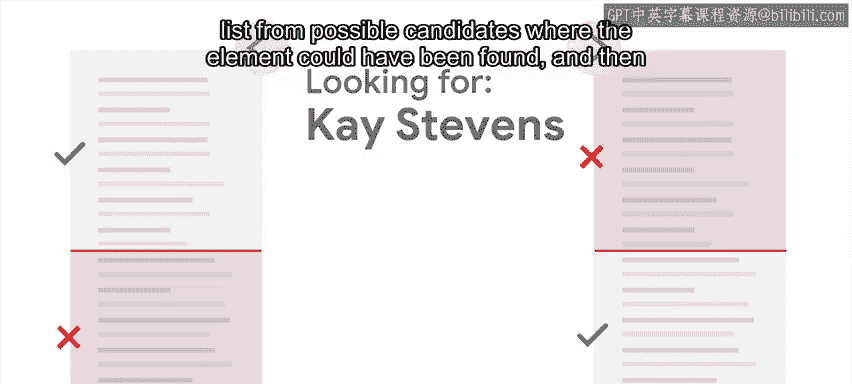
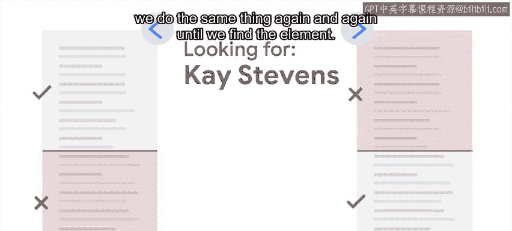

# 谷歌《用Python进行IT自动化办公3、4、5、6课（Git、debug、云端、实践）Google IT Automation with Python》中英字 - P68：10_什么是二分查找法.zh_en - GPT中英字幕课程资源 - BV1LW4y1F7XW

🎼Yeah。

Usually， when trying to find the root cause of a problem。

 we'll be looking for one answer in a list of many。

 Search for an element in a list is a common problem in computing。

 There are a bunch of different algorithms that can help us find the element that we're looking for。

 Sa， for example， you have a list that contains the data of employees that work at your company。

 And you want to find one specific employee。 One possible approach would be to start from the first entry。

And then check if the name is the one that we're looking for。

If it doesn't match， move to the second element and check again。

And keep going until we find the employee with the name we're looking for。

 Or we get to the end of the list。 This is called a linear search。 This type of search works。

 but the longer the list， the longer it can take。

In other words， the time it takes to find the result is proportional to the length of the list。

 If the list is sorted， we can use an alternative algorithm for searching called binary search。

 because the list is sorted。 We can make decisions about the position of the elements in the list。

 So the first thing we do is compare the name that we're looking for with the element in the middle of the list and check if it's equal。

 smaller or bigger。😊。

If it's smaller， we know that the element we're looking for must be in the first half of the list。

On the flip side， if it's bigger， we know that it's in the second half of the list this way。

 with only one comparison， we've eliminated half of the list from possible candidates where the element could have been found。

And then we do the same thing again and again until we find the element。

So if the element we were looking for was smaller than the middle element。

 we look at the element in the middle of the first half， if our element is now bigger。

 we look at the element in the middle of the second quarter and so on。

Each time we look at the middle element of the section we're dealing with until we find the element we're looking for。

Using linear search， going through a list with 1000 elements might take up to 1000 comparisons。

 if the element we're looking for is the last one in the list or isn't present at all。

 using binary search for the same list of 1000 elements。 The worst case is only 10 comparisons。

 This is calculated as the base  two logarithm of the list's length。

 and the benefits get more and more significant the longer the list。 for a list of 100000 elements。

 it would be 17 comparisons instead of 100000 comparisons。 But remember that for this to work。

 the list needs to be sorted。 So if the list isn't sorted， we would need to sort at first。

 which takes a chunk of time。 It can still make sense to do it if we're going to search through it several times。

 but it doesn't make sense to sort the list and then use binary search to only find one element。😊。

In that case， using linearar search is simpler and faster。

If you're curious about what these two types of search look like when implemented in Python。

 you can see a possible implementation of linear search and one for binary search in the next reading。

After that， we'll talk about how we can apply the principles of binary search to troubleshooting。

