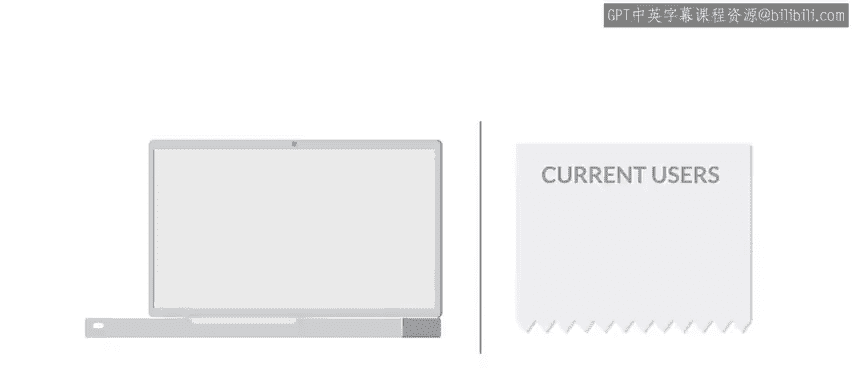
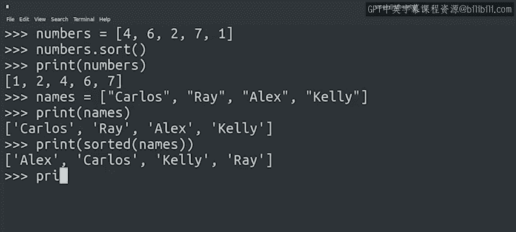

# 谷歌《用Python进行IT自动化办公1、2课（Python、控制操作系统）｜Google IT Automation with Python》中英字幕 - P68：67_研究.zh_en - GPT中英字幕课程资源 - BV1gw411E7E1

Okay， so we have a problem statement which helps us understand the problem and focus our approach。

 We know we have to input a list of event objects and evaluate these objects attributes to output a report of all the users currently logged into a machine。

 Now it's time for step 2。 The research。 We're going to consider all the tools we have available to help us solve the problem。

 to find out which users are currently logged into machines。

 We need to check when they logged in and when they logged out。

If a user logged into a machine and then logged out， they're no longer logged into it。

 But if they didn't log out yet， they're still logged in。 I know we're stating the obvious here。

 but in programming， it is super important to be clear on the parameters。 Also。

 knowing this tells us that to solve this correctly。

 It's vital that we process the events in chronological order。 If they're not。

 we can get the log out event before the corresponding login event and our code may do unpredictable things。

 and no one likes unpredictable code。 So how do we sort lists in Python。

 We'll need to do some research。Type sort lists and Python into your favorite search engine。

 and you'll get a bunch of results that mention the list's sort method and the sorted function。

The difference between these two options is that the sort method modifies the list it's executed on while the sorted function returns a new list that's been sorted。

 Apart from that， they work the exact same way。 Let's check out this difference in action。 First。

 we'll create a list of numbers and call the sort method to sort the list。

You can see here that the elements of the list have been sorted。 Let's try a different example Now。

 using the sorted function。 We'll create a list of names。

Then we'll print the output of the sortded function。

Let's print the original list again to check that。 it didn't change。

So you can see that the original list wasn't modified。

 The sordid function returned a new sordid list， but the original was left untouched。Nice。

We now know how to sort things in Python for this problem。 It's fine to modify the original list。

 So we'll use the sort method。 But wait， see how both these options sorted the list alphabetically。

 That's the default approach Python takes。😊，But what if we wanted to organize our lists by a different criteria。

Again， if we take a look at the documentation we found online。

 we'll see that the sort method can take a couple of parameters。

 One of these parameters is called key， and it lets us use a function as the sorting key。

 Let's try this out on our list of names。 Instead of sorting alphabetically。

 we could sort by the length of each string。 Do you remember which function we can use to do that。😊。

Yep， we can pass the lens function as the key。All right。

 We now know how to order elements of a list based on the return value of a function。

In our report scenario， we know that our elements will be instances of the event class。

 and we want to order by date， which is an attribute of the event class。

 One way we could do this is to write a function called get event date。

 which returns the date stored in the event object。

We could also create this as a method in the event class if we had access to modifying the class。

 But since we're working with a bigger system that generates these events。

 we'll assume that we can't just add a method to the class。 So we'll create our own function instead。

😊，How does this sound， Is it all making sense。Remember that there are various paths we could take to solve this problem。

 but some are better than others， so it's important to understand why we chose the options we did。

Feel free to take some time on your own to explore the possibilities and understand what we're doing In the next video。

 we will dive into our plan to build our script。😊。