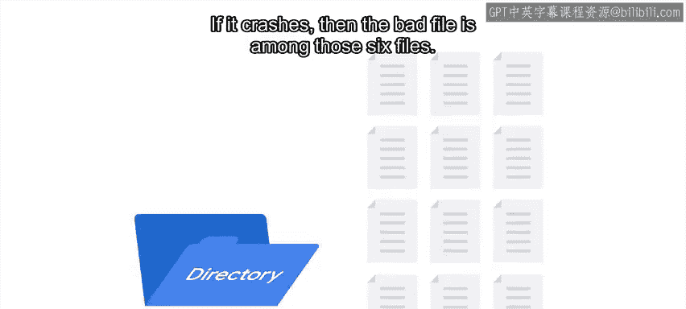
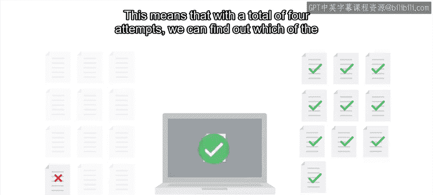
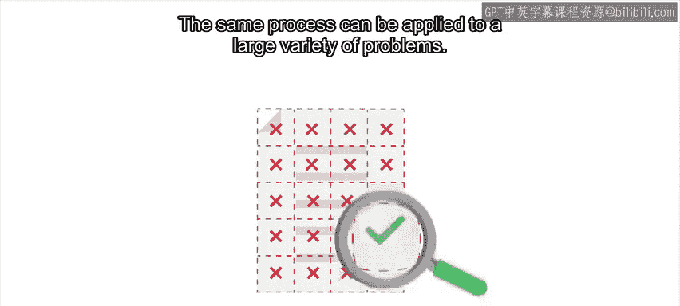

# 谷歌《用Python进行IT自动化办公3、4、5、6课（Git、debug、云端、实践）Google IT Automation with Python》中英字 - P69：11_在故障排查中应用二分查找法.zh_en - GPT中英字幕课程资源 - BV1LW4y1F7XW

🎼Yeah。

We called out that the binary search algorithm is really efficient when trying to find an element in a sorted list In troubleshooting。

 we can apply this idea when we need to go through and test a long list of hypotheses。

 when doing this， the list of elements contains all the possible causes of the problem。

 and we keep reducing the problem by half until only one option is left。

 the list of elements could be entries in a file extensions enabled boards connected to a server or even lines of code added to a faulty release。

😊，And with each iteration， the problem is cut in half。This approach is sometimes called bisecting。

 which means dividing in 2。 In an earlier video， we gave the example of a new version of a program that failed to start when the old configuration directory was present。

If the directory contained a bunch of different files in it。

 we could identify the one causing the failure by bisecting the list of files。

 say the old directory contained 12 different config files。

 We want to identify which of those 12 is causing the failure。To do that。

 we can create a copy of the directory with just six of the 12 files and then try to start the program again。

 If it crashes， then the bad file is among those six files。 If it doesn't， it's among the other six。

 In the next step， we would pick three out of the failing group of 6。 If the program crashes again。

 it's one of those three， if it doesn't， it's one of the other three。😊。

For the last three， we can first check two together or just go one by one， either way。

 it's two checks to get to the failing file。

This means that with a total of four attempts， we can find out which of the 12 files is causing the problem since things in I can sometimes be complex and intertwined before declaring victory。

 well want to verify the program crashes with that single file present and doesn't crash when the single file isn't present once we've confirmed that we've reduced the reproduction case of our problem to a single file instead of a whole directory。

Much easier to understand and figure out what's going on。

After that， we can proceed in the same way with the contents of that single file。

 cutting it in half repeatedly until we find the specific part of the file that's causing the problem。

The same process can be applied to a large variety of problems。 It's very common， for example。

 to use it to figure out which browser extension is causing the browser to crash。

 Disabling half of the extensions， then checking if the browser crashes with that subset and so on until we find the faulty extension。

 We can also use this technique to discover which plugin in a desktop environment is causing the computer to run out of memory。

 or which entry in a database is causing the program to raise an exception。

 We can also apply this to code when trying to find a bug that was introduced in a recent version。😊。

If we know the list of changes that were made between one version and the next。

 we can keep cutting that list in half until we find the one that caused the failure when using git for version control。

 we can use a git command called bisect。Bect receives two points in time in the Git history and repeatedly lets us try the code at the middle point between them until we find the commit that caused the breakage。

 and this doesn't even need to be your Git repository。

 If you're using open source software that's trackinging Git。

 you can use the biec command to find out which commit caused the software to stop working on your computer。

For example， if the latest release of the Linux kernel causes the sound card on your computer to stop working。

 you can use Git bisect to find the commit that broke it and report this as a bug to be fixed。

 and as we called out when we were talking about binary search。

 the longer the list of items that needs to be checked。

 the more we gain by cutting our problem in half on each iteration if it's just five options that need to be checked。

 we can simply go one by one， it won't make a lot of difference。

 and it might be easier to keep track of what we tried。

 but if it's 100 we definitely want to bisect the problem， so we can find the answer in seven steps。

 not 100。When we have to test a bunch of different options to find the one that's causing a failure。

 we'll want a quick and easy way to check it， even if we're reducing the amount of attempts by bisecting the problem。

 we don't want to spend a long time on each check。Sometimes it's straightforward。

 either the program starts or it fails， but other times it can take a bunch of manual steps to check what we want to check。

 So depending on what the problem is that we're trying to find。

 it might make sense to spend some time creating a script that checks for the issue Up next。

 we'll see this in action in a practical example。