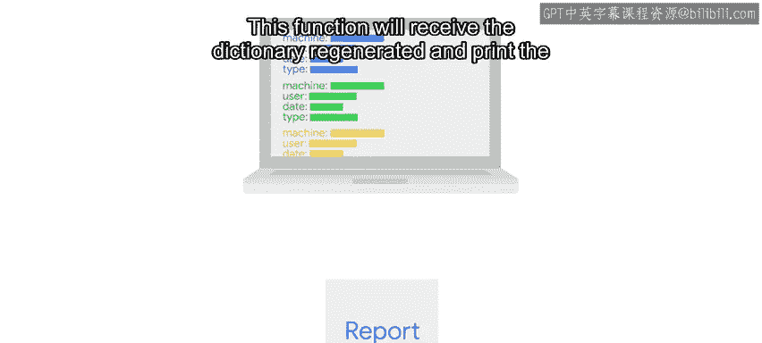

# 谷歌《用Python进行IT自动化办公1、2课（Python、控制操作系统）｜Google IT Automation with Python》中英字幕 - P69：68_计划.zh_en - GPT中英字幕课程资源 - BV1gw411E7E1

Okay， you're doing great with this so far。 We've already defined our problem statement and then researched options to figure out what tools we have available and which are best for the job。

 Now， it's time to plan our approach。 So we know that our input will be a list of events and we'll sort them by time。

 Each event in that list will include a machine name。

 a user name and tell us whether the event is a log in or a log out。

 We want our script to keep track of users as they log in and out of machines。 So how can we do this。

 Let's think about what well do for each event and see if we can figure out the best strategy。😊。

When we process an event， we'll see that someone interacted with a machine。 If it's a login。

 we want to add it to the group of users logged into that machine。 If it's a log out。

 we want to remove it from the group of users logged into the machine。In this scenario。

 it makes sense to use a set to store the current users。

 adding new users at login time and removing them at logout time。Great。

 but if the current users of a given machine are stored in a set。

 how do we know which set corresponds to the machine we're looking for。

The easiest way to know this is to store this information in a dictionary。

 We'll use the name of the machine as the key and the current users of that machine as the value。

So for each event we process， we'll first check in the dictionary to see if the machine is already there。

 We need to check this because it could be the first time we're processing an event for that machine。

 If it's not there， we'll create a new entry。 If it is。

 we'll update the existing entry with the action corresponding to the event。

 which means we either add the user if the event is a login or remove the user。 if it's a log out。😊。

Once we're done processing the events， we'll want to print a report of the information we generated。

This is a completely separate task， so it should be a separate function。

 This function will receive the dictionary we generated， and print the report。

It's important to have separate functions to process the data and to print the data to the screen。

This is because if we want to modify how the report is printed。

 we know we only need to change the function in charge of printing。

 or if we find a bug and how we're processing the data。

 we only need to change the processing function。 It would also allow us to use the same data processing function to generate a different kind of report。

 like generating a Pf file， for example。Yay， we know what we need to do， how we need to do it。

 and how we'll structure our code Now we can get into the meaty stuff actually writing the code。

