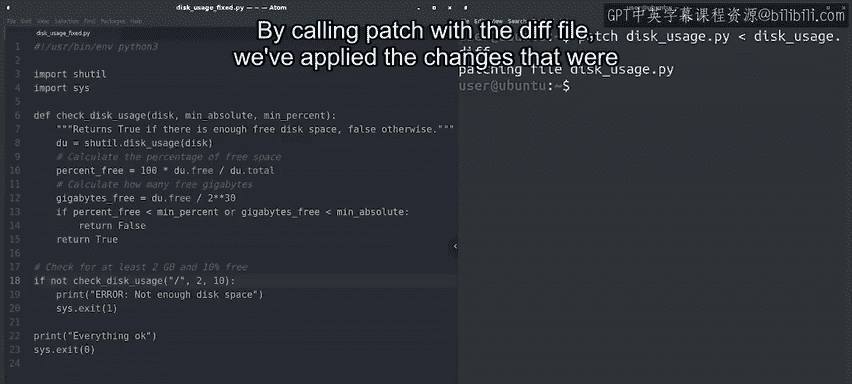

# 谷歌《用Python进行IT自动化办公3、4、5、6课（Git、debug、云端、实践）Google IT Automation with Python》中英字 - P6：5_差异和补丁的实际应用.zh_en - GPT中英字幕课程资源 - BV1LW4y1F7XW

Imagine this。 A colleague is asking our help with fixing a script named disk the usage dot Pi。

 The goal of the script is to check how much disk space is currently used and print an error if it's too little space for normal operation。

But the script is currently broken because it has a few bugs。

We'll help our colleague fix those bugs to demonstrate how to use diff and patch。

Before we change anything， let's make a couple copies of the script。

 We'll add underscore original to one copy， which will keep unmodified and used for comparison and underscore fix to the other copy。

 which we'll use to prepare our fix。Okay。Now that we have our copies。

 we'll edit the underscore fixed version and actually fix it。This file has a bunch of code。

Before we try to understand what it does and what's wrong with it。

 let's execute it and see what we get。Hm。The Python interpreter isn't too happy。

It's complaining that there's a return outside of function， and if we look at the code。

 we can clearly see that there's a return that's not inside any function。

You might remember that in Python we can only use return statements inside functions so how do we fix this。

 There's a couple options， we could turn the current code into a function and then call that function from the main part of our script。

 or we could use S exit to make the return number the exit code of our script。

Which is the code that causes a program to exit with the corresponding exit value。For now。

 let's go with the second option。Okay， we've made the change。

 Let's execute this new version of our script。Darn， we fix the syntax error。

 but now the script is telling us we don't have enough space on our disk。

But we know that we actually do have some free space， right， what's up with that？

If you look closely at the code， you might notice that the script is converting to gigabytes twice。

The function call to check disc usage is passing two times 2 double star 30。

 You might remember that the double star operator is used to calculate powers。 In this case。

2 to the power of 30， which is how many B are in a gigaby。So。This would be two gigabytes。

But that'd be if the check disc usage function was expecting a value in bytes。

If we look at the code of the function， we can see that it's already dividing the amount of free bytes by 2 to the power of 30。

So， in other words， we're doing the gigabyte conversion twice once when calling the function and once inside the function。

We need to get rid of one of them。 Let's change how we call the function。Okay。

 let's try it out again。 it works now。 Okay， now we need to send the fix to our colleague so that they can fix their script。

To do that， we'll use the technique we just learned to generate a di file like this。

Let's check the contents of the diff using the cat command。Awesome， this seems to have what we want。

 So this is what we need to send to our colleague to have them patch their file。😊。

How would they do that， They would run the patch command like this。

By calling patch with the diff file， we've applied the changes that were necessary to fix the bugs。

 Let's check that disk usage that pi now executes successfully。

Success。So we've now seen how we can look at differences between files。

 generate diff files to gather together our changes， and then apply those changes using patch。

 but this is still a very manual process where version control systems can really help。

 But before we jump into that in the next cheat sheet。

 you'll find a summary of the commands we just covered。

 So check that out and then head over to the practice quiz to make sure you've got a grasp on all this。

