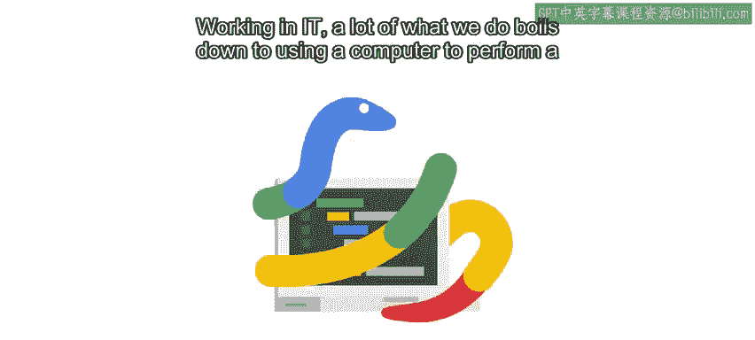
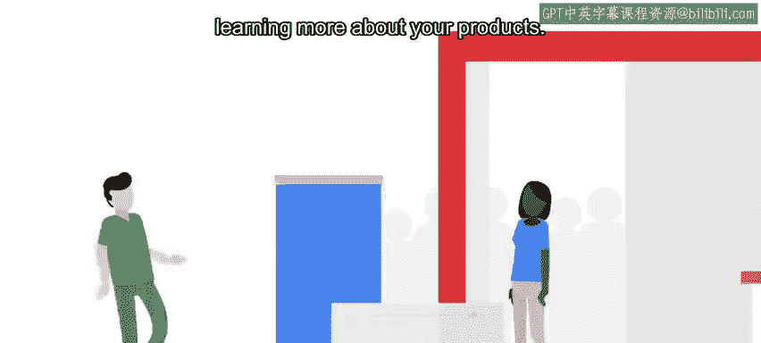
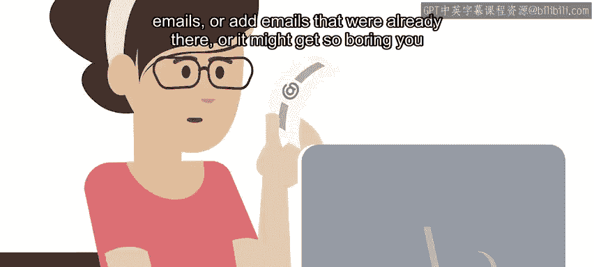
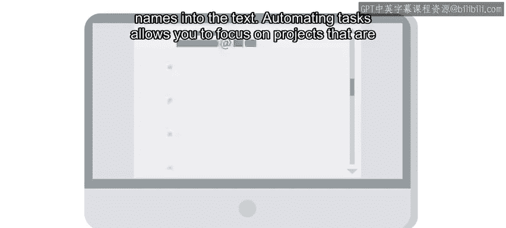
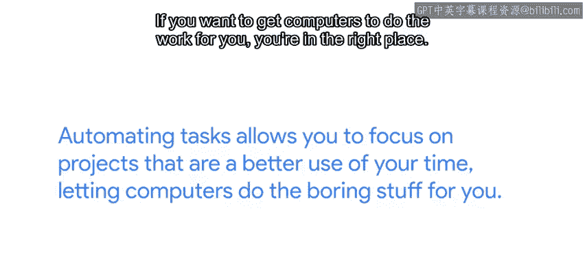

# 谷歌《用Python进行IT自动化办公1、2课（Python、控制操作系统）｜Google IT Automation with Python》中英字幕 - P6：5_让计算机为您工作.zh_en - GPT中英字幕课程资源 - BV1gw411E7E1

🎼Yeah。

Working in I T， a lot of what we do boils down to using a computer to perform a certain task In your job。

 you might create user accounts， configurefigu the network， install software。

 back up existing data or execute a whole range of other computer based tasks from day to day back in my first I T job。

 I realized that every day I came into work。 I typed the same three commands to authenticate into systems。

 Those credentials timed out every day by design for security reasons。

 So I created a script that would automatically run these commands for me every morning to avoid having to type them myself。

Funny enough， the team that monitors anomalous activity discovered my little invention and contacted me to remove it。

Tasks performed by a computer that need to be done multiple times with little variation are really well suited for automation。

 because when you automate a task， you avoid the possibility of human errors and reduce the time it takes to do it。

 Imagine this scenario。 Your company had a booth at a recent conference and has gathered a huge list of emails from people interested in learning more about your products。

You want to send these people your monthly email newsletter。

 but some of the people on the list are already subscribed to receive it。

 So how do you make sure everyone receives your newsletter without accidentally sending it to the same person twice。

 Well， you could manually check each email address one by one to make sure you only add new ones to the list。

 Sound boring and inefficient， right？ It could be。 And it's also more error prone。

 You might accidentally miss new emails or add emails that were already there。

 or it might get so boring。 You fall asleep at your desk。

Even your automated coffee machine won't help you out there。So what could you do instead。

 You could get the computer to do the work for you。

 You could write a program that checks for duplicates and then adds each new email to the list。

 Your computer will do exactly as it's told， No matter how many emails there are in the list。

 So it won't get tired or make any mistakes。 Even better once you've written the program。

 you can use the same code in the future situations， savingaving you even more time。 Pretty cool。

 right。😊。

It gets better。 Think about when you're going to send these emails out if you send them out manually。

 you'll have to send the same email to everybody Personalizing the emails would be way too much manual work。

If instead you use automation to send them， you could have the name and company of each person added to the email automatically。

 The result， more effective emails without you spending hours inserting names into the text。

 Automating tasks allows you to focus on projects that are a better use of your time。

 Letting computers do the boring stuff for you。 Learn how to program is the first step to being able to do this。

 If you want to get computers to do the work for you， you're in the right place。 Earl in this video。

 I told you about the first task I ever automated。 Now。

 I want to tell you about the coolest thing I ever automated。

 It was a script that changed a bunch of access permissions for a whole lot of Google internal services。

 The script traversed a large directory tree with tons of different files。

 Check the file contents and then updated the permissions to the services based on the conditions that I laid out in the script。

 Okay， I admit， I'm a total nerd， but I still think is really cool。 Next up。

 it's time to share your ideas。 What things would you like to automate using programming。

 While these discussion prompts are optional。😊。

They're really fun。 Serious。 They let you get to know your fellow learners a bit and collaborate on ideas and insights。

 Make sure you read what others are saying。 They may give you ideas that you haven't even thought of。

 After that， you're ready to take your very first quiz of the course。 Don't worry。

 it's just for practice。😊。