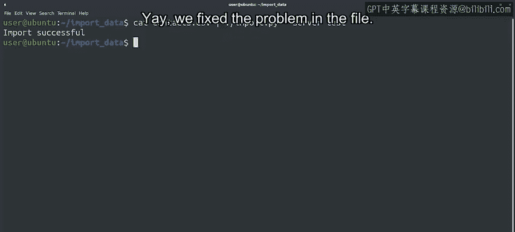

# 谷歌《用Python进行IT自动化办公3、4、5、6课（Git、debug、云端、实践）Google IT Automation with Python》中英字 - P70：12_找到无效数据.zh_en - GPT中英字幕课程资源 - BV1LW4y1F7XW

We've discussed how we can quickly find out the reason for a problem in a list of possible reasons by splitting the problem in half and testing each half separately。

Let's see this in action with an example， We have a program that reads data from a CSV file。

 processes it， and then imports it into a database。

 One of the users of the system tells us that the file they're trying to import fails with an obscure import error。

They've sent us the file so we can try it ourselves to call the command。

 we'll connect the output of catcontext。csv， the file that the user sent us to the import Pi command。

But before we run the command， it's a good time to remember that we shouldn't test in production。

 and since this script is going to be trying to import data into a database。

 we should run it against the test database instead of the production database to do that。

 we'll use the dash dash server flag that takes the name of the database server and then we'll pass the test as the parameter。

HWe see that the file fails with an importing error and doesn't give us a lot of information about what's failing。

And how big is that file， we could open it with an editor and check， but we don't need to。

 we can use the WC command that counts characters， words， and lines in a file。In particular。

 WCL will print the amount of lines in a file。So our file has 100 lines in it， that's a lot。

We don't want to have to go looking through that list to find out what could be wrong。

Especially since we have no idea what that might be。Instead。

 we can try passing only half of the file to the script and check if it succeeds or fails。

If it fails， then we pick up that part of the file and check again with half of it。

If our import succeeds， then we take the other half and split it in。

 we could edit the file manually to add or remove the parts as needed， but that would be tedious。

 Instead， we can use the tools available to us to help us do that with less effort。

 We can use the head command to print the first lines in the file and the tail command to print the last lines。

😊，We can pass the amount of lines we want to include as a parameter。

 so head dash 15 will print the first 15 lines， while tail D20 will print the last 20 lines。Okay。

 and as we saw earlier， our command reads the file to import from standard input。

So we can use pipes to connect the output of our head or tail commands to it。

Let's try to input the first half of the file now。Okay， so the first half failed。

 let's split it again to do that we'll use another pipe to take only half of the previous number this way in each step we'll add a call to head or tail for the corresponding size。

よし。とりがい。This time it succeeded， Hooray， this means that the failure must be in the second quarter of the file。

Let's verify that that's the case by giving that part to our command To do that。

 we'll take the first half using head， then get the second half of it using tail。Wampbo。

 this fails again， but that's good。 It means we're on the right track。 Let's split it once again。

Great， our test set is getting smaller。 Let's split it once more。Okay。

 we're down to six entries and we know that one of them is the bad one。

Let's split it one more time and then we can look at the three remaining entries。All right。

 let's look at the three entries lap and see if we can find the culprit。Can you see the problem？

This is a comma separated file， this means that each comma is used as a separator between the fields in the file。

If a field includes commas， it should be written between quotes。

But in the case of the third line we're looking at here。

 we can see that there's a comma instead of a period after the middle initial。

 and this is not written between quotes。The importing script is then confused because there are too many fields in this line。

Okay， let's edit the file and fix it。And now let's run our importer again with the fixed file。Yay。

 we fixed the problem in the file。

Using the biec method， we very quickly found which line out of 100 lines contained the corrupt data。

 and then we could fix it and successfully import it。

 The short termm remediation here is to tell our user about what we found and how to fix it so that they can import the data into the production database。

 The longterm remediation is to figure out why the file was generated with the invalid field in the first place and make sure that it doesn't happen again。

 Com up another practice quiz to help put your bisecting knowledge into action。😊。

