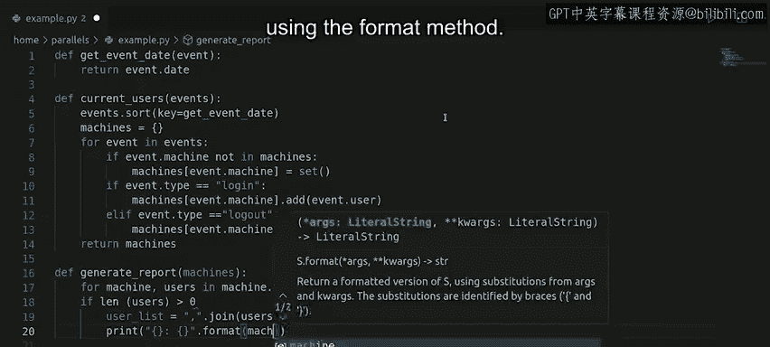

# 谷歌《用Python进行IT自动化办公1、2课（Python、控制操作系统）｜Google IT Automation with Python》中英字幕 - P70：69_编写脚本.zh_en - GPT中英字幕课程资源 - BV1gw411E7E1

We've come a long way to get here。 So let's quickly rattle off what we know so far。

 We know that we need to process the events to generate a report。

 We know how to sort the list of events Chronologically。

 We know that willll store the data in a dictionary of sets。

Which willll use to keep track of whose logs and where。

And that will have a function that generates the dictionary and a separate one that prints the dictionary。

 I think that's everything。 You know what that means。 We're finally ready to write our code。

 Here we go。😊，Let's start by defining the helper function that we'll use to sort the list。

Will'll use the simple function as the parameter to the sort function， to sort the list。

Now we're ready to start coding our processing function， which we will call current users。

The first step is to define the function。Inside the function we'll first sort our events by using the sort method and passing the function we just created as the key。

Now， before we start iterating through our list of events。

 we need to create the dictionary where we will store the names and users of a machine。

Now we're ready to iterate through our list of events。Next。

 we want to check if the machine affected by this event is in the dictionary。 If it's not。

 we'll add it with an empty set as the value。Now for the login events。

 we want to add the user to the list and for the logout events we want to remove the user from the list。

To do this， we're going to use the add and remove methods which add and remove elements from a set。

Once we're done iterating through the list of events。

 the dictionary will contain all machines we've seen as keys with a set containing the current users of the machines as values。

 This function returns。 The dictionary will handle printing in a different function。😊，Nice。

 we now have a dictionary ready， and we need to print it for that。

 We'll create a new function called generate report。😊，In our report。

 we want to iterate over the keys and values in the dictionary。To do that。

 we'll use the method items that returns both the key and the value for each pair in the dictionary。

Now， before we print anything， we want to ensure that we don't print any machines where nobody is currently logged in。

 This could happen if the user is logged in， and then logged out。To avoid that。

 we tell the computer only to print when the set of users has more than zero elements。Now。

 we said earlier that we want to print the machine name followed by the users logged into the machine。

 separated by commas。 Let's generate the string of logged in users for that machine。

 using the method join。Now we can generate the string we want using the format method。

Yea， we've written all the functions we need to tackle our problem。 Did everything make sense。

 This is a great moment to pause and review the videos for each step in our approach from the problem statement to writing the code。

 Make sure it's clear not just which function we're using， but why we're using it。😊。

If anything is a little fuzzy， remember， the discussion forums are always there for you to ask for help。

It's about to get exciting in the next video。 We're going to execute this code and see if it works。

 I'm feeling good about it。 Let's put our code to the test。😊。

