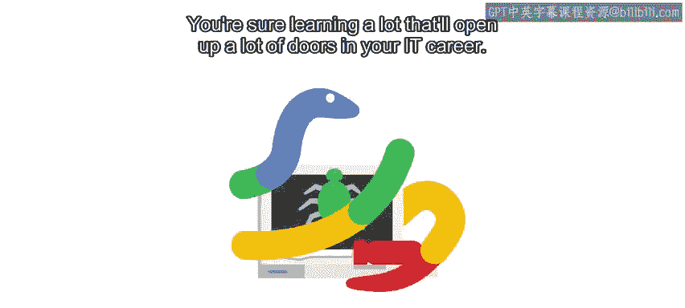

# 谷歌《用Python进行IT自动化办公3、4、5、6课（Git、debug、云端、实践）Google IT Automation with Python》中英字 - P71：13_模块 1 总结 - 故障排查概念.zh_en - GPT中英字幕课程资源 - BV1LW4y1F7XW

。

Congrats on making it to the end of the module。 You're sure learning a lot thatll open up a lot of doors in your IT career Over the past videos。

 we learned the general principles of debugging and troubleshooting。

 we looked into the basic process of solving a technical problem like getting information finding the root cause and implementing the remediation we learned about a bunch of different tools and techniques that we can use to better understand what's going on with our systems and our programs including how to create a reproduction case。

 how to find the root cause of a problem and how to deal with issues that only appear occasionally。

 Finally， we learned about the binary search algorithm and how we can use it to bisect a problem and quickly find the root cause of a technical problem all along we've checked out a bunch of realword examples and seen how we can apply this to lots of different types of problems like a bug in our code a bug in someone else's code。

 a configuration issue or even a hardware problem It's been great sharing。😊。

These interesting stories and examples with you I hope you're starting to have fun learning more about how to understand problems and find solutions Next time you need to solve a technical problem。

 try to use some of these steps we outlined and the ideas we talked about remember that logs are your best friend and use all the resources available to you。

 including looking things up on the internet and asking colleagues or friends for help throughout the rest of this course will'll keep exploring scenarios that deal with specific problems like our computer being slow or crashing unexpectedly and we'll keep applying the techniques we've explained in this module to solve those issues。

😊，So you can expect a lot more practice。 Speaking of practice up next is the graded assessment。

 which lets you try your hand at solving an actual problem for the graded assessments in this course。

 we'll use the Quicklab's online learning platform， which is powered by the Google Cloud console。

 This platform lets you experience real worldor scenarios where you're the one in charge of solving the problems to interact with the labs you'll connect to virtual machines running in the cloud。

😊，Each lab will present a different problem that needs solving。

 and you'll get a chance to practice your new skills and solve the problem。 Exing， right。

 Remember that if anything isn't clear， you can always go back and rewatch the videos When you're ready。

 the lab is waiting for you。 You got this。😊。