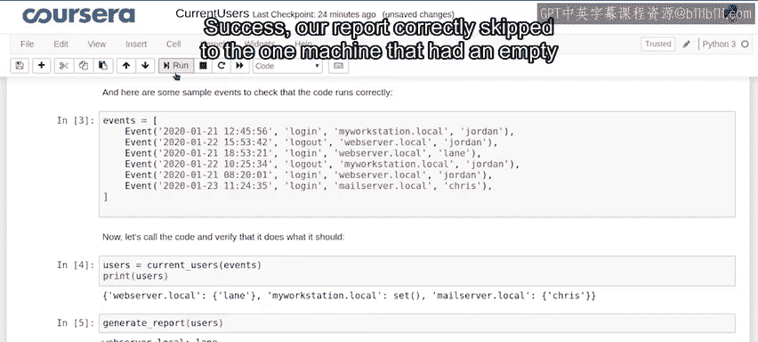

# 谷歌《用Python进行IT自动化办公1、2课（Python、控制操作系统）｜Google IT Automation with Python》中英字幕 - P71：70_汇总.zh_en - GPT中英字幕课程资源 - BV1gw411E7E1

We're almost done solving our problem。 We've written the code that solves our problem statement After following our research and plan。

 We're now going to put all of our code in a Jupiter note。 Ex it and see what happens。😊。

This is what our code currently looks like as we wrote in the previous video。

To check that our code is doing everything it's supposed to do。

 we need an event class for this scenario， we'll use the very simple event class。Okay。

 we have an event class that has a constructor and sets the necessary attributes using this constructor will create some events and add them to a list。

Okay， we've got a bunch of events。 they're currently unsorted。

 they affect a few machines and include some users。

 will'll feed these events into our function and see what happens。Everything is now ready to go。

 Drum roll， please。Great， our code correctly created a dictionary with the machine names as keys。

 There's one empty set and two sets with one value。 Let's now try generating the report。😊。

Whoop whoop， success。 Our report correctly skipped the one machine that had an empty set。

 That's great。

In the world of I T， there's a bunch of other things that could happen。

 What happens if we come across an event for a user logging out that had never logged in。

What do you think we should do then， We're going to try and figure this out in the next exercise。

