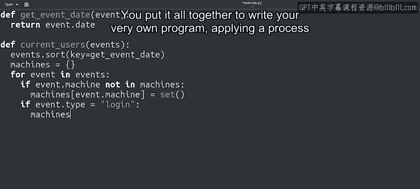

# 谷歌《用Python进行IT自动化办公1、2课（Python、控制操作系统）｜Google IT Automation with Python》中英字幕 - P72：71_祝贺.zh_en - GPT中英字幕课程资源 - BV1gw411E7E1

Congratulations， you've made it through the entire course。 These weren't easy concepts to learn。

 I want you to think all the way back to when you were just starting this journey。

 Can you remember what you were feeling when you watched to those first videos。

 maybe a little nervous， terrified， even excited， Probably all these emotions at once。

 You tuned in with me， watched all these videos and kept going when it got complex。

 You should be proud of yourself。 Take a moment to reflect on where you are now。

 You've gone from having little or no knowledge of programming to being able to write all kinds of complex functions。

 You're using conditionals， loops， strings， lists and even dictionaries。

 You even created your own objects。 You put it all together to write your very own program。

 applying a process which you might use in your day to day I T role。😊。

And hopefully， you had as much fun doing it as I did teaching you。

It's impressive that you've mastered all this stuff。

 And I hope it's just the beginning of your Python journey。

 Building a successful career in I T calls for perseverance。

 Cur and grit  Three qualities you've proven to have heaps of by making it thus far。

 It also requires skills and knowledge。 and basic Python is definitely a powerful tool in your I T tool box。

😊，Knowing how to write scripts will set you apart from others as you look to advance in your career。

I bet you're now seeing tasks all around you， which are sparking ideas on how you could automate them with a script。

 The possibilities are endless。And it's just the start。

 Remember what we said in one of our first videos。 a journey of 1000 miles begins with a single step。

 There's still a lot of exciting things you can learn。 We hope you will join us in the next course。

 where we will be learning all about how Python interacts with the computer's operating system to get a taste of what's in store。

 Stay put for the next video where we will chat with Roger， your next instructor。 But for now。

 I want to wish you best of luck。 I look forward to seeing you and your code out there。😊。

