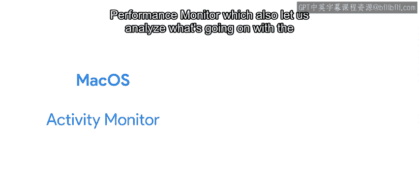
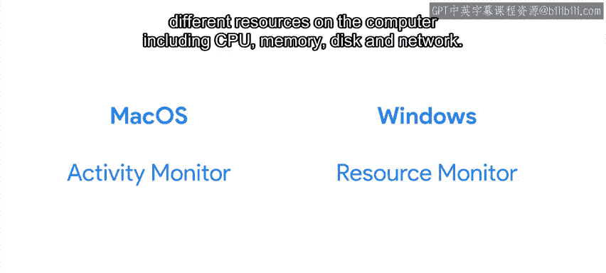
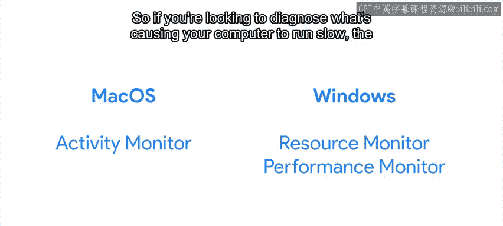
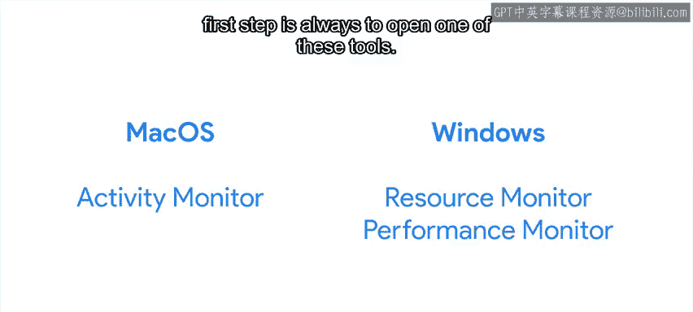

# 谷歌《用Python进行IT自动化办公3、4、5、6课（Git、debug、云端、实践）Google IT Automation with Python》中英字 - P73：15_为什么我的计算机运行缓慢.zh_en - GPT中英字幕课程资源 - BV1LW4y1F7XW

🎼Yeah。

Our computers execute thousands of millions of instructions per second。

Each of those instructions does one small thing， like incrementing a value， comparing two values。

 or moving a value from one place to another。 Still。

 with thousands of millions of instructions per second。

 theres a lot that a computer can do in just one second。

 This allows our computer to seemingly execute a number of different things at the same time。

 say you're browsing the web， while also running an application that plays your favorite music in the background。

 Even if your computer has a single core to execute those applications。

 It will seem like the computer is running these two programs at the same time。😊。

What's happening under the hood is that each application gets a fraction of the CPU time。

 and then the next application gets a turn。

Most of the time， this works fine， but if we run too many applications。

 or if one of these applications we're running needs more CPU time than the fraction it's getting。

 things might become frustratingly slow。

The general strategy for addressing slowness is to identify strategy for addressing Sloanan in our device our script or our system to run slowly。

 The bottleneck could be the CPU time， as we just mentioned。

 but it could also be time spent reading data from disk。

 waiting for data transmitted over the network， moving data from disk to Ram or some other resource that's limiting the overall performance。

 Pre often， we can speed things up by getting rid of anything else that's using resources on the same computer。

So if the problem is that your program needs more CPU type。

 you can close other running programs that you don't need right then if the problem is that you don't have enough space on disk。

 you can uninstall applications that you don't use or delete or move data that doesn't need to be on that disk。

 if the problem is that the application needs more network bandwidth。

You can try stopping any other processes that are also using the network and so on。

This only helps us if the issue is that there are too many processes trying to use the same resource if we've closed everything that wasn't needed and the computer is still slow。

 we need to look into other possible explanations。What if the hardware we're using just isn't good enough for the applications we're trying to run on it in cases like these。

 we'll have to upgrade the underlying hardware， but to make a difference in the resulting performance。

 we need to make sure that we're actually improving the bottleneck and not just wasting our money on new hardware that will go unused。

 So how can we tell which piece of hardware needs to be changed。

We need to monitor the usage of our resources to know which of them is being exhausted。

This means that it's being used completely and programs are getting blocked by not having access to more of it。

 Is it the CPU， the memory， the disk I O， the network connection， the graphics card。To find out。

 we'll use the tools available in our operating system， monitor the usage of each resource。

 and then work out which one is blocking our programs from running faster。

We've already talked about using top on Linux systems。

 This tool lets us see which currently running processes are using the most CPU time。

 and if we sort by memory， which ones are using the most memory。

It also shows a bunch of other load information related to the current state of the computer。

 like how many processes are running and how the CPU time or memory is being used。

We also called out in earlier videos a couple of other programs like IOTop and IFTop that can help us see which processes are currently using the most disk IO usage or the most network bandwidth。

On Mac OS， the OS ships with a tool called Act Monitor， which lets us see what's using the most CPU。

 memory， energy， disk， or network。

On Windows， there's a couple of OS tools called Resource Monitor and Performance Monitor。

 which also let us analyze what's going on with the different resources on the computer。

 including CPU， memory， disk， and network。

So if you're looking to diagnose what's causing your computer to run slow。

 the first step is always to open one of these tools。

 check out what's going on and try to understand which resource is the bottleneck and why。

And then plan how you're going to solve the issue。Of course。

 not all performance problems are solved by closing applications or getting better hardware。

 Sometimes we need to figure out what the software is doing wrong and where it's spending most of its time to understand how to make it run faster。

We need to really study each problem to get to the root cause of the slowness。Up next。

 we'll talk about some ideas to help us better understand what's going on under the hood。

