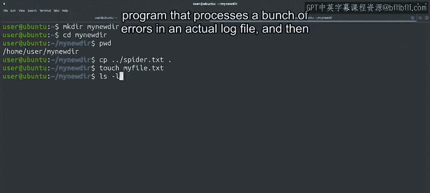
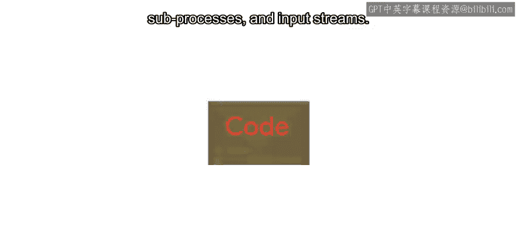
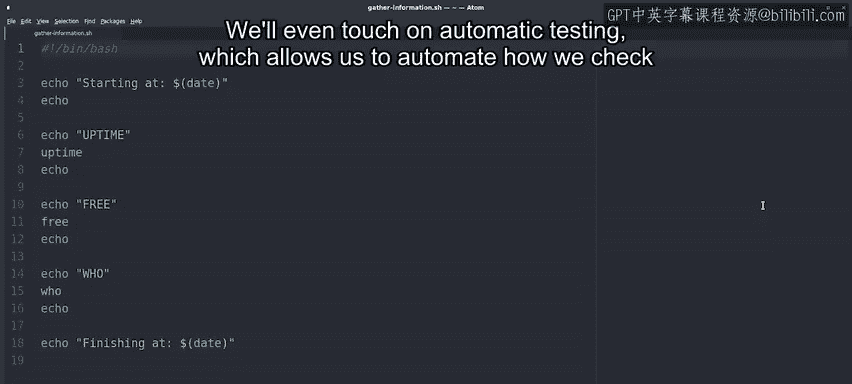
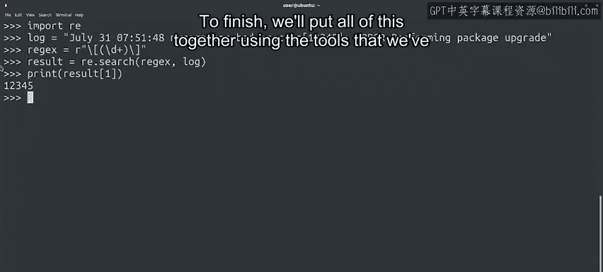
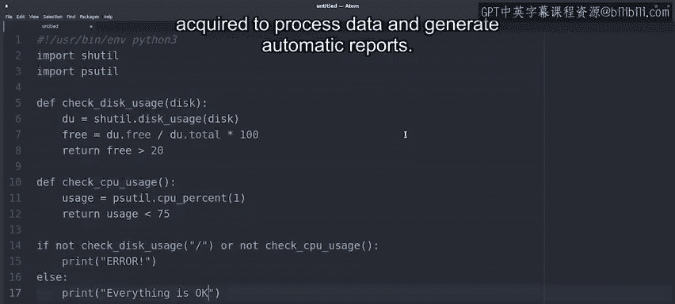

# 谷歌《用Python进行IT自动化办公1、2课（Python、控制操作系统）｜Google IT Automation with Python》中英字幕 - P74：0_课程介绍.zh_en - GPT中英字幕课程资源 - BV1gw411E7E1

🎼。う。

Hi there， and welcome back if you joined us for the Python Introduction course。

And if you skip that course and this is the first time we're meeting， well， welcome aboard。

If you did join us for the introductory course， you've heard this before and no doubt you're going to hear it again When you work in IT。

 computer programming skills open up an incredible amount of opportunity you've also heard us use the metaphor of the toolkit that every successful career in IT is built upon a toolkit of skills。

 experience， knowledge and curiosity。Python scripting is a powerful tool in your IT toolkit。

 and you're here because you've taken the first steps on your Python journey。By now。

 you're starting to understand programming concepts and you've seen how an IT specialist might create automation to save time and cut down on the stakes。

My name is Roger Martinez， and I'm a system Adist for hardware at Google。

The team I work on maintains and monitors servers that Google hardware engineers use to design and test silicon chips that Google makes for their P phones。

I'm really excited to be your instructor for this course。As you know。

 this program has been developed and designed exclusively by Google。

Each course takes place at a different campus location to bring you some extra Google goodness。

And in case you're wondering。No， we aren't actually orbiting a distant galaxy。

 although we are trying to bring you a universe of knowledge about Python。 Don't worry。

 the curriculum is stronger than a lot of my jokes。 Throughout this program。

 you're going meet other Googlers， besides me and the other instructors。😊。

Many of them started their careers in IT support， just like me。

 learn programming and advanced onto more technical roles。

They're excited to share their stories with you about how they've built their IT careers through persistence and a commitment to learning new skills。

Some of them will also share more detail on their jobs and what their day to day tasks look like。

Before we dive into the course， I'd like to share with you a story to give you some insight into why I'm excited to be here teaching you this course。

Years ago， when I started college in New Jersey， I really didn't know what I wanted to study。

A friend of mine recommended that I check out the IT program。I've always liked working on computers。

 but I had no idea that a career in IT was even a possibility。

From the moment I walked into that class， I felt so out of place。 No one really looked like me。

 no one sounded like me， and no one seemed to come from a background similar to mine。

I dropped the class the next day， and I never went back In hindsight， I kind of regret that decision。

If I would have stayed in that class， then maybe the next Latino person or other minority that walked in would have felt like they belonged。

Diverse ideas， experiences and backgrounds are crucial to IT to any industry really。

And diverse representation is so important to showing the next generation that they belong in a field and that they can thrive there。

So that's why teaching this course is so meaningful to me。Maybe it will in a small way。

 help more people walk through that door and never turn back。Okay， enough about me。

 Let's talk about the course。So what's ahead？By the time you finish the last video of this course。

 you'll be able to manipulate files and processes on your computer's operating system。

You also have learned about regular expressions， a very powerful tool for processing text files。

 and you'll know how to use the Linux command line。

And this might feel like a stretch right now， but you'll also write a program that processes a bunch of errors in an actual log file and then generates a summary report。

That's a super useful skill， and by the end of this course you're going to know how to do it。

We'll kick it off now by exploring how to execute Python locally and organize and use code across different Python files。

 we'll then learn how to read and write different types of files and use sub processessses and input streams。

We'll also dive with the batchsh scripting and regular expressions。

 both very powerful tools for anyone working with systems we'll even touch on automatic testing。

 which allows us to automate how we check if our code is correct。

To finish， we'll put all of this together using the tools that we've acquired to process data and generate automatic reports we'll also explain how to set up your own developer environment in your machine。

And we really recommend that you do this。You'll need to have administrator rights to install software。

 or you'll have to ask the administrator to install it for you。

 Se up your developer environment is a key step in being able to write and deploy powerful automation tools so we strongly advise that you do this and get comfortable with working with it。

In this course， we'll use Quicklabs， which is an environment that allows you to test your code on a Linux virtual machine。

This lets you experience real world Linux scenarios while you will need to write code to solve problems。

We'll use Linux for our examples and exercises in this course。

Linux is an industry standard for running servers， which is why we chose it。At some points though。

 we'll talk about how things are done on Windows or Mac OS OS to give you a broader picture。

While we'll be using Linux a lot， you don't need to run Linux on your machines to follow along。

 What you do need to do is make sure you've got Python installed。

You also need to know how to install additional Python modules， but don't worry。

 we'll walk through all that later on。You've already learned building blocks of programming and this course we'll examine different tasks that you might come across in your day to day activities and we'll learn how we can solve them through programming。

One difference I bet you'll notice real quick if you joined us for the introduction to Python course is that we'll use a lot more modules than before Oh。

 and when I say modules here， I'm not talking about the parts of this course。In this context。

 I mean the Python modules that we can use to get extra functionality for our scripts。

Please remember， there might be some complex topics and videos that may not 100% sink in the first time around。

 That is totally natural。 Take your time。 rewatch the videos a couple of times， if you need to。

I promise you'll get the hang of it。Also， remember that you can use the discussion forums to connect with your fellow learners and ask any questions that you might have。

We're about to go on a fun and fascinating journey together into the universe of Python。 So let's go。

😊。