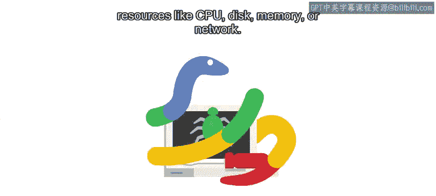
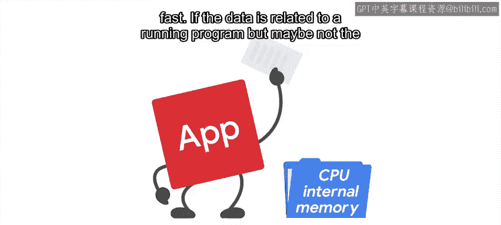
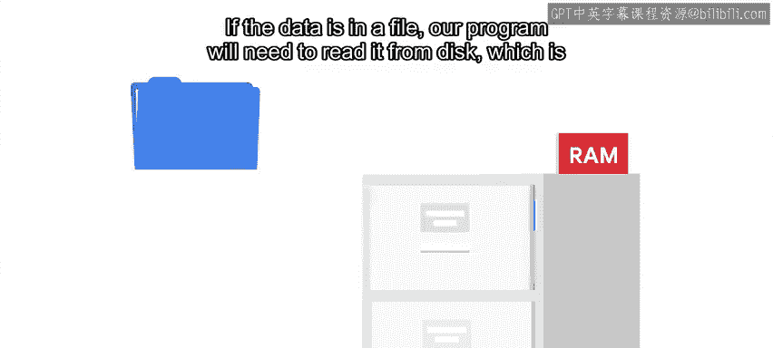
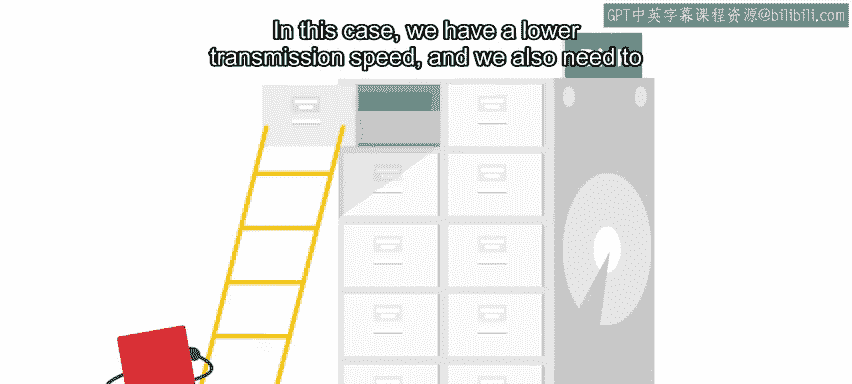
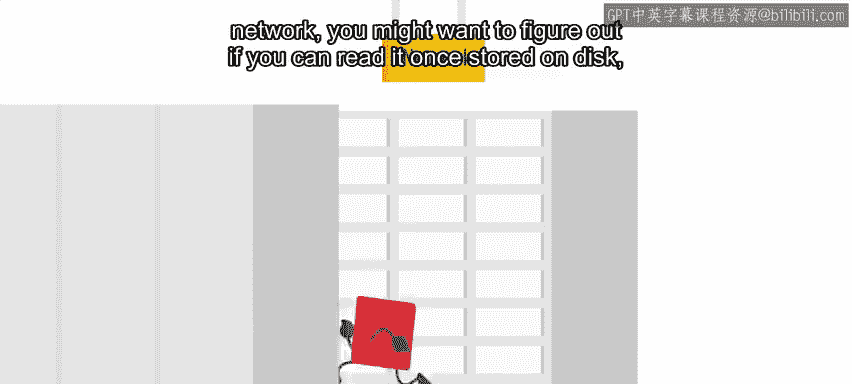
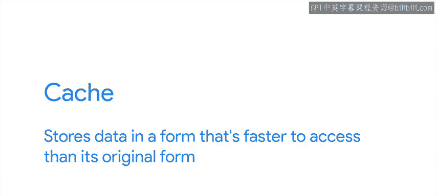
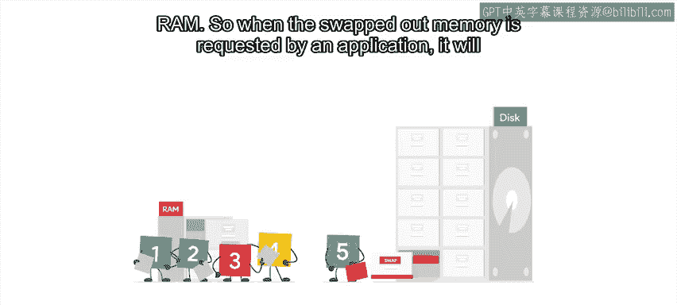
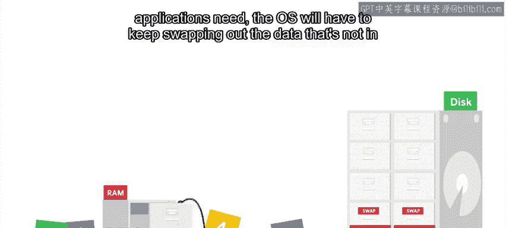
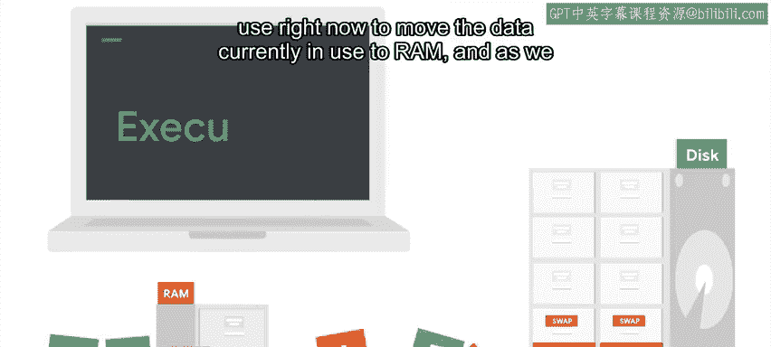
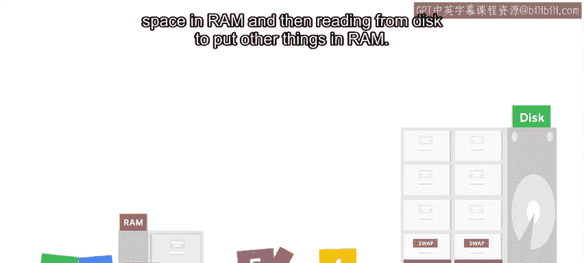

# 谷歌《用Python进行IT自动化办公3、4、5、6课（Git、debug、云端、实践）Google IT Automation with Python》中英字 - P74：16_计算机如何使用资源.zh_en - GPT中英字幕课程资源 - BV1LW4y1F7XW

🎼Yeah。

In the last video， we called out how our computer can be constrained by different resources like CPU。

 disk， memory， or network。We discussed how we need to eliminate the bottlenecks and get our computer to better use its resources to boost our systems performance to do that。

 we need to understand how each component interacts with the other。

 and what the limitations are in particular， when thinking about making things faster。

 it's important to understand the different speeds of the parts involved when an application is accessing some data the time spent retrieving that data will depend on where it's located。

 if it's a variable that's currently being used in a function。

 the data will be in the CPU's internal memory， and our program will retrieve it really fast。

If the data is related to a running program， but maybe not the currently executing function。

 it will likely be in RAM， and our program will still get to it pretty fast。

If the data is in a file， our program will need to read it from disk。

 which is much slower than reading it from RAM。

And worse than reading from disk is reading information from over the network。

In this case， we have a lower transmission speed， and we also need to establish the connection to the other endpoint to make the transmission possible。

 which adds to the total time needed to get to the data。

 so if you have a process that requires repeatedly reading data over the network。

 you might want to figure out if you can read it once。

 store it on disk and then read it from disk afterwards。

Or similarly， if you're repeatedly reading files from disk。

 you might see if you can put the same information directly into the process memory and avoid loading it from disk every time。

 In other words， you'll want to consider if you can create a cache。

 a cache stores data in a form that's faster to access than its original form。

There's a ton of examples of caches in IT。A web proxy is a form of cache。 It stores websites。

 images or videos that are accessed often by users behind the proxy so they don't need to be downloaded from the Internet every time DNS services usually implement a local cache for the websites they resolve so they don't need to query from the Internet Every time someone asks for their IP address。

 The operating system also takes care of some caching for us。

 It tries to keep as much information as possible in Ram so that we can access it fast。

This includes the contents of files or libraries that are accessed often。

Even if they aren't in use right now。We say that these contents are cached in memory We called out that if the data is part of a program that's currently running。

 it will be in RAM， but RAM is limited if you run enough programs at the same time。

 you'll fill it up and run out of space What happens when you run out of RAM At first the OS will just remove from RAM anything that's cached but not strictly necessary if there's still not enough RAM after that。

 the operating system will put the parts of the memory that aren't currently in use onto the hard drive in a space called swap。

Reading and writing from disk is much slower than reading and writing from Ram。

 So when the swapped out memory is requested by an application， it will take a while to load it back。

 The swapping implementation varies across the different operating systems。

 but the concept is always the same。The information that's not needed right now is removed from RAM and put onto the desk while the information that's needed now is put into RAM。

This is normal operation， and most of the time we don't notice it。

 but if the available memory is significantly less than what the running applications need。

 the OS will have to keep swapping out the data that's not in use right now to move the data currently in use to RAM。

And as we called out， our computer can switch between applications very quickly。

 which means that the data currently in use can also change very quickly。😊。

The computer will start spending a lot of time writing to disk to make some space in RAM。

 and then reading from disk to put other things in RAM。This can be super slow。

 so what do you do if you find that your machine is slow because it's spending a lot of time swapping。

There are basically three possible reasons for this We've already talked about two of them first。

 if there are too many open applications and some can be closed， close the ones that aren't needed。

Or if the available memory is just too small for the amount the computer is using。

 add more RA to the computer。The third reason is that one of the running programs may have a memory leak。

 causing it to take all the available memory， a memory leak means that memory which is no longer needed。

 is not getting released。

We'll talk a bunch more about memory leaks later in the course for now。

 let's just say that if a program is using a lot of memory and this stops when we restart the program。

 it's probably because of a memory leak。Up next， we'll discuss a bunch more different reasons our computer might run slowly and what we can do to fix them。

