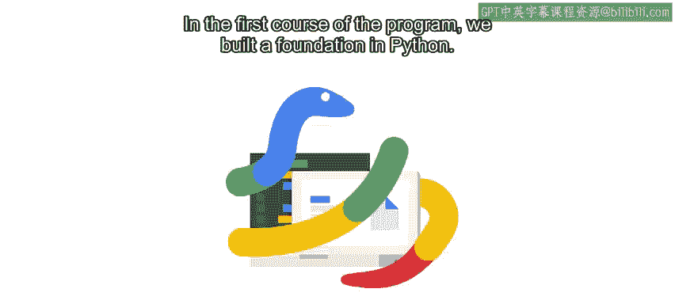

# 谷歌《用Python进行IT自动化办公1、2课（Python、控制操作系统）｜Google IT Automation with Python》中英字幕 - P75：1_模块 1 开始使用 Python 介绍.zh_en - GPT中英字幕课程资源 - BV1gw411E7E1

🎼。う。

Welcome to the next chapter in your programming journey。In the first course of the program。

 we built a foundation in Python。You've done an amazing job getting to this point。

Now it's time to take next step。We're going to build on that foundation to boost your programming toolkit with even more useful tools。

Are you excited， are you a little nervous？Don't worry about a thing As always。

 we're here to guide you and help you build your confidence step by step。Are you ready。

 Let's do this To really get the most out of this course。

 We strongly recommend that you have Python installed on your machine。😊。

Having Python at your fingertips like this lets you understand how to run Python programs。

 how to install additional Python modules， and how it all comes together。

So we'll devote some of the next videos to guiding you through setting up your environment。

 We'll then use your newly configured Python environment to run Python scripts locally。

 discover how to organize code into different files and talk about what co editoritors are for and how to choose what tools to use after you get set up and familiar with your environment we'll dig deeper into some automation concepts。

In the introductory course on Python， we talked a lot about automation。

 We saw some automation examples and spoke about many possibilities that come with learning to program。

In this course， we'll keep expanding on that base， we'll learn how to decide whether to automate something or not。

 and what it takes to put automation into place。To put this into practice throughout the course。

 you'll be writing Python scripts on a remote Linux machine using Quicklas。

 This tool lets you experience real world scenarios that simulate programming problems you'll likely have to tackle in an I T job。

 If at any point along the way， you feel lost or confused， don't panic。😊。

You can watch the videos as many times as you need to let the concept sink in。Plus。

 you can ask questions in the discussion forums， which is one of the best ways to find extra information and to connect with other learners。

So we've got a lot to cover。 Let's get started。