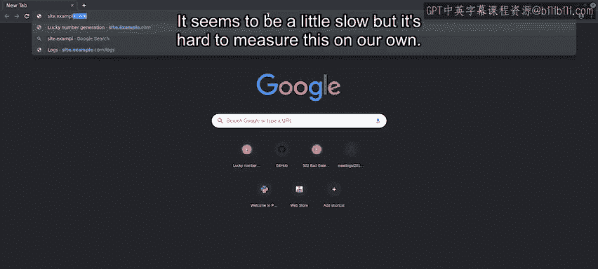
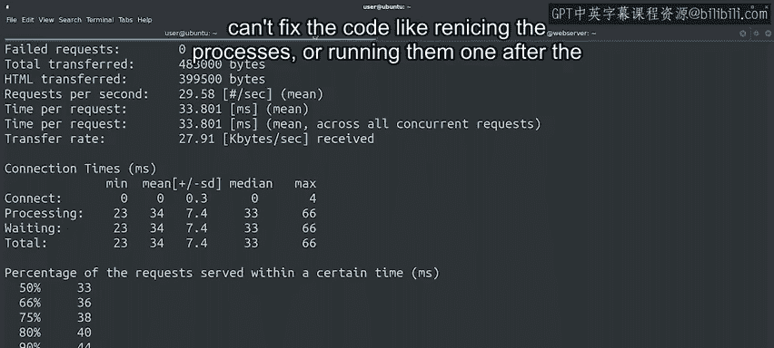

# 谷歌《用Python进行IT自动化办公3、4、5、6课（Git、debug、云端、实践）Google IT Automation with Python》中英字 - P76：18_网站服务器运行缓慢.zh_en - GPT中英字幕课程资源 - BV1LW4y1F7XW

🎼Yeah。

A user has alerted us that one of the web servers in our company is being slow and we need to figure out what's going on。

 Let's start by navigating to the website and loading the page。

Okay， we see that the page loads， it seems to be a little slow。

But it's hard to measure this on our own Let's use a tool called AB。

 which stands for Apache benchmarkch tool to figure out how slow it is We'll run ABN500 to get the average timing of 500 requests and then pass our site。

example。com for the measurement。This tool is super useful for checking if a website is behaving as expected or not。

It will make a bunch of requests and summarize the results once it's done。Here。

 we're asking for it to do 500 requests to our website。

 there are a lot more options that we could pass， like how many requests we want the program to do at the same time。

 or if the test should finish after timeout， even if not all requests completed we're making 500 requests so that we can get an average of how long things are taking。

 once the test finishes， we can look at the data and decide if it's actually slow or not。All right。

 the tool is finished running the 500 requests and we see that the mean per requests was 155 milliseconds。

While this is not a super huge number， it's definitely more than what we'd expect for such a simple website。

It seems that something is going on with the web server， and we need to investigate further。

Let's connect to the web server and check out what's going on。

We'll start by looking at the output of top and see if there's anything suspicious there。Hm。

 we see that there's a bunch of FFM peg processes running。

 which are basically using all the available CPU。See those load numbers 30 is definitely not normal。

 Remember that the load average on Linux shows how much time a processor is busy in a given minute with one meaning it was busy for the whole minute。

This computer has two processors， so any number above two means that it's overloaded。

During each minute， there were more processes waiting for processor time than the processor had to give。

This FFM PEG program is used for video transcoding。

 which means converting files from one video format to another this is a CPU intensive process and seems like the likely culprit for our server being overloaded。

So what can we do？One thing we can try is to change the process's priorities so that the web server takes precedence。

The process priorities in Linux are so that the lower the number， the higher the priority。

 typical numbers go from  zero to 19。By default， processes start with a priority of zero。

 but we can change that using the nice and re niceice commands。

 we'll use nice for starting a process with a different priority and renice for changing the priority of a process that's already running。

Okay， let's exit top with Q and change the priorities。

We want to run Renice for all the FFM peG processes that are running right now。

We could do this one by one。But it would be manual， errorprome， and super boring。 Instead。

 we can use a quick line of shell script to do this for us。For that。

 we'll use the PiI of command that receives the process name and returns all the process IDs that have that name。

We'll iterate over the output of the Pi of command with a floor loop。

 and then call Renice for each of the process IDs。Reice takes the new priority as the first argument and the process I to change as the second one In our case。

 we want the lowest possible priority， which is 19。

 so we'll call for P in dollar sign parenthesesis P of FFM peg。Clsose parenthey， semicolon。

 do re nice 19 Do sign P， semicolon， done。All right。

We see that the priorities for those processes were updated。

Let's run our benchmarking software again and check out if it made any difference。Okay。

 it's running once again， we'll need to wait until the 500 requests are done and check out the new mean time per request value。

This time， the mean time is 153 milliseconds。 it doesn't seem like our Reis helped。Apparently。

 the OS is still giving these FFM PEg processes way too much processor time and our website is still slow。

What else can we do these transcoding processes are CPU intensive and running them in parallel is overloading the computer。

 so one thing we could do is modify whatever' is triggering them to run them one after the other instead of all at the same time。

To do that， we'll need to find out how these processes got started。 First。

 we'll look at the output of the PS command to get some more information about the processes。

 we'll call PSAX， which shows us all the running processes on the computer and we'll connect the output of the command to less to be able to scroll through it。

Now we'll look for the FFM PEG process using slash， which is the search key when using less。Okay。

 we see that there are a bunch of FFM PEG processes that are converting videos from the WebM format to the MP4 format。

We don't know where these videos are on the hard drive。

 We can try using the locate command to see if we can find them。

 We'll first exit the less interface with Q and then call locate static s 001。 webm。

We see that the static directory is located in the server deployloy V directory。

Let's change into that directory and see what we find。There's a bunch of files here。

 we could check them all one by one to see if one of them contained a call to FFM Peg。

 but that sounds like a lot of manual work。Instead。

 let's use GrP to check if any of these files contains a call to FFMPG。

So we see that there's a couple of mentions in the Deer SH file。Let's take a look at that one。

Since we're connecting to this server remotely， we can't open the file using a graphical editor。

We need to use a command line editor instead。We'll use viM in this case。

We see that this script is starting the FFM peG processes in parallel。

 using a tool called Damonize that runs each program separately as if it were a Damon。

This might be okay if we only need to convert a couple of videos。

 but launching one separate process for each of the videos in the static directory is overloading our server。

 so we want to change this to run only one video conversion process at a time we'll do that by simply deleting the demonized part and keeping the part that calls FFMg thenSafe and exit。

All right， we've modified the file， but this won't change the processes that are already running。

We want to stop these processes but not cancel them completely。

 as doing so would mean that the videos being converted right now will be incomplete。

So we'll use the kill all command with the dash stop flag， which sends a stop signal。

 but doesn't kill the processes completely。We now want to run these processes one at a time。

How can we do that？We could send the CAt signal to one of them wait till it's done。

 and then send it to the next one， but that's a lot of manual work。Can we automate it。Yes。😊。

But it's a little tricky， so pay close attention。 we can iterate through the list of processes using the same for loop with the pit of command that we used earlier。

Inside the for loop， we want to send the cont signal and then wait until the process is done。

Unfortunately， there's no command to wait until the process finishes。

 but we can create a while loop that sends the cont signal to the process。

 This will succeed as long as the process exists and fails once the process goes away。

Inside this while loop， we'll simply add a call to sleep one to wait one second until the next check。

Okay， now our server is running one FFM peg process at a time。Let's try our benchmark once more。

The mean is now 33 milliseconds， that's much lower than before。

We've managed to get our web server to reply promptly to the request again。

We've mentioned a few different approaches that we can take when we can't fix the code。

 like reniizing the processes or running them one after the other when that doesn't help in our next few videos。

 we'll talk about how to improve performance by fixing our code。But before that。

 there's a reading to put all the resources we mentioned in one place and then a quick quiz to check if everything is making sense。

