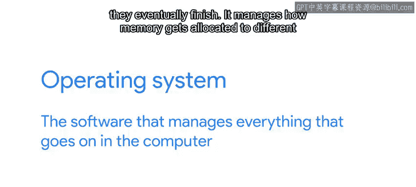
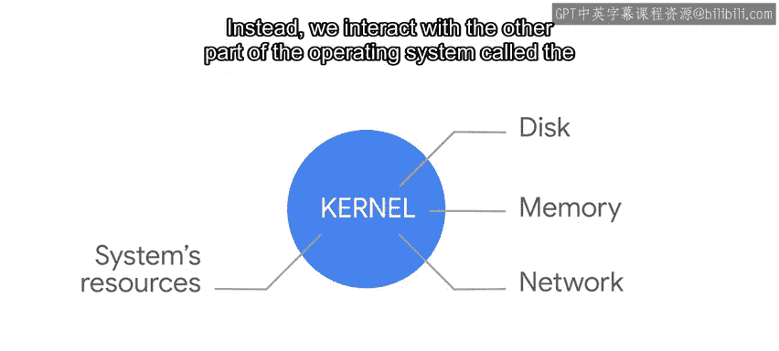
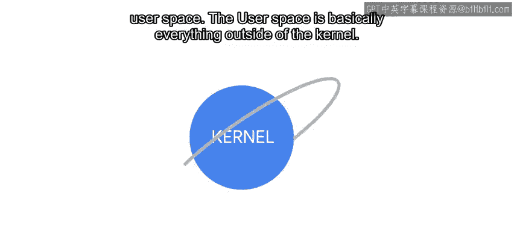
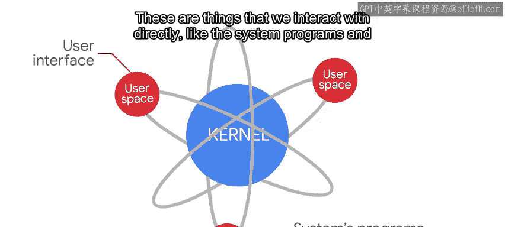
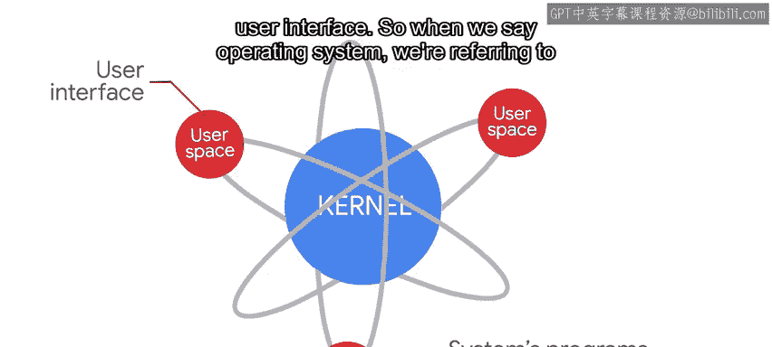
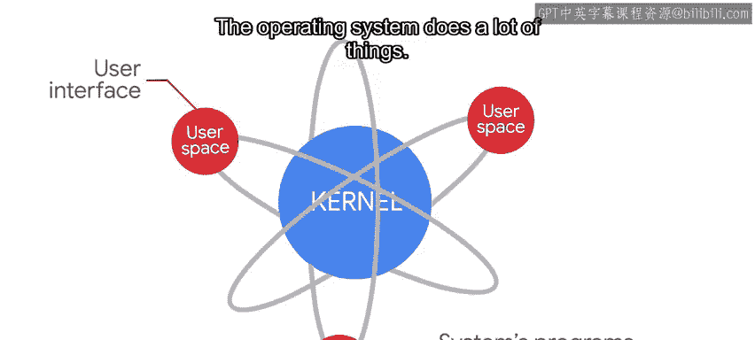
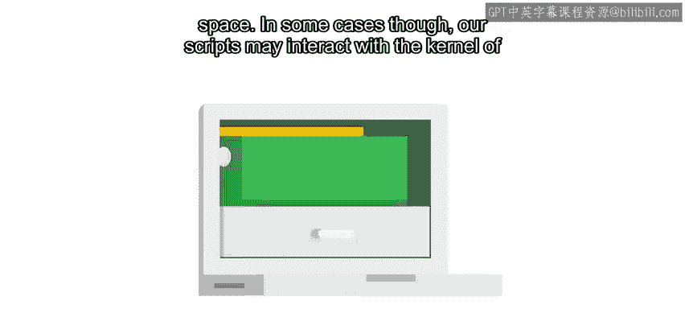
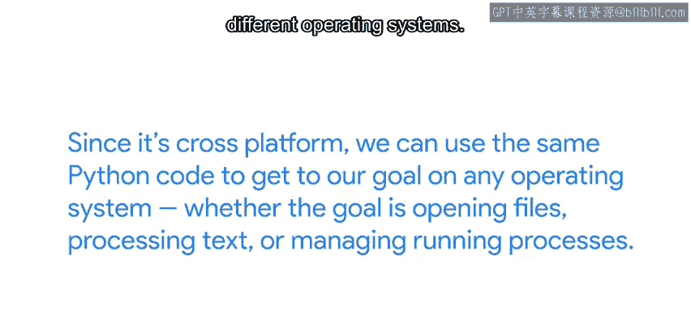

# 谷歌《用Python进行IT自动化办公1、2课（Python、控制操作系统）｜Google IT Automation with Python》中英字幕 - P76：2_熟悉操作系统.zh_en - GPT中英字幕课程资源 - BV1gw411E7E1

🎼。う。

In this course， we'll interact with the operating system a lot。

 so before we deep dive into more complex concepts。

 let's do a quick rundown of what we mean when we talk about the operating system or OS for short。

The operating system is a software that manages everything that goes on in the computer， it reads。

 writes， and deletes files from the hard drive。

It handles how the processes start， how they interact with each other and how they eventually finish。

It manages how memory gets allocated to different processes。

 how network packets are sent and received， and how each programming can access the different hardware components Basically。

 the OS is a total boss and doesn't mess around。There are actually two main parts in operating system。

 the kernel and the user space。

The kernel is the main core of an operating system。

 it tus directly to our hardware and manages our systems resources。

As users， we don't interact with the kernel directly。

Instead， we interact with the other part of the operating system called the user space。

The user space is basically everything outside of the kernel。

These are things that we interact with directly， like the system programs and user interface。

So when we say operating system， we're referring to both the kernel and the user space。

The operating system does a lot of things。 It does so much that we need a bunch of courses to cover all of it。

But for this course， we'll focus on managing files and processes。

On the OS running on your computer。The scripts we write will all run in the user space。

 In some cases， though， our scripts may interact with the kernel of the operating system to get extra information or to ask it to perform certain operations。

As you probably already know， there's a lot of different operating systems out there。

The major operating systems using IT today are Windows， MacOS， and Linux。

The Windows operating system is developed by Microsoft and is widely used in the business and consumer space。

Most PCs come with Windows as the default operating system。

Mac OS is developed by Apple and is mainly used in the consumer space。

If you purchase any Apple computer， it'll come with Mac OS preloaded。

Linux is an open source operating system。Open source software is free to share。

 modify and distribute score。 Linux is used heavily in business infrastructure。

Most servers in the world today are running Linux。It's also available in the consumer space。

 although less common， Linux itself is actually the name of the kernel originally developed by Linuxnus Torvas。

 Also a total boss because of the evolution of the rest of the operating system。

 We typically use Linux to refer to both the kernel and the whole operating system。 Today。

 Linux has grown into a huge community effort with developers all over the world contributing to its success。

Because Linux is open source， a lot of different organizations package their own versions of it。

 unlike Windows or Mac OS， which are solely developed by their respective companies。

We refer to these different flavors of Linux as distributions。

Some common Linux distributions are Uunsu， Dian， and Red Hat。If you heard of Chrome O OS。

 you may know that it's another operating system based on the Linux kernel。

 but unlike other distributions， Chrome OS OS is usually considered an OS in its own right。Lastly。

 the Android operating system， which is used a lot on smartphones， also runs a Linux kernel。

You may have also heard of Unix。Uunix is an operating system developed back in the 70s by Bell Labs。

After its original release， the OS went through a bunch of different versions with different companies releasing variants of it。

The fundamental ideas of how Linux works today are based on the UniX principles。

And a lot of the tools that we use to interact with the operating system are open source versions of those originally developed for UniX。

This is why these tools and operating principles are usually referred to as UniX。

 even though the OS we're using is called Linux， So Linux created Linux， which is based on Unix。

 it's basically a programming tongue twister， try setting it 10 times fast the Mac OS kernel and some of its user space are also based on a kernel and user space tools from the Uniix family known as BSD So although the graphical interface is extremely different between the two。

 the command line is actually pretty similar。 Like we said earlier in this course we'll use Python interact of the operating system。

 Python is a crossplatform language， you can use it on Windows， Mac。

 Linux and even lesser known Unix variant like free BSD。It's even available on mobile phones。

Since its cross platform， we can use the same Python code to get to our goal on any operating system。

 whether the goal is opening files， processing text， or managing running processes。

This makes Python a great tool for IT specialists who need to interact with different operating systems。

You can apply the skills that you learn from one platform to all the others。 So how helpful is that。

As we called out before， for the exercises in discourse， we'll be practicing with Linux computers。

 We've chosen Linux because it's the industry standard when it comes to server that are managed remotely and through automation。

When it's relevant， we'll also talk about how the same concepts will apply to Windows or Mac OS OS。

In my job as a Ss admin， I mainly work with the Linux operating system。

I grew up using Windows computers and interacted with them through the graphical interface。

 The very first time I used Linux was when I was a teenager and my PC crashed。

 It wouldn't boot up into the user environment。 I had a lot of different files and docs。

 I didn't want to give up。😊，So I did some research and on a friend's computer。

 I burned a portable Linux O S called Slacks onto a C D。

 I got my PC boot up from there and was able to rescue most of my files。😊。

Learning Links opened up a whole new world of customization and configuration for me。

When I first started， I found it really interesting， intriguing， and even a little bit scary。 Today。

 Linux is the primary OS I use to work every day。We've learned a bunch of things about operating systems and their histories。

 If all those different names are making you feel like your human operating system is crashing。

 don't worry。😊，You'll pick it up as we go along。 now that we know we're on the same page when we say OS in the next video。

 we're going to get our computer ready to work with Python。

