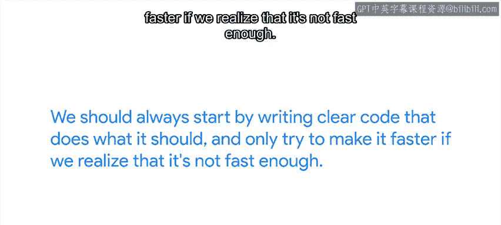
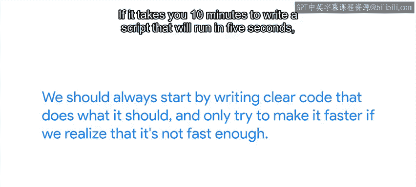
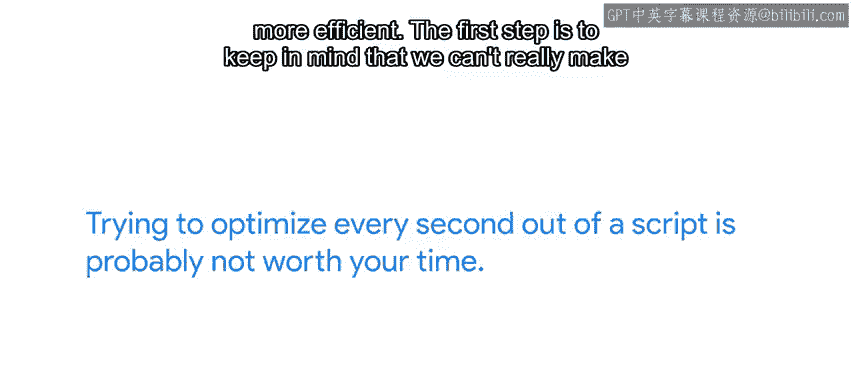
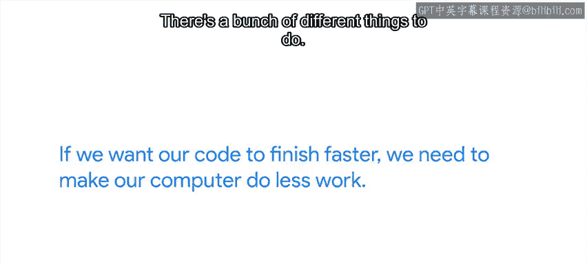
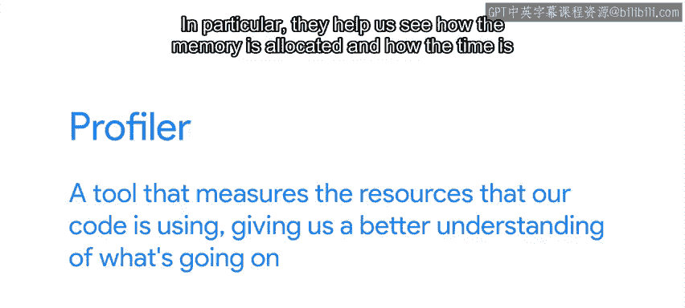
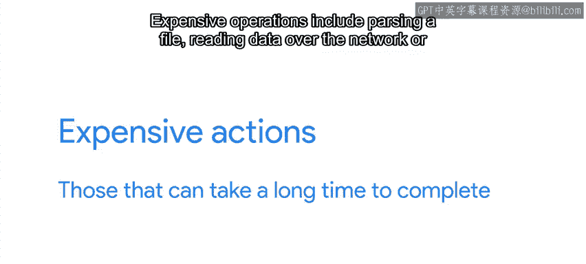

# 谷歌《用Python进行IT自动化办公3、4、5、6课（Git、debug、云端、实践）Google IT Automation with Python》中英字 - P77：19_编写高效代码.zh_en - GPT中英字幕课程资源 - BV1LW4y1F7XW

🎼Yeah。

In your role as an I specialist or systems administrator。

 you'll likely need to write scripts to automate tasks。

 A piece of code may start as a simple script that does a single thing。

 but end up growing into a complex program that handles many different tasks。

 and no matter the size and complexity of our code。

 we usually want it to perform well in this and the next few videos well discuss some ideas for how to make our code more efficient and how to figure out what needs fixing if it's slow。

 What important thing to keep in mind， though， is that we should always start by writing clear code that does what it should and only try to make it faster if we realize that it's not fast enough。

😊。

If it takes you 10 minutes to write a script that will run in 5 seconds and 20 minutes to write a script that will do the same。

 but take 3 seconds， Does it make a difference， It all depends on how often you run the script。

 If you run it once a day， the two seconds difference。

 definitely won't justify the additional 10 minutes of work。

But if you're going to run the same script for the 500 computers on your network。

 that small difference means it will take 15 less minutes to run the whole script。 So overall。

 you're gaining time， of course， it's pretty hard to know in advance how fast your script will be and how long it will take you to make it faster。

But as a rule， we aim first to write code that's readable， easy to maintain and easy to understand。

 because that lets us write code with less bugs。 if there's something that's super slow， then yes。

 it makes sense to fix it。Particularly if the script will be executed frequently enough。

 that making it faster will save you more time than the time you spend optimizing it， but remember。

 trying to optimize every second out of a script is probably not worth your time。

Okay， with that said， let's dive into how we can make our code more efficient。

 The first step is to keep in mind that we can't really make our computer go faster。

 if we want our code to finish faster， we need to make our computer do less work。

And to do this， we'll have to avoid doing work that isn't really needed。

 How there's a bunch of different things to do。 The most common ones include storing data that was already calculated to avoid calculating it again。

 using the right data structures for the problem。And reorganizing the code so that the computer can stay busy while waiting for information from slow sources like disk or over the network。

To know what sources of slowness we need to address。

 we have to figure out where our code is spending most of its time。

 There's a bunch of tools that can help us with that called Profilrs。

 A profiler is a tool that measures the resources that our code is using。

 giving us a better understanding of what's going on。

In particular， they help us see how the memory is allocated and how the time is spent because of how profilers work。

 they are specific to each programming language， so we would use GProf to analyze a C program。

 but use the C profilefi module to analyze a Python program。Using tools like these。

 we can see which functions were called by our program， how many times each function was called。

 and how much time our program spent on each of them this way we could find， for example。

 that our program is calling a function more times than we originally intended。

Or that a function that we thought would be fast is actually slow to fix our code well probably need to restructure it to avoid repeating expensive actions。

What do we mean by expensive in this context， expensive actions are those that take a long time to complete。

Expensive operations include parsing a file， reading data over the network。

 or iterating through a whole list。Okay， and how do we modify our code to avoid expensive operations we'll discuss a few strategies in our next videos。

