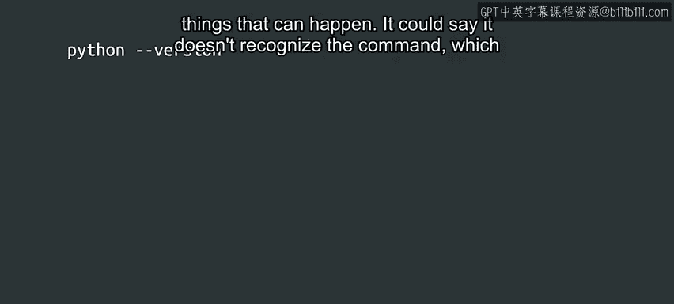
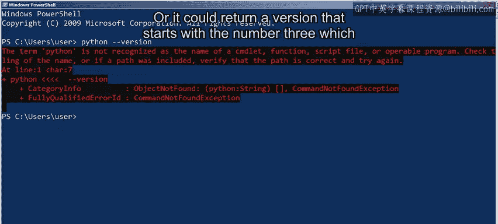
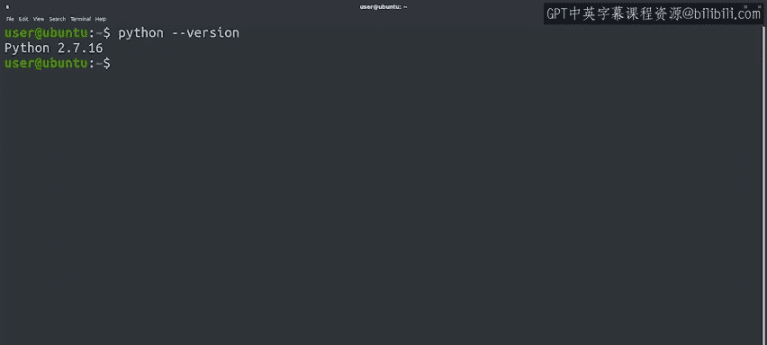
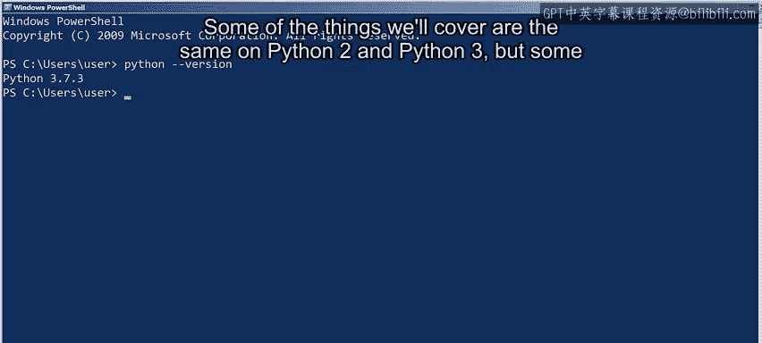
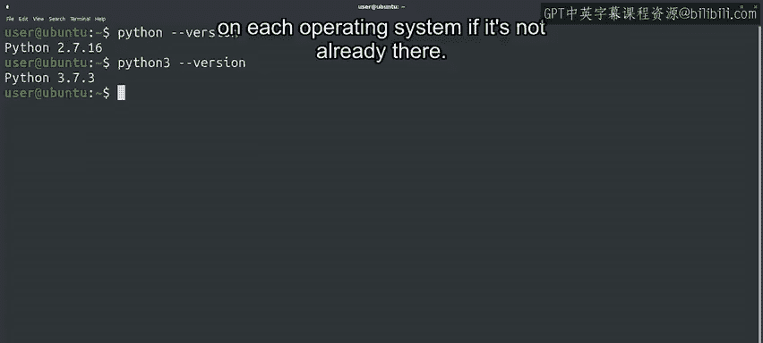

# 谷歌《用Python进行IT自动化办公1、2课（Python、控制操作系统）｜Google IT Automation with Python》中英字幕 - P77：3_为 Python 准备计算机.zh_en - GPT中英字幕课程资源 - BV1gw411E7E1

🎼。う。

They say that the best way to learn is to practice practice practice， and then practice some more。

 so we encourage you to practice the exercises in this course by running the scripts on your computer doinging this will help you hone your programming skills as much as possible and can spark new ideas of things that you could do through programming。

As an IT specialist， it's important to know how to install and uninstall software in different operating systems to run Python locally。

 you need to have it installed on your computer。We'll give you some pointers in the next videos on how to do this for Python。

 but we also encourage you to research how to manage your platform on your own。

If you feel like you can use a refresher on how to do some basic operations in your OS。

 like installing packages or running commands， I recommend you take the course operating Systems and you becoming a power user。

This course is taught by my colleague， Cindy， and can really help you get up to speed on O Ss。

 You'll find a link to it in the next reading。As we said in the last video。

 you can use Python on all major operating systems， so it doesn't matter if you're running Windows。

 Mac OS or Linux， you should be able to run Python locally on your computer。

It may even already be installed of your system。To check whether you already have Python installed on your computer。

 open a terminal or command prompt and execute the Python command。

 passing dash dash version as a parameter。

Depending on what's installed on your computer， there's a bunch of different things that can happen。

 It could say it doesn't recognize the command， which means you don't have Python installed。

It could return a version that starts with the number two。

 which tells us that you have it installed but it's Python 2。

 or it could return a version that starts with number3， which means you guessed it。

 you have Python 3 installed。

For this course， we'll be using Python 3。Some of the things we'll cover are the same on Python 2 and Python 3。

 but some can be pretty different。So make sure you have Python 3 installed If running Python dash dash version returns a version starting with two。

 try running Python 3 dash dash version。Your computer could tell you that the command isn't present。

 which means you'll have to install Python 3。Or if you return a version that starts up with number three。

 which means you already have Python 3 installed。

In the next few videos， we'll talk about how to install and set up Python on each operating system if it's not already there。

After checking that you have Python 3 installed， we'll also learn about installing additional modules that aren't part of the Python Standard library。

You'll need these additional modules for some specific exercises in the course。

What are these additional modules that we were talking about？In the intro to Python course。

 we talked about the Python Standard Library。This comes as part of the Python installationsulation and includes modules for the most common tasks you can do with Python。

But there's tons of other things you might want to do in your scripts and not all of them are in the standard library。

 This is where external modules come into play。We can use external modules for a bunch of tasks like generating PDFs。

 serving web pages， creating compressed files， interacting with email and a load of other things。

 So how do we find what modules are available？When developers write a Python module that they think others might find useful。

 they publish it in PP， also known as the Python package Inex。

 we can browse this repository of Python modules to find the module we need。

It includes thousands of projects which are classified by different categories like topic。

 development status， and intended audience。These external modules are generally managed with a command line tool called PIip。

This is a cross platform tool so you can use it to install， update。

 and remove external modules on whichever operating system you're running on your computer。Next up。

 we're going to talk about installing main Python packages and installing external modules on Windows。

 Mac OS and Linux。 These videos are all optional。 You can watch the ones most relevant to you。

 or if you have Python already installed in your computer and you already know how to install external modules。

 feel free to skip ahead。