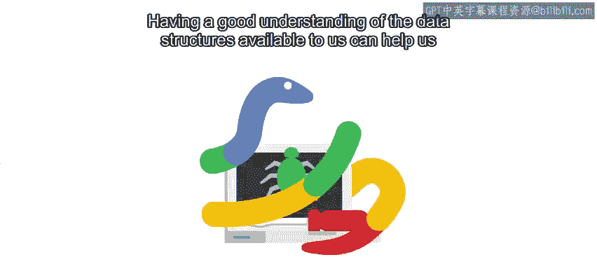
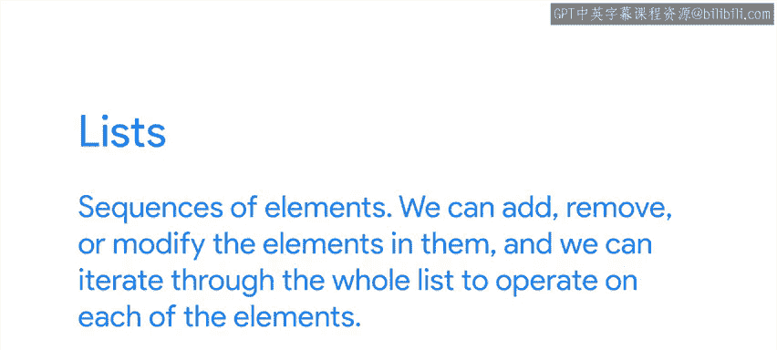
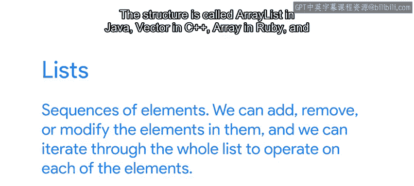
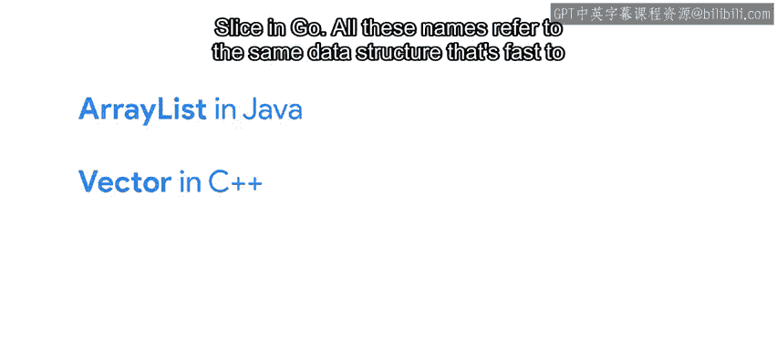
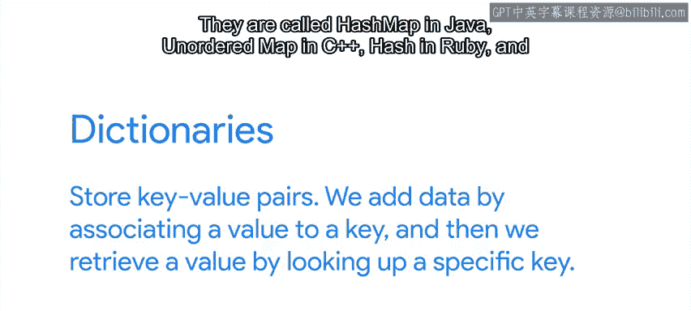
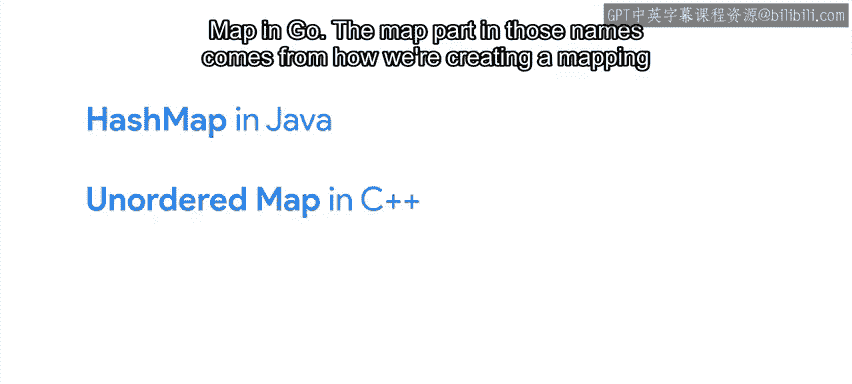
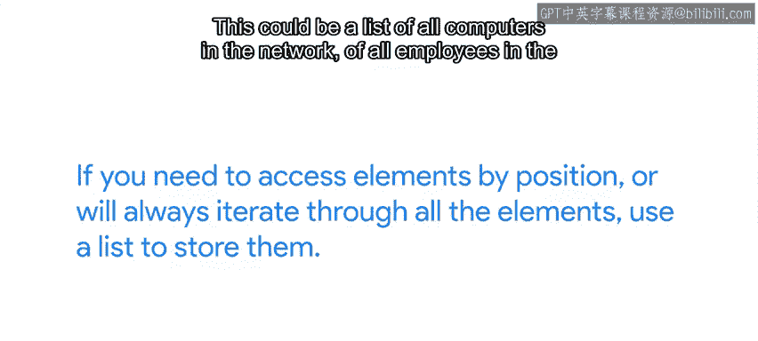
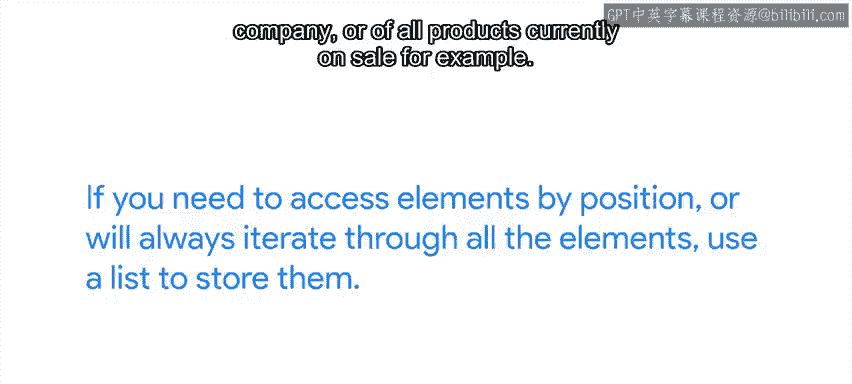
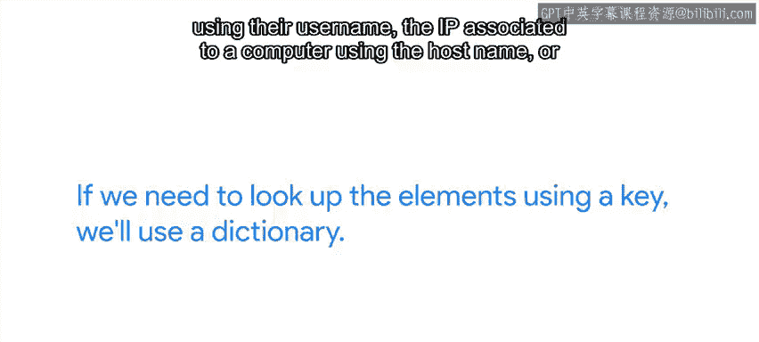

# 谷歌《用Python进行IT自动化办公3、4、5、6课（Git、debug、云端、实践）Google IT Automation with Python》中英字 - P78：20_使用合适的数据结构.zh_en - GPT中英字幕课程资源 - BV1LW4y1F7XW

🎼Yeah。

Having a good understanding of the data structures available to us can help us avoid unnecessary。

 expensive operations and create efficient scripts。 in particular。

 we'll want to understand the performance of those structures under different conditions In the introductory course to Python。

 you learned about a bunch of different data structures available in Python， like lists， Tuples。

 dictionaries and sets。😊，Each of them have their uses， their advantages and disadvantages。

 Let's do a very quick recap of lists and dictionaries。 Ls are sequences of elements。 We can add。

 remove or modify the elements in them， and we can iterate through the whole list to operate on each of the elements。

😊。

Different programming languages call them differently。The structure is called array list in Java。

 Ve in C++， array in Ruby， and slice and go。

All these names refer to the same data structure that's fast to add or remove elements at the end。

 but adding or removing elements in the middle can be slow because all the elements that follow need to be repositioned。

 It's fast to access the element in a specific position in the list。

 but finding an element in an unknown position requires going through the whole list。

This can be super slow if the list is long。 Dictionaries store key value pairs。

 We add data by associating a value to a key， and then we retrieve a value by looking up a specific key。

They're called hashmap in Java unordered map in C++ hash in Ruby and map and Go。

The map part in those names comes from how we're creating a mapping between a key and a value。

The hash part comes from the fact that to make the structure efficient。

 a hashing function is used internally to decide how the elements will be stored。

 The main characteristic of this structure is that it's super fast for looking at keys。

 once we have our data stored in a dictionary， we can find the value associated to a key in just one operation。

 if it were stored in a list， we need to iterate through the list。 So as a rule of thumb。

 if you need to access elements by position， or we'll always iterate through all the elements。

 use a list to store them。😊。

This could be a list of all computers in the network， of all employees in the company。

 or of all products currently on sale， for example。On the flip side。

 if we need to look up the elements using a key， we'll use a dictionary。

This could be the data associated to a user， which we'd look up using their username。

The IP associated to a computer using the host name or the data associated to a product。

 using the internal product code whenever we need to do a bunch of these lookup operations。

 creating a dictionary and using it to get the data will take a lot less time then iterating over a list to find what we're looking for。

 but it doesn't make sense to create a dictionary and fill it with data if we're only going to look up one value in it。

 In that case， we're wasting time creating the structure。

 when we could just iterate over the list and get the element we're looking for。

Another thing that we might want to think twice about is creating copies of the structures that we have in memory。

If these structures are big， it can be pretty expensive to create those copies。

 So we should double check if the copy is really needed。 All right。

 now that we have a better understanding of when to use each data structure and what actions to avoid。

 we can look into how to deal with expensive loops。 that's coming up in our next video。

