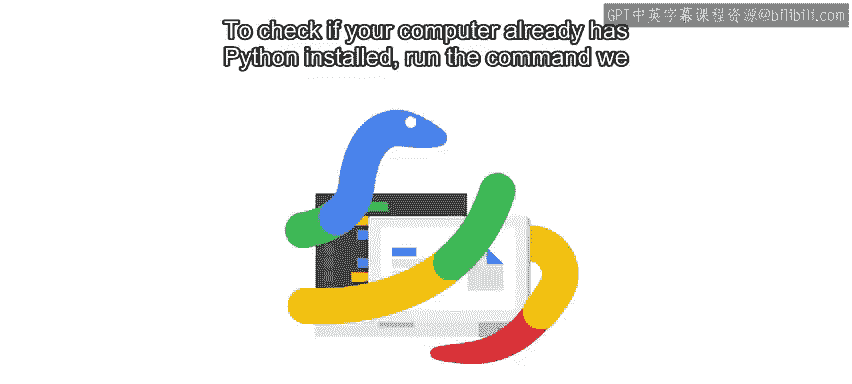
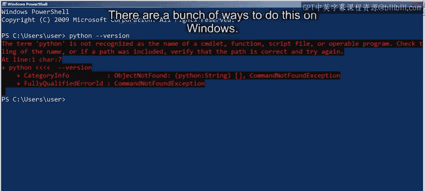
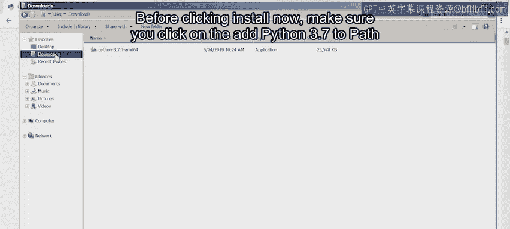
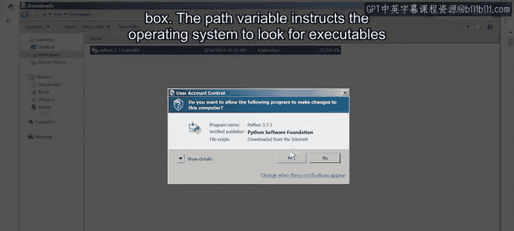
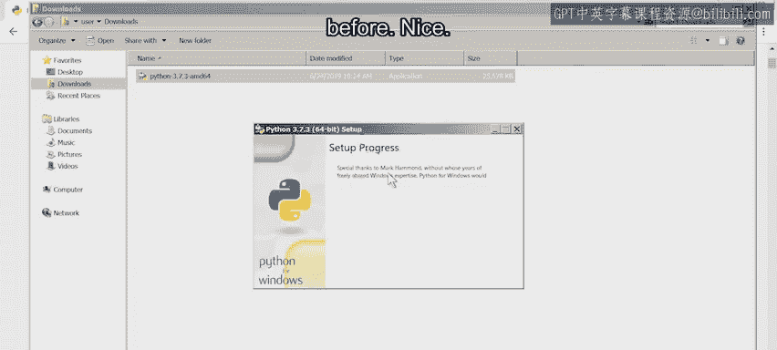
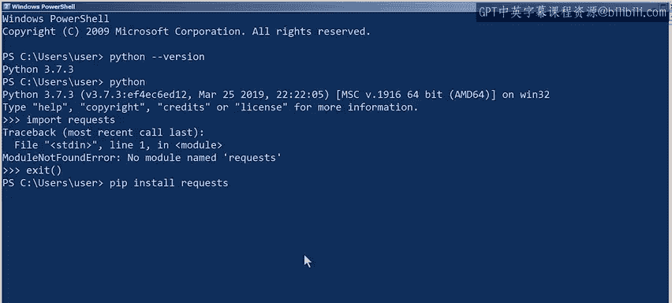

# 谷歌《用Python进行IT自动化办公1、2课（Python、控制操作系统）｜Google IT Automation with Python》中英字幕 - P78：4_在 Windows 上配置环境（可选）.zh_en - GPT中英字幕课程资源 - BV1gw411E7E1

🎼。う。

Windows computers don't usually come with Python pre installedsalled。

To check if your computer already has Python installed， run the command we talked about earlier。

 Python， dash， dash version。

Nope， no Python here。 Python isn't installed on this computer， so we'll need to install it。

 There are a bunch of ways to do this on Windows。 We can download the installable package from the official website and install that one。

 get it from the store if we're using Windows 10， or we can use a package management system called Choity to manage the installation。

For this video， we're just going install the package from the official website。

 But if you'd like to get a taste of chocolatey， you can check it out and download it on your own because who doesn't like things。

 a little extra chocolateluy， right， To find the installer。

 go to the official download page for Windows。😊，On this page。

 we can download the executable installer for the Python 364 B architecture。

Most computers today are installed with 64 bit installations。 So if you don't know which one to pick。

 pick that one。Unless you know for sure that your computer is running a 32 B installation。

Once the executable installer has downloaded， we want to run it。

This will install a new software on our machine， so we need to run it as the administrator user。

Before clicking installst now， make sure you click on the add Python 3。7 Pa box。

The path variable instructs the operating system to look for executables in certain directories of our system when running commands from the terminal。

You want to have that box selected so that Python interpreter gets executed when we invoke it from the command line。

Great， it's installing。 It might take a moment。

Now that it's done， we can test to see if it worked。

We do this by opening a new powerhe and executing the same command as before。 Nice。

 we now have an executable Python interpreter that we can use for testing the scripts that we write。

😊，As we called out， just because we've got Python 3 installed。

 it doesn't mean that we have the modules we might need for every possible script。

 let's say we're tasked with writing some automation that extracts information out of a website。

To get the contents of a website from Python， we can choose the Re module which is used for interacting with web services。

First， let's check whether we have this module already available。Darn。

 the interpreter tells us that the module isn't available。

 let's install it using PIP to do that we'll call PIip install requests from the command line。

 not the interpreter。

A yeah。We've now got the module installed。 Let's try to import it again， from the interpreter。系。

Awesome， it worked。And just to double check that， let's try to do something with this module。

 For example， we can use the get function to get the contents of a website。

So the get function processed the website and the response object now has its contents。

We can do a bunch of things with it。How about we check the length of the response to text using the L function。

Fantastic。Now that we have Pythons set up on our Windows environment。

 we are ready to have some fun with it。Feel free to explore on your own and try some things out。

Up next， I'll show you how to install Python on Mac OS。

 You can check that one out or you can skip ahead。 It's up to you。

