# 谷歌《用Python进行IT自动化办公3、4、5、6课（Git、debug、云端、实践）Google IT Automation with Python》中英字 - P79：21_低效循环.zh_en - GPT中英字幕课程资源 - BV1LW4y1F7XW

🎼Yeah。

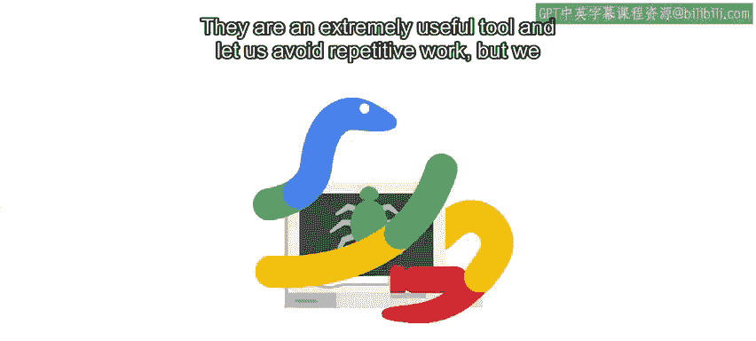

Loops are what make our computers do things repeatedly。

 They're an extremely useful tool and let us avoid repetitive work。

But we need to use them with caution In particular。

 we need to think about what actions we're going to do inside the loop and when possible。

 avoid doing expensive actions。 If you do an expensive operation inside a loop。

 you multiply the time it takes to do the expensive operation by the amount of times you repeat the loop。

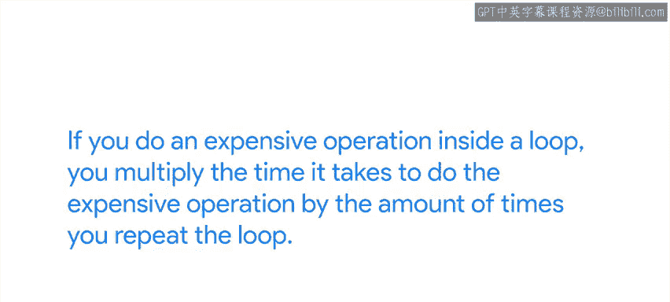

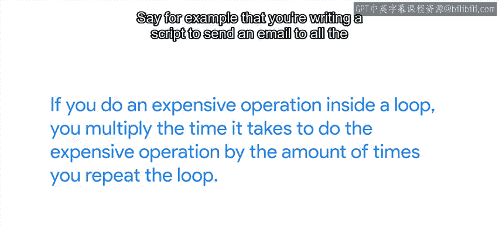

Say for example， that you're writing a script to send an email to all the employees at your company。

 asking them to verify that their emergency contact information is still valid。

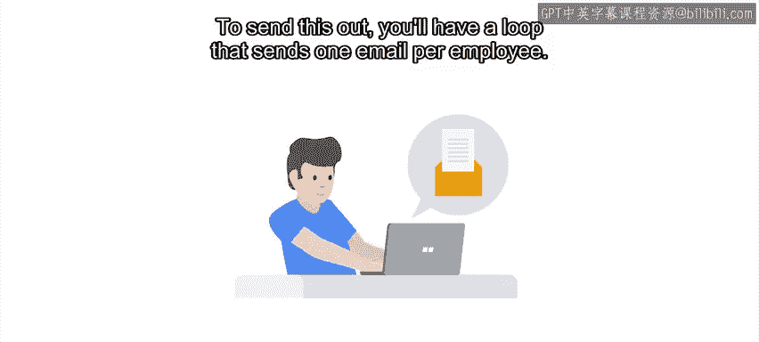

To send this out， you'll have a loop that sends one email per employee and in the body of the email。

 you'll include the current emergency contact data。

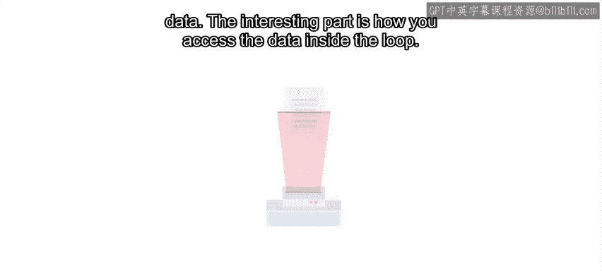

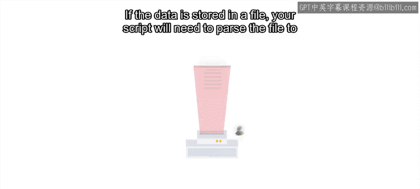

The interesting part is how you access the data inside the loop。If the data is stored in a file。

 your script will need to parse the file to fetch it。

 if the script reads the whole file for every user。

 you'll be wasting a lot of time parsing the file over and over unnecessarily Instead you could parse the file outside of the loop。

Put the information into a dictionary and then use the dictionary to retrieve the data inside the loop。

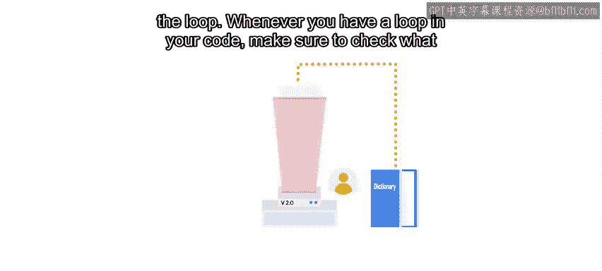

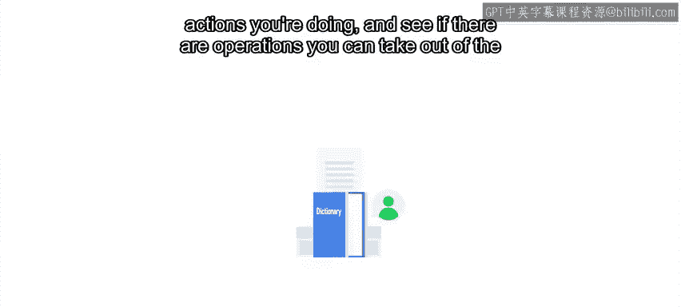

So whenever you have a loop in your code， make sure to check what actions you're doing and see if there are operations you can take out of the loop to do them just once instead of making one network call for each element。

 make one call before the loop instead of reading from disk for each element。

 read the whole thing before the loop and even if the operations done inside the loop aren't especially expensive。

 if we're going through a list of1000 elements and we only need five out of them。

 we're wasting time on elements we don't need。So make sure that the list of elements that you're iterating through is only as long as you really need it to be。

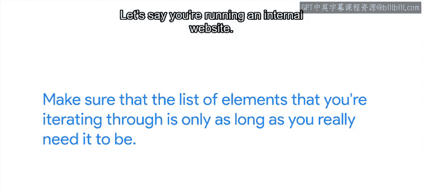

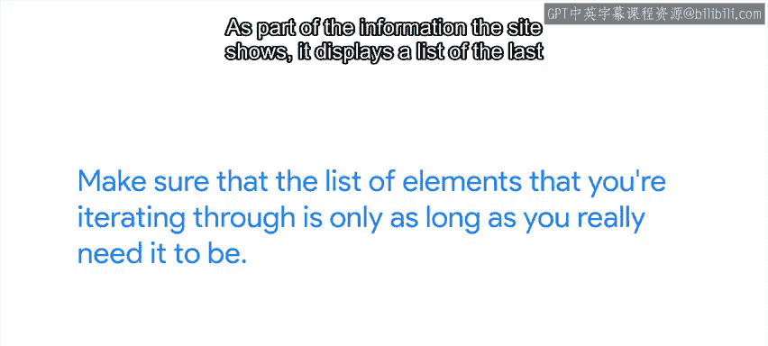

Let's say you're running an internal website。As part of the information the site shows。

 it displays a list of the last five users that logged in。

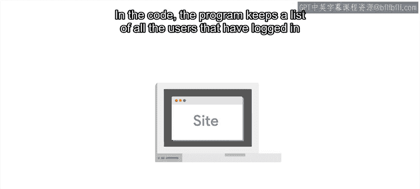

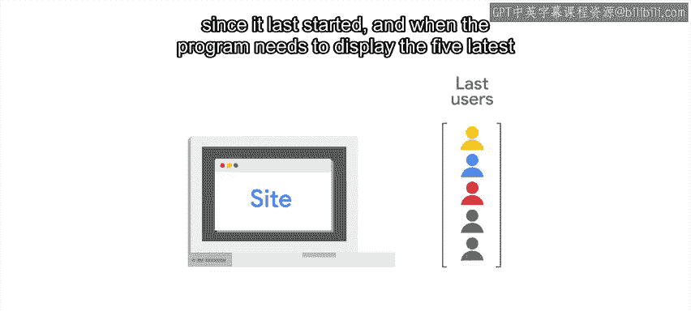

In the code， the program keeps a list of all the users that have logged in since it last started。

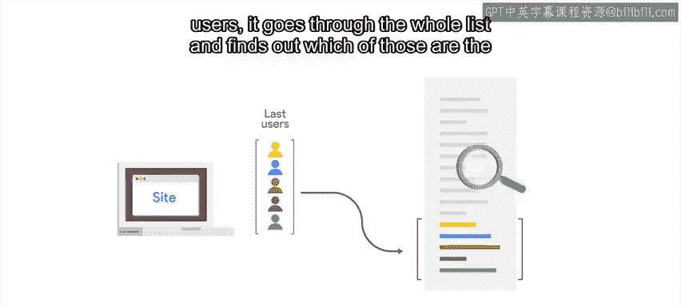

And when the program needs to display the five latest users。

 it goes through the whole list and finds out which of those are the five most recent。

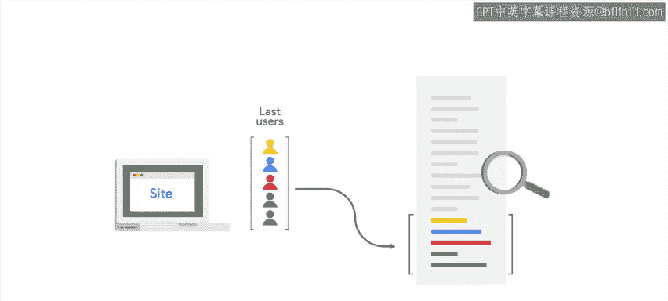

This wastes a lot of time and if the service has been running for a while。

 it can take really long to go through the whole list。Instead。

 you could modify the service to store the user access info in log files that can be read if necessary and only keep the last five logins in memory。

 So whenever a new user logs in， the oldest entry in the list gets discarded and a new one gets added。

😊。

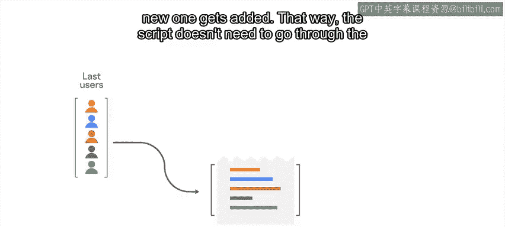

That way， the script doesn't need to go through the whole list every time it needs to display the five most recent users。

 Another thing to remember about loops is to break out of the loop once you found what you were looking for。

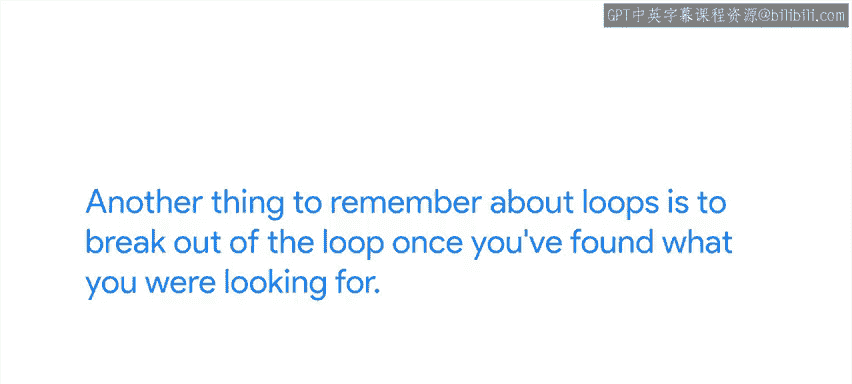

In Python， we do this using the keyword breakak。Breaking out of loops means that as soon as the data we're looking for is found。

 our script can continue。 Of course， if the data is at the end of the list。

 then we need to go through the loop anyway。 But when the data is at the beginning of the list and not at the end。

 it makes sense to have our code break early to make the script faster。

Say your writing a script that checks of a given username is within the list of authorized entities。

 and if it is， it grants some access to a particular resource。

 You can use a floor loop to iterate through the list of entities。 and when the username is found。

 you can break out of the loop and continue the rest of the script。

One last thing to keep in mind is that the right solution for one problem might not be right for a different problem。

 sayy your service has a total of 20 users。 In that case。

 it's okay to go over this list whenever you want to check something。

 it's short enough that you don't need to do any special optimization。

 but if your service has over1 thousand0 users， you'll want to avoid going through that list unless absolutely necessary。

And if the service has hundreds of thousands of users。

 going through that list isn't even a possibility Up next。

 we'll talk about what we can do when the expensive operations are already outside of our loops。😡。

