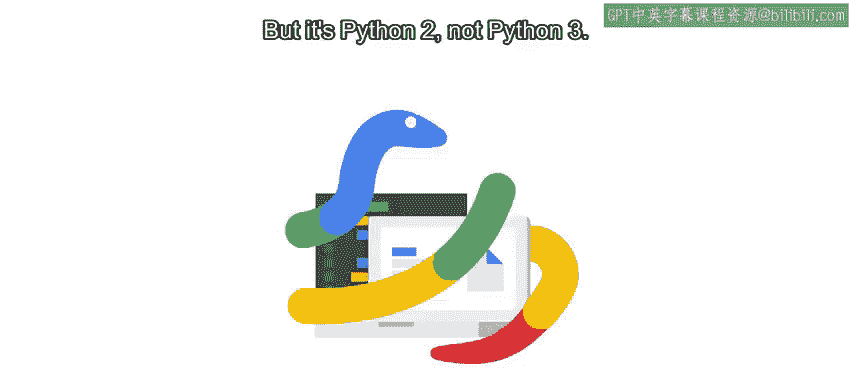
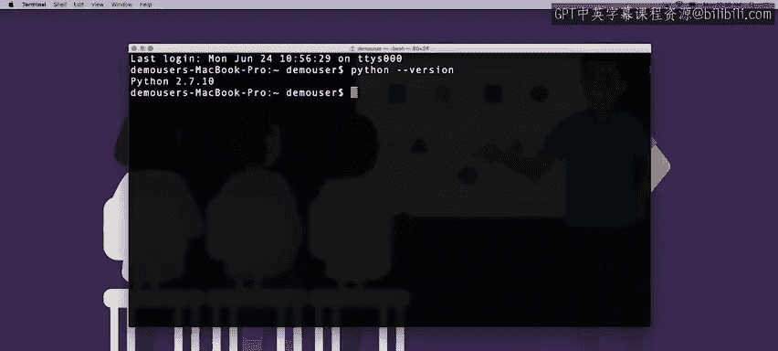
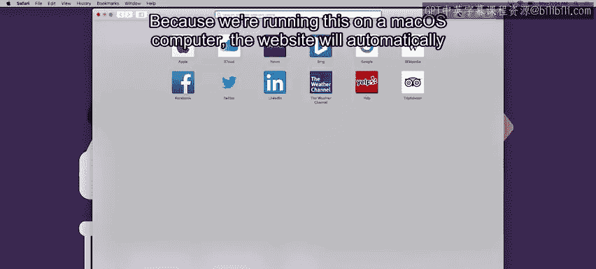
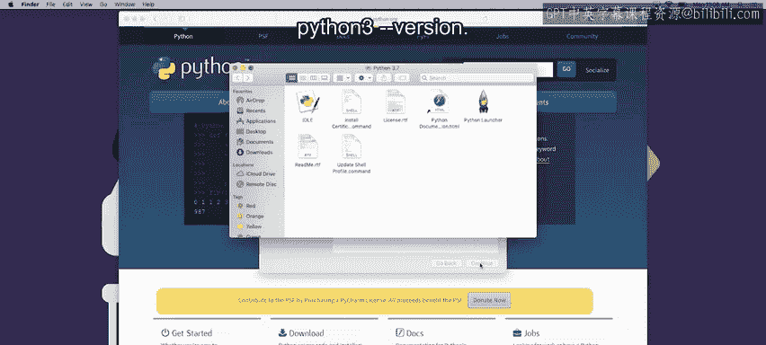
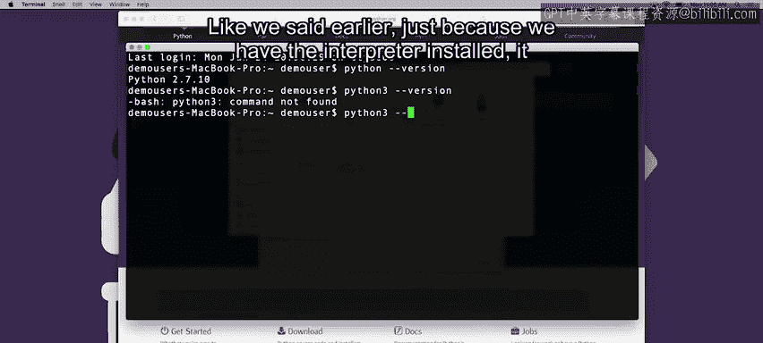
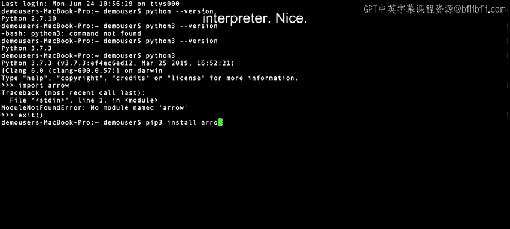

# 谷歌《用Python进行IT自动化办公1、2课（Python、控制操作系统）｜Google IT Automation with Python》中英字幕 - P79：5_在 macOS 上配置环境（可选）.zh_en - GPT中英字幕课程资源 - BV1gw411E7E1

🎼。う。

By default， Mac OS ships with a version of Python installed， but it's Python 2， not Python 3。

Let's check this out。So while we have Python installed on this computer， it's only Python 2。

 I wonder if we have Python 3 installed as a different command。 Let's check。

So we don't have Python pre installedalled in this computer。 Let's install it。

 There are two ways to install Python on Mac O。 We can either download the installable package from the official website and install that one。

 or we can use a package management system called Homebw to manage an installation。For this video。

 we're going to install the package from the official website。

 but feel free to check out Homebrew on your own。To install Python on Mac OS。

 go to the official Python page at Python do org。

Now we'll click the downloads menu because we're running this on a Mac OS computer。

 the website will automatically offer us a link to install Python 3 for Mac OS。

 We're now downloading the Python 3 executable installer for Mac OS。Once it's done downloading。

 we'll execute it， go through the license in terms of use pages and finally install it。

Depending on how your machine is set up， you might need to enter your password to perform the actual installation using Admin rights。

Cool， now we have an executable Python 3 interpreter that we can use for testing the scripts we're going to write。

 Let's check that It's working by executing the same command as before。 Python 3， dash， dash version。

😊。

Great， now we have Python 3 installed。 like we said earlier。

 just because we have the interpreter installed， it doesn't mean we have all the modules we might need to execute every possible script。

Let's say we need to write an automation script for handling event scheduling to do that。

 we need to manage a bunch of different dates and due date operations like calculating what date it will be in two weeks to make our lives easier with all that date manipulation。

 we could use the arrow module， which makes it simple to handle lots of different dates。First。

 let's check whether we already have this module available。Miss Fire。

 the interpreter says there is no arrow module available to get that module will install it using PIP3 command。

Notice that on Windows the command was called PIP on Mac OS， it's called PIipP3。

 so to install the arrow module， we'll call PIP3 installs arrow from the command line。

 not the interpreter。

Now that we got the module installed， let's try again to import it from the interpreter。Nice。

 looks like that worked。 to check that we can use it。 Let's try to do something with this module。

 How about we use the get function in the module to create a date object from a string。😊，Great。

 arrow parse a date from the string in the format we told to use。

 And now the date object has that date。 We can now operate with this object。 For example。

 we can ask to increment it by six weeks using the shift method and then print it using the format method。

😊，The format method that we just use can receive a bunch of parameters。

 These parameters let us intuitively format the string that we print。

 We've got our Mac O S environment， ready to go。😊，Now。

 we can use Python and start having some fun with it。

 Feel free to explore on your own and try some other things out。😊，Up next。

 I'll show you how to install Python on Linux。You can check that one out， or you can skip ahead。

 It's up to you。