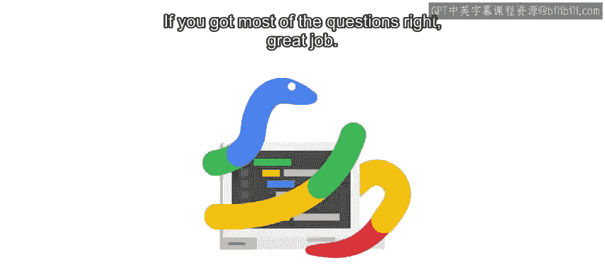
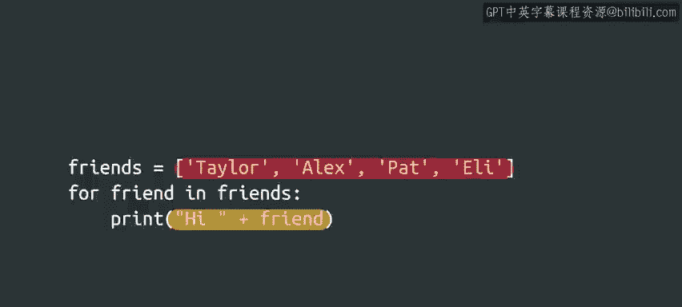
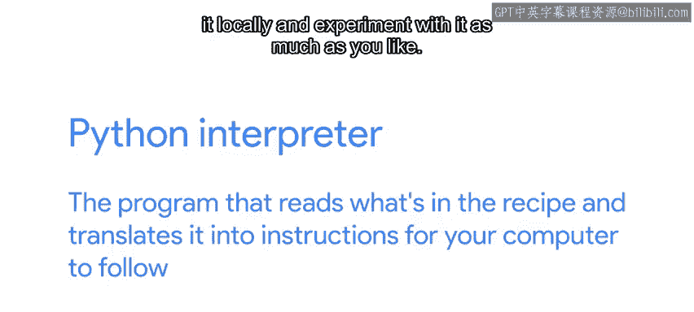

# 谷歌《用Python进行IT自动化办公1、2课（Python、控制操作系统）｜Google IT Automation with Python》中英字幕 - P7：6_什么是 Python.zh_en - GPT中英字幕课程资源 - BV1gw411E7E1

🎼Yeah。

Welcome back， How'd you do on your first quiz？If you got most of the questions， right， great job。

 If not， no worries。 It's all part of learning。 We'll be here to help you check that you've really got your head around these concepts with regular quizzes like this。

 If you ever find a question tricky。 go back and review the videos and then try the quiz again。

 You want to feel super comfortable with what you've learned before jumping into the next lesson。

 Remember， take your time。 I'll be here whenever you're ready to move on。 Okay， feeling good， great。

 let's dive in。 in this course， we'll use the Python programming language to demonstrate basic programming concepts and how to apply them to writing scripts。

 We mentioned that there are a bunch of programming languages out there。 So why pick Python。😊，Well。

 we chose Python for a few reasons。 First off， programming in Python usually feels similar to using a human language。

 This is because Python makes it easy to express what we want to do with syntax that's easy to read and write。

 Check out this example。There's a lot to unpack here。 So don't worry。

 if you don't understand it right away。 We'll get into the nitty gritty details later in the course。

 But even if you've never seen a line of code before， you might be able to guess what this code does。

 It defines a list with names of friends and then creates a greeting for each name in the list。 Now。

 it's your turn to make friends with Python。 Try it out and see what happens。

Throughout this course， you'll execute Python code using your web browser。

 We'll start with some small coding exercises using code blocks。

 just like the one you experimented with Later on， as you develop your skills， you'll work on larger。

 more complex coding exercises， using other tools。 getting good at something takes a whole lot of practice and programming and Python is no different。

 We recommend that you practice every example we share in this course on your own。

 If you don't have Python installed on your machine。 No worries。

 you can still practice using an online Python interpreter。

 Check out the next reading for links to the most popular python interpreters available online。 Now。

 I'm sure you're wondering what the heck is a Python interpreter in programming。

 an interpreter is the program that reads and executes code。

 Remember how we set a computer program is like a recipe with step by step instructions。 Well。

 if your recipe is written in Python， the Python interpreter is the program that reads what's in the recipe and translates it into instructions for your。

😊。

To follow。Eventually， you'll want to install Python on your computer so you can run it locally and experiment with it as much as you like。

 We'll guide you through how to install Python in the upcoming course。

 but you don't have to have it installed to get your first taste of Python。

 You can practice with the quizzes we provide and with the online interpreters and code pads that we'll give you links to in the next reading。

 We'll provide a whole bunch of exercises for you， but feel free to come up with your own and share them in the discussion forums。

 Feel free to get creative。 This is your chance to show off your new skills。😊。

