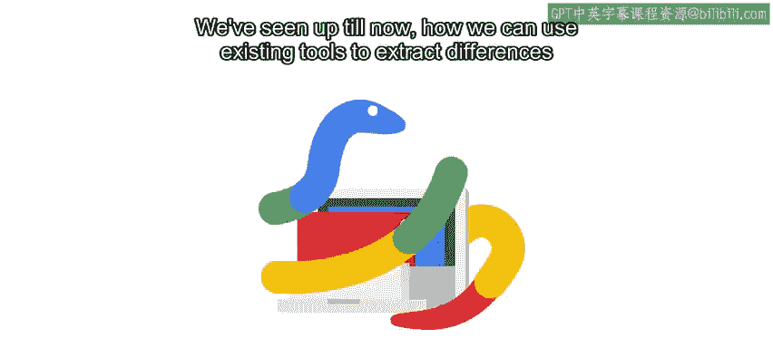
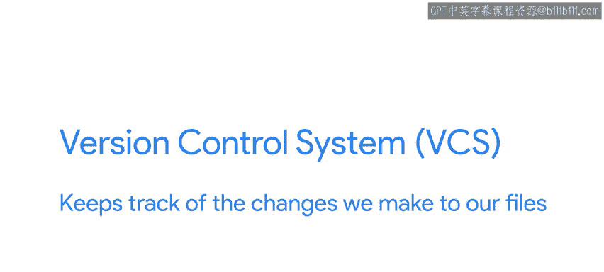
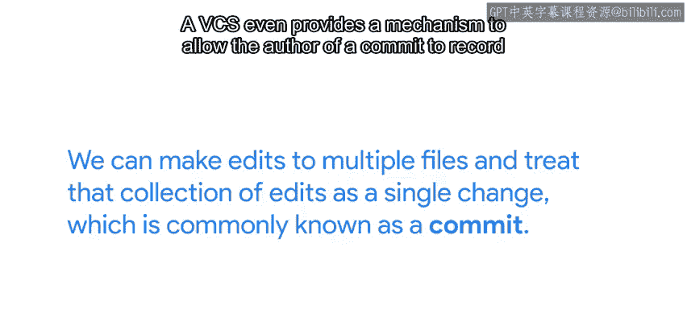
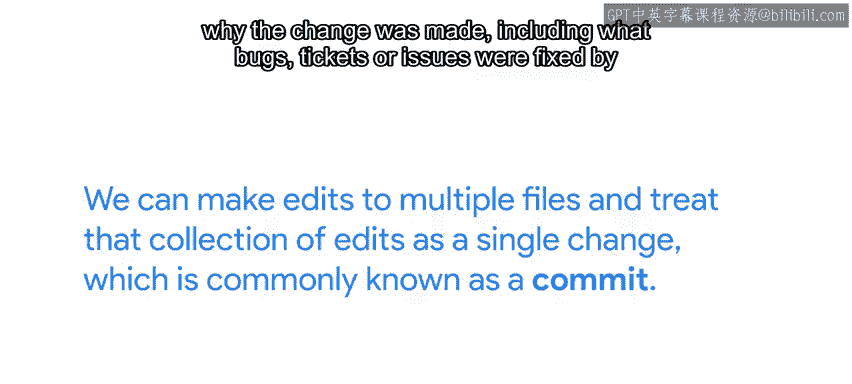

# 谷歌《用Python进行IT自动化办公3、4、5、6课（Git、debug、云端、实践）Google IT Automation with Python》中英字 - P7：6_什么是版本控制.zh_en - GPT中英字幕课程资源 - BV1LW4y1F7XW

🎼。う。

We've seen up till now how we can use existing tools to extract differences between versions of files and apply those changes back to the original files。

Those tools are really useful， but most of the time we won't be using them directly。Instead。

 we'll use them through a version control system or a VCS。

A version control system keeps track of the changes that we make to our files。

By using a VCS， we can know when the changes were made and who made them。

It also lets us easily revert a change if it turned out not to be a good idea。

And it makes collaboration easier by allowing us to merge changes from lots of different sources。

At first look， a version control system can seem like a complicated， possibly intimidating tool。

But if you look closer， you'll see that it's really just a system that stores files。However。

 unlike a regular file server， which only saves the most recent version of a file。

 a VCS keeps track of all the different versions that we create as we save our changes。

There are many different Viin control systems， each with their own implementation and with their own advantages and disadvantages。

But no matter how the VCS is implemented internally， they always access the history of our files。

They let us retrieve past versions of the file or directory and see who changed which files。

 how each file was changed， and when the file was changed on top of this。

 we can make edits to multiple files and treat that collection of edits as a single change。

 which is commonly known as a commit。

A VCS even provides a mechanism to allow the author of a commit to record why the change is made。

Including what bugs， tickets or issues were fixed by the change。

This information can be a lifesaver when trying to understand a complex series of changes or to debug some obscure issue。

So be sure to record this extra info in your commits to be truly committed。To better code。

In any organization that produces software， aVCS is a key part of managing the code。

Fileles are usually organized in repositories， which contain separate software projects or just group all related code。

If there's a lot of people involved in developing software。

 some developers may have access to only some of their repositories。

A single repository can have as little as one person using it。

 and it can go up to thousands of contributors。 And as we called out earlier。

 a version control system can be used to store much more than just code。

 We can use it to store configuration files， documentation。

 data files or any other content that we may need to track。

Because of the way tools like DF and patchwork a VCS is especially useful when tracking text files。

 which can be compared with DF and modified with patchch。We can also store images， videos。

 or any other complex file formats in a VCS， but it won't be easy to check the differences between versions when comparing these file formats。

And it might not be possible to automatically merge changes made to older versions of a file。

All right， you now have a basic idea of what a version control system is and how it works。

You might be asking yourself， do I really need this。

 Can't I just keep making backups of my code once in a while。We'll answer that in our next video。

