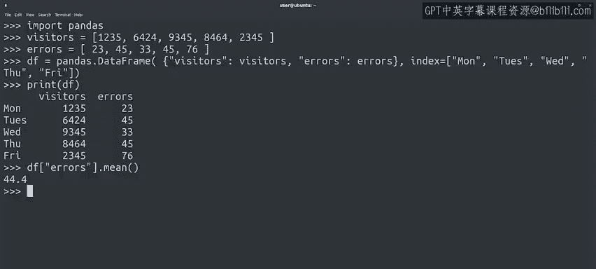

# 谷歌《用Python进行IT自动化办公1、2课（Python、控制操作系统）｜Google IT Automation with Python》中英字幕 - P80：6_在 Linux 上配置环境（可选）.zh_en - GPT中英字幕课程资源 - BV1gw411E7E1

🎼。う。

If your computer runs Linux， chances are extremely high that your distribution comes with Python already installed。

You can check to see this by opening a terminal and running a command like this。

Okay， we have Python installed， but as we saw of Mac OS， it's Python 2。

 that's an old version of Python and we want to use Python 3 instead Let's check whether we have that。

Nice， Python 3 is already there in some Linux distribution。

 the Python command may already be using Python 3。In other distributions like this one。

 you may need to use Python 3 as a command to access Python 3。

And all of these courses will be using Python 3， so make sure that you run the right command for your distribution。

If for some reason your Linux installation doesn't have Python 3 installed。

 you'll need to have it installed using the package management system。

 the name of the tool to manage local packages will depend on the distribution that you're using。

It's called A on Debian Uuntu and Linux Mint， Ym on Red Hat or CosOS and DNF on feddoa。

 If you're not sure what the right command is for your distribution。

 it's a good idea to do a little research to find out We've included a pointer of more information in the next reading。

While our computer here has Python 3 already installed。

 we still might not have all the modules needed to execute all the scripts that we' write。

 so we still need to learn how to add these modules to our system to make the most out of our Python installation。

In this example we'll be using an abutu computer and the app tool to install Python packages。

 We'll talk about two different ways of installing packages first through the package management system and second through PP。

As we said earlier， Linux distributions usually have a package management system。

 and it's a good idea to use it to install additional software on your computer。

Distributions usually include separate packages for the different Python modules available。

Say we're tasked with writing some automation software that resizes images to fit a specific size。

We can accomplish this by using the Python imagingaging Library known asP moduleule。

This includes a ton of image manipulation functionality to install this module on yourumbbutu computer。

 we can use the app tool to install Python 3 dash pill package。

One of the advantages of using the package management system to install packages is that we can set the system to automatically upgrade to newer versions。

 the package management system makes sure that any dependencies are also installed so that the module is ready to use so let's check out this module that we just installed。

The pill module is very large because it includes tons of things that we can do for images。

For this example， we want to open an image and check its size and format so we've imported the image sub moduleule inside the pill module。

Now， let's open a file in our home directory using the open method。Great， we've opened the image。

 now we can check its size and its format attributes。Okay， the modules working properly In this case。

 we wanted a module that was provided by the package management system。

 so it was easy to just install it using apps。 In other cases。

 we may want to install module versions that are newer than the ones provided in the distribution。

 or that are not even present in the distribution at all for cases like these。

 we can use the same command we mentioned for Windows and MacOS， the PIP command。For this scenario。

 we first need to make sure that we have Python 3 version of PIP。

 which is called PIipP3 and is provided by the Python 3 PIP package。

We'll do this by installing the package through the package management system。

This might take a minute。Now that we have PIP3 installed。

 we can solve problems using a wide range of external modules， For example。

 imagine that you're tasked with creating an automation that processes the error log from our web service and then generates statistics on the amount of errors or when the most errors occur to do this kind of data processing we could use our cutest sounding module yet panndadas。

 which is widely used in the data analysis field。Alright， we have the pandas module installed。

 Let's try it out with some sampled numbers。Okay， we've imported the module to state the obvious。

 since this is a tool for data analysis， we'll need some data to use it。

Let's generate a few sample lists from the data associated with our website。

How about a list of the amount of visitors we've had in the last five days？

Let's add another list with the amount of errors generated during the same five days。

Now that we have these two lists， we can use them to generate a data frame。

 which is the main structure used by the pandas module to do data analysis。

 so we'll generate the data frame with the list adding the days of the week as indexes like this。

With this， we have a data frame that we can use for operations。For example。

 we can print it in a nicely formatted way。It's always fun to print stuff。

 but that's not really data analysis。The pans module allows us to operate on the numbers of each column。

 For example， we can calculate the mean or average value of one of the columns using the mean method。

Nice， we now know how to install Python modules on Linux using either the package management system or PIP。

Are you ready to have some fun with it？Meet me over to the next video while we'll talk about interpreted and compiled languages。

