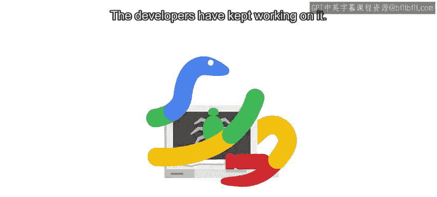
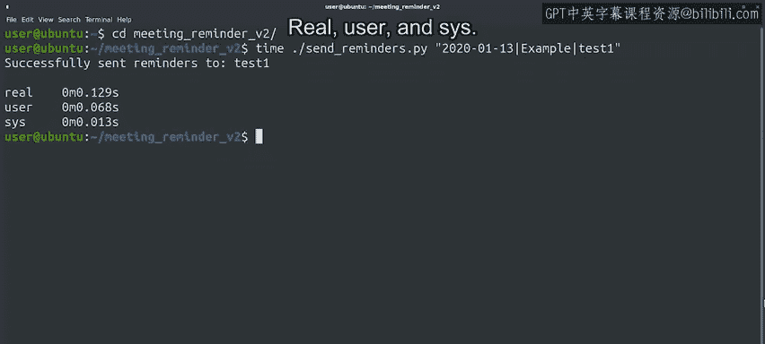
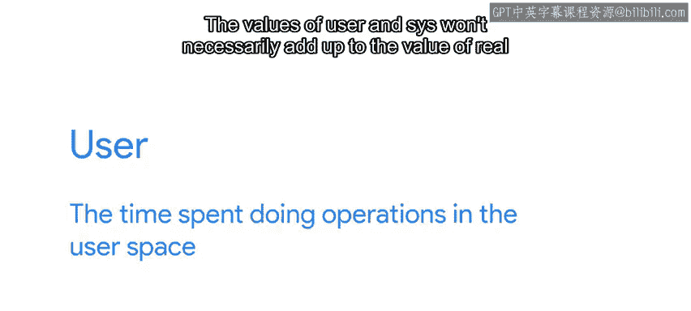
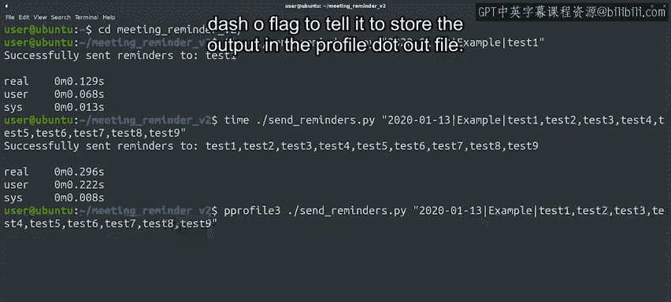
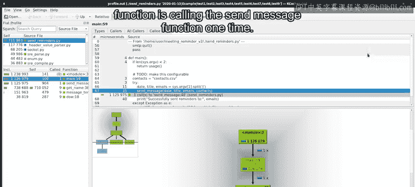
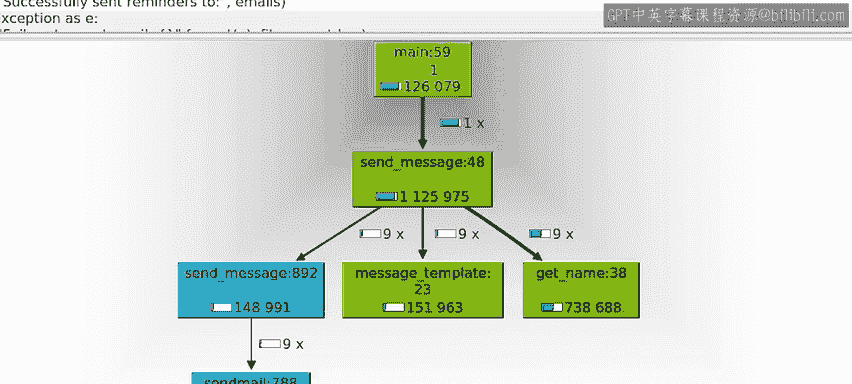
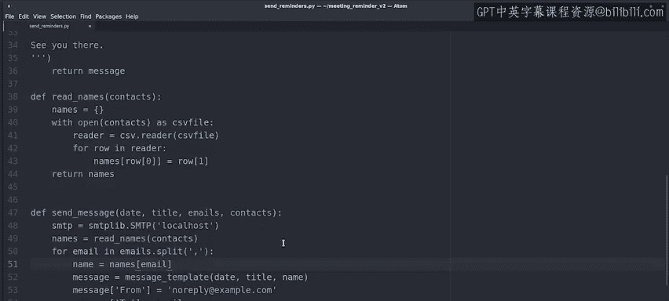
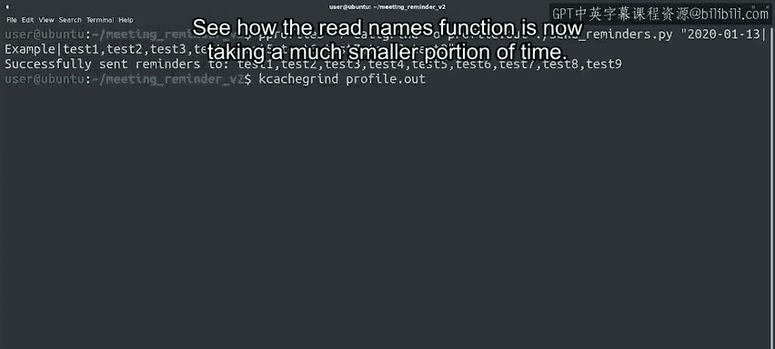

# 谷歌《用Python进行IT自动化办公3、4、5、6课（Git、debug、云端、实践）Google IT Automation with Python》中英字 - P81：23_包含低效循环的缓慢脚本.zh_en - GPT中英字幕课程资源 - BV1LW4y1F7XW

。

Remember that meeting reminder script that was having trouble with the dates。

 the developers have kept working on it， it now sends personalized emails with the name of the person getting the email in the greeting。

That's cool， but unfortunately it seems to have made the application pretty slow。

 the developers are asking for our help in figuring out how we can make the program faster。

So let's get to work。First， we'll need to reproduce the problem and figure out what slow means in this case。

 One user told us that the problem is visible when the list of recipients is long。

To avoid spaing our colleagues while we're testing this issue。

 we'll send the reminders to a bunch of test users that we've created in our mail server。

 you might remember that the application has two parts。

A shell script that pops up a window where we can enter the data of the reminder and a Python script that prepares the email and sends it。

 The part that's slow is the sending of the emails。 So we won't interact with the pop up at all。

 We'll just pass the parameters we need to the Python script。

We'll measure the script speed using the time command。

 Let's first call it with just one test user and see how long it takes。When we call time。

 it runs the command that we passed to it and prints how long it took to execute it。

There's three different values， real user and cis real is the amount of actual time that it took to execute the command。

This value is sometimes called wall clock time because it's how much time a clock hanging on the wall would measure。

No matter what the computer is doing， user is the time spent doing operations in the user space。

 and Ss is the time spent doing system level operations。

The values of user and cis won't necessarily add up to the value of real because the computer might be busy with other processes。

 Okay， what do we see here？It took our script 。129 seconds to send the email。That's not a lot。

 but we only send the message to one user。 Let's try this again with our nine test users。2。Test 3。

Test。I。6。Just seven。8。All right， we see that it took 0。

296 seconds to send the email this time that's still not a lot。

 but it does look like it's taking longer with a longer list of emails。Okay。

 it's time to try to make this better。How can we find out what's wrong with the code？

We could always look at the code and see if we find any expensive operations that we could improve。

But in this case， we want to use a profiler to get some data about what's going on。

 so let's try that there's a bunch of different profilers available for Python that work for different use cases here we'll use the one called P profilefile 3。

We'll use the dash F flag to tell it to use the callG file format and the dash O flag to tell it to store the output in the profile。

out file。

Okay， this generated a file that we can open with any tool that supports the CalG format。

We're going to use K hassh Gr to look at the contents。

 which is a graphical interface for looking into these files。

There's a lot going on with this program， so don't get scared if it takes a while to make sense out of it。

As with so many other things， practicing and tinkering on your own will help you get used to what all the different things here mean。

Let's look at the information we need now in the lower right half， we see a call graph。

 which tells us that the main function is calling the sendend message function one time。

 This function is calling the message template function， the get name function。

 and the sendend message function9 times each。The graph also tells us how many microseconds are spent on each of these calls。

We can see that most of the time is being spent in the get name function。

That's probably the one we should optimize。 Let's see what this function is doing， using atom。

So we see that the get name function opens a CSV file， then goes through the whole file。

 checking if the first field in the line matches the email name。And when that's the case。

 it sets the value of the name variable。There's a couple of things that are wrong with this function。

First， once it finds the element in the list， it should immediately break out of the loop。

Right now it's iterating through the whole file， even if the email was found in the first line。

 but even if we fixed that， it would still open the file and read through it for each email address。

 this can get really slow if the file has a lot of lines。So how can we make this better？

We can read the file once and store the values that we care about in a dictionary and then use that dictionary for the lookups。

 Let's do that。 We'll change the getname function and turn it into a read names function that will process the CSV file and store the values we want in the names dictionary。

For each line， we'll store the email as the key and the names as the values。

 and instead of returning one name， we'll return the whole dictionary。All right。

 we have a read names function that stores the data we want in a dictionary。

We now need to change the way this is called in the send message function。

We see that the getname function is being called once per email。To apply our change。

 we should call the read names function before the for loop so that we do it only once， and then。

 instead of calling get name， we'll just get the value from the dictionary。All right。

 we've made the change， let's save our file and profile our script again to see if we manage to make it any faster。

😊。

The graph looks different now as we've changed how the code behaves。

 see how the read names function is now taking a much smaller portion of time on the flip side。

 we see that the message template is the one that's taking the most time now。

So if we wanted to keep making our script faster， that's where we would look next。

In this video we saw how we can use the time command to check how long it takes to execute a program we then saw how we can combine a profiler and a profile visualizer to figure out where our code is spending most is time and finally we changed our code to avoid doing an expensive loop over and over by storing the information in a dictionary and then accessing the dictionary instead up next。

 there's a reading with more information about profiling and after that a practice quiz to check if this is all still making sense。

