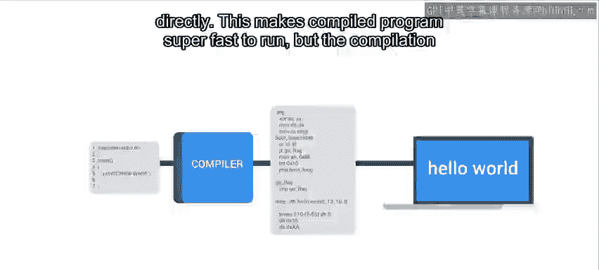
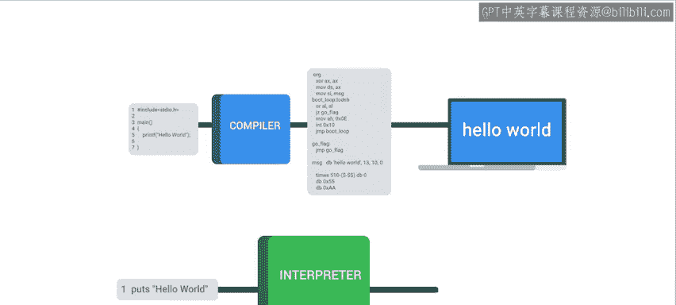
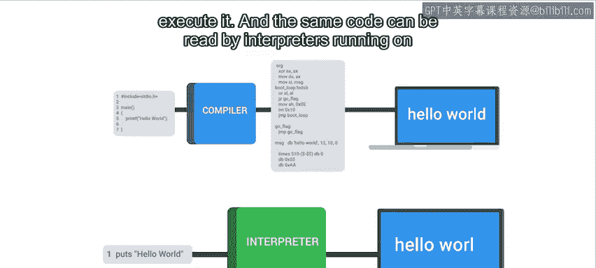
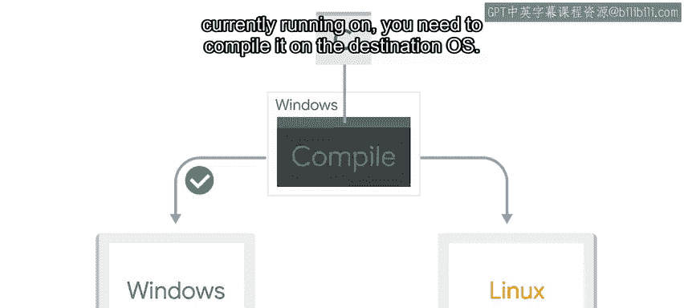
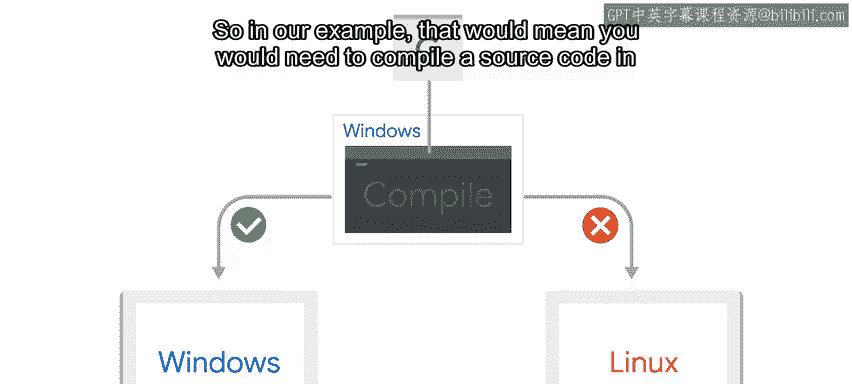
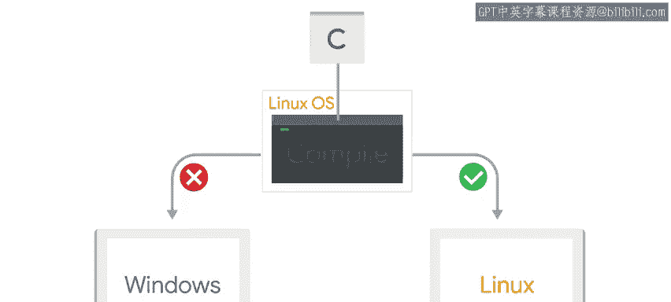
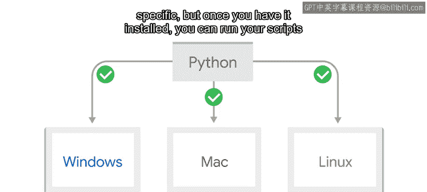
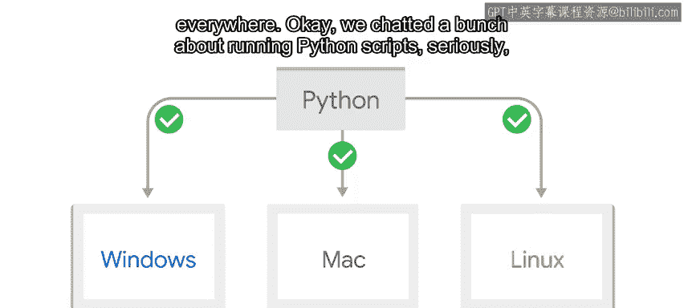
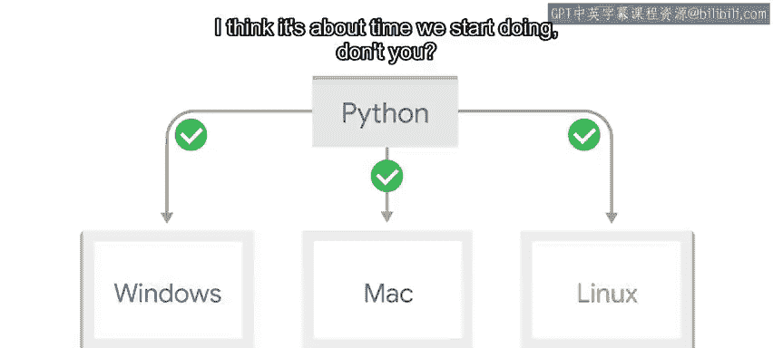

# 谷歌《用Python进行IT自动化办公1、2课（Python、控制操作系统）｜Google IT Automation with Python》中英字幕 - P81：7_解释型与编译型语言.zh_en - GPT中英字幕课程资源 - BV1gw411E7E1

🎼。う。

We've touched on how we can write a script in Python on a Windows computer and then run the same script on a Linux computer or vice versa。

This is a case for scripts written in many other interpreted languages， too。

 So you might be wondering what's an interpreted language。Well。

 when you want to run a programmer in a traditional programming language like C。

 the source code is fed into a piece of software called a compiler。

 the compiler translates this code into machine level language。

 which means a language specific to the underlying architecture of the computer it's running on。

The computer can read and execute the machine level code directly。

 This makes compiled programs super fast to run， but the compilation process itself can take a bit of time。

 Some examples of commonly used compiled programming languages are C， C plus plus， go and rust。

On the flip side， programs written in an interpreted language generally rely on an intermediary program called an interpreter These programs use interpreters to execute the instruction specified in the code rather than running them through a compiler first。

 so this makes the development cycle for a program written in an interpreted language much faster because the developer doesn't need to wait for the code to be compiled to execute it。

And the same code can be read by interpreters running on different operating systems without needing to make any additional changes。

 The tradeoff is that interpreted languages generally run slower than compiled ones， Python， Ruby。

 JavaScript， Bsh and Powerhell are all examples of interpreted programming languages。Last up。

 Java and CSharp are languages that use a mixed approach。 the code needs to be compiled first。

 but it gets compiled into intermediate code。This means that instead of getting compiled into machine language that's specific for the current operating system。

 it gets compiled into portable code that can execute on different platforms。

We execute this code using a program that's OS specific。

 the Java virtual machine for Java and the common language runtime for C sharpharp。Say for example。

 you have a program that's written in C and you're running on Windows。

But you want to run the program on the Linux server to run the program on a different operating system than the one you're currently running on。

 you need to compile it on the destination OS。 So in our example。

 that would mean you would need to compile a source code in Linux OS and preferably one that has the same version of the installed libraries on the destination server you could run the program source code in Python instead if you did that it wouldn't matter if you're running on Windows。

 Mac OS or Linux you could write and test the program locally and then just copy the script to the server and use it as is。

The Python interpreter itself is a compiled executable that's platform specific。

But once you have it installed， you can run your scripts everywhere。 Okay。

 we've chatted a bunch about running Python scripts。 Seriously， we've been talking a lot。

 I think it's about time we start doing， don't you。

Hop on over to the next video， while I'll walk you through creating and running a Python script。😊。

