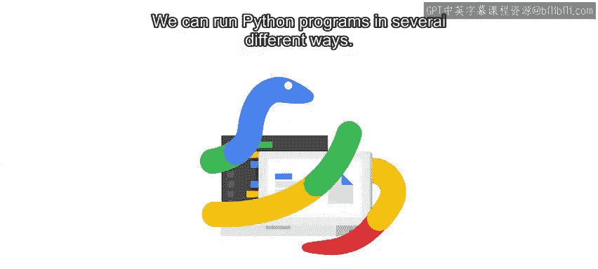
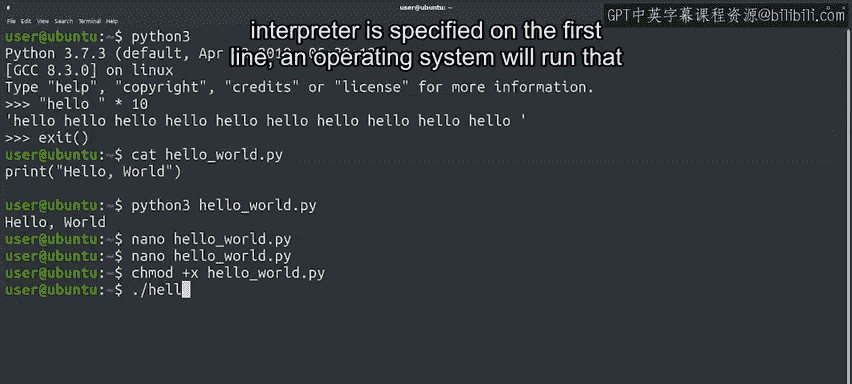
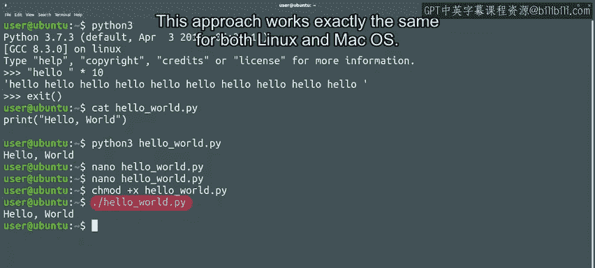

# 谷歌《用Python进行IT自动化办公1、2课（Python、控制操作系统）｜Google IT Automation with Python》中英字幕 - P82：8_如何运行 Python 脚本.zh_en - GPT中英字幕课程资源 - BV1gw411E7E1

🎼。う。

Okay， ready to see what our Python scripts can really do。

 we can run Python programs in several different ways。

 and this course we'll focus on running scripts from a command prompt。

And because our Quicklabss instructional environments will use Uunstu。

 we'll concentrate on using a command prompt in a Linux based setting。 That said。

 with the little tweaking， the techniques we use here can be applied to other platforms like Windows or Mac OS。

As we called out in our installation videos， the commands are around that Python 3 interpreter might be Python or Python 3。

 depending on your platform。In our examples， we'll always show Python 3 because that's the command for the Ubutu distribution we'll be using。

You should use the right command for your platform。As we saw in our installation videos。

 when we run the Python 3 command， we get an interactive interpreter。When we run this command。

 it prints a bunch of things first we're told the version of Python interpreter we running。

Then we get some extra information， like which compiler was used to build it。

 and then some suggestions for commands that we can use to get more information usinging the interactive interpreter。

 we can do everything we learned in the introductory course on Python。 Like， say。

 printing hello 10 times because， you know， Python's always down to have a convo。 Hey， Python。😊。

So this is fun and useful for experimentation and trying out new concepts。

 but unfortunately we can't save any of our work once you close the interpreter by typing exit or pressing control D on Linux and Mac OSOS or control Z on Windows。

 the code you wrote isn't even saved boo。To make our code more permanent。

 we can store it in files Sa Python scripts usually end with a dot pi extension such as Hello worldl dot Pi。

Let's have a look at our Hello Worldl。pi file using the CA command。

 which is a command that shows the contents of a file on Linux。

To run a Python script saved on a Windows system， you can just type the name of your script and the operating system will recognize is the Python executable from the file extension。

On Linux and MacOS， you can execute the script by calling the Python interpreter followed by the name of the file。

So here， the Python3 command， the same Python interpreter as before， reads the contents of Helloorld。

 Pi and then tells the computer to execute the instructions in that file。

But typing Python 3 each time you want to run your script can get really old， really fast。

 So pro tip， there's a way we can avoid this。 We can add the extra line to our file called Shibang。

 which tells the operating system what command we want to use to execute that script。

Let's try this now， first， open the file and an editor。For this example， we're going to use nanono。

 which is one of the editors available on a Linux system。

Now we'll add our magic line at the beginning of the file。

 This line tells us OS that we want to run the script using Python 3。 It looks like this。

And that's it， we can now exit nano by pressing C X。

 then saying that we want to save the file and then accepting the proposed name。

 which is the same name that the file had before。All right。

 our system now knows it should execute the file with a Python Pre interpreter。

There's one more thing we need to do to run the script directly about having to call the interpreter every time。

 We need to make that file executable using the C， H mod command。

 Remember that this command lets us change the file permissions。

A files possible permissions are read， write， and execute。To run the file directly。

 we want our file to be executable。 This is how we do it。

Marking the script as executable means that we can now run the file by just prefixing it with a dot slash。

Because the script has been marked as executable and the path to the interpreter is specified on the first line。

 the operating system will run that interpreter and pass the name of the script to it。

 This means that running dot slash hellello world dot pi is equivalent to Python 3。

 Hello world dot pi。 This approach works exactly the same for both Linux and Mac Os。

 Maybe you're wondering why we need to prefix the script with a dot slash instead of just writing the name of the script。

😊。

The reason for this is that the script isn't located in any of the directories listed in the path variable。

 this variable tells the operating system where to find programs to execute。

The dot in the dot slash expression represents the current directory。

 so we're basically tailing the OS to find the script in the current directory and then execute it。

So we just created our first executable Pythons script。How cool is that now it's your turn to do it。

Take some time and experiment with running scripts locally on your machine。

We went over a lot of info in this video。 that's super important to get down。

If there's anything that doesn't quite click yet， watch this video again and practice the scripts a few times。

After that， we've got something even more exciting coming up。

 We're going to create our own Python module。😊。