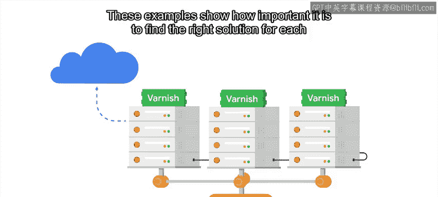

# 谷歌《用Python进行IT自动化办公3、4、5、6课（Git、debug、云端、实践）Google IT Automation with Python》中英字 - P83：25_复杂度逐渐增长.zh_en - GPT中英字幕课程资源 - BV1LW4y1F7XW

🎼Yeah。As we called out in an earlier video， a solution that's good for one problem might not be so good for a different problem。

And as a system becomes more complex and grows in usage。

 a solution that worked well before may no longer be well suited。

 Let's say you're writing a secret s where each person gives a secret gift to one other randomly assigned person。

The script randomly selects pairs of people and then sends an email to the gift giver。

 telling them who they're buying a present for if you're doing this for the people working on your floor。

 you might just store the list of names and emails in a CSV file。

The file will be small enough that the time spent parsing it won't be significant。 Now。

 if this script grows into a larger project that handles everyone at your company。

And the company keeps hiring more and more people at some point。

 parsing the file will start taking a lot of time。This is where you might want to consider using a different technology。

For example， you could decide to store your data in a SQL light file。

 This is a lightweight database system that lets you query the information stored in the file without needing to run a database server。

Using SQLite for the data probably works just fine for assigning secret Santas at your company。

 but imagine that you've kept adding features to the service。

 so it now includes a way to create a wish list， a machine learning algorithm that suggests possible gifts。

 and a tracker that keeps a history of each present given。

And since people at your company love the program so much。

 you've made it an external service available to anybody。

Keeping all the data in one file would be too slow， So you'll need to move to a different solution。

 You'll have to use a fully fledged database server。

 probably even running on a separate machine than the one running the secret Santa service。

 And there's even one more step after that， if the service becomes really， really popular。

 you might notice that your database isn't fast enough to serve all the queries being requested。

In that case， you can add a caching service like MeCashD。

 which keeps the most commonly used results in RA to avoid querying the database unnecessarily。

So we've gone from hosting the data in a CSV file to having it in a SQLL file。

 then moving it to a database server， and finally using a dynamic cacheier in front of the database server to make it run even faster。

A similar progression can happen on the user facing side of the same project。 Initially。

 we said the service would simply send emails to the people on the list。

That's fine if it's a small group and there's one person in charge of the script。

 But as the project grows more complex， you'd want to have a website for the service to let people do things like check who their assigned person is and create wish lists。

😊，Initially， this could just be running on a web server on the same machine as the data。

 If the website gets used a lot， you might need to add a caching service like varnish。

 This would speed up the load of dynamically created pages and eventually this still might not be enough。

 so youd need to distribute your service across many different computers and use a load balancer to distribute the requests。

You could do this in house with separate computers hosted at your company。

 but this means that as the application keeps growing， you'd need to add more and more servers。

 It might be easier to use virtual machines running in the cloud that can be added or removed as the load sustained by the service changes。

These examples show how important it is to find the right solution for each problem。

It makes no sense to deploy a multiserv web service with a distributed database for storage when you're only going to have a few dozen users。

 you just need to pay attention to how the service is growing to know when you need to take the next step to make it work best for the current use case Up next。

 we'll talk about some of the issues that you might come across when dealing with complex systems。

