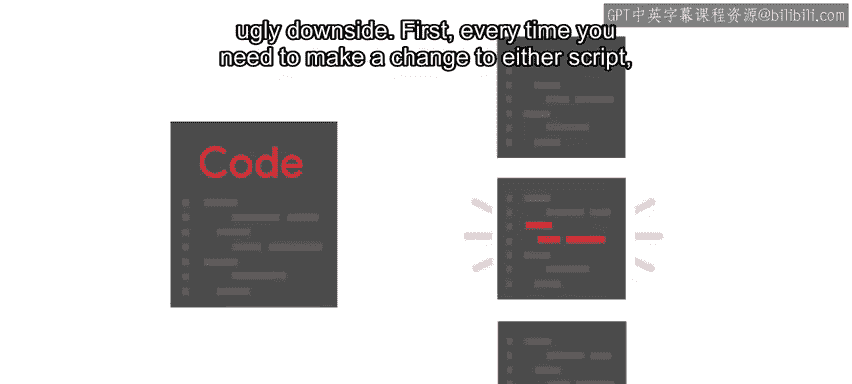
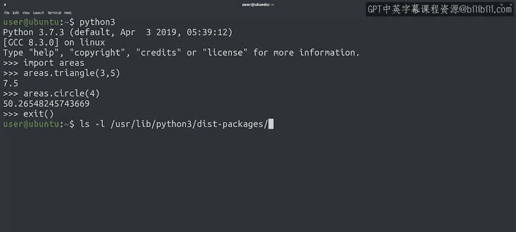

# 谷歌《用Python进行IT自动化办公1、2课（Python、控制操作系统）｜Google IT Automation with Python》中英字幕 - P83：9_你自己的 Python 模块.zh_en - GPT中英字幕课程资源 - BV1gw411E7E1

🎼。う。Okay， got Python installed in your computer。 check， got it running locally。 check。

 created your first executable script。 double check。 You're doing great。 Let's keep going。😊。

In programming， we often reuse code that we've written or someone else has written。

This is called code reuse， and nearly all languages provide some way of doing it。

We talked about code reusability back when we first looked at functions。

 functionss let us group code into logical blocks that can be executed at a later point and as many times as we need。

 but as our scripts get bigger and more complicated。

 we want to be able to reuse more than a single function。

We might even want to reuse entire scripts and other programs that we write。

Let's say that you created a script that emails a daily summary of tickets you completed to your manager。

The script has two main jobs。 First， it assembles a list of the tickets you close by interfacing with the company's issue tracking system。

 Second， it uses that list to create an email and then sends it off to your manager。

In a separate project， let's say that you'd like to automatically parse a system log and search for an event inside of it。

If the event is found in the log， you want to trigger an email to notify yourself。

Can you spot the functional overlap in these two scripts？

Both of these automation projects need to send an email message。

The most straightforward way to do this is to duplicate the email sending code。

 copying it from one Python file to the other。

On the whole， this seems pretty easy。 But duplicating code in this way has some ugly downsides。

 First， every time you need to make a change to either script。

 you have to remember to do it to both places。 That means you'd have to do any update and bug fixes twice。

 no one wants to have to do that。 And on top of this。

 if your coworkers want to use the same email code you wrote for their own projects。

 they'd probably have to go and create new copies。 As you can imagine。

 keeping track of all the places that's being copied too quickly becomes tricky。

 And so does sharing different versions。😊。

So instead of going crazy trying to maintain a bunch of different copies of the code。

 we can put the code we want to reuse into a separate module this way we can have our scripts and our colleague scripts import our code without having to create multiple copies。

Great， but first， we need to create our own Python module by putting the contents that we want to be part of the module into a separate file to use the module we'll import it using the file name。

We can access each function， class， and variable defined in the file by using dot notation。

Let's see this in action。We have a file called Are do pi。

 which contains functions to calculate the area of different geometrical figures。

 We can see the contents of that file using CA command。

We have three functions of defining this module。 The circle function uses the Ma dot pi Con。

 that's why we import the math module at the top so that we can use it。Okay。

 we've seen that the functions are defined in the areas。

 Pi file to use them in an interpreter or a script， we can import the module by typing importm areas。

 Let's do this。Perfect， we've now loaded the Are module and can use it to calculate areas。

Let's calculate the area of a triangle and a circle to test this out。

Our area module is pretty small and simple。 So if fits nicely in just one file。 In some cases。

 the code we're working with can become more complex。

And it might make sense to split it into submods。In this case。

 we'd create a directory of the name of the module and separate dot pi files for each of the submods。

To see what we mean， let's look at a list of files chip by a module installed on this computer。

 the request module using the LS L command。

This module is super complex。 So all the things it does are split into separate files。

 Notice that init dot pi file。 This is a special file。

 It's read when the module gets imported and it's used by the interpreter to check if a directory of Python files should be a module。

 So if you have a module that's split into separate files and you want the interpreter to recognize the directory as a module。

 you need to create the in it dot pi file。 even if you don't have anything to put in this file。

 you need to create it。😊，You can leave it empty， but it needs to exist for the interpreter to recognize the directory as a Python module。

Wow， that was a lot of stuff to grasp， but now we know how to create our own executable files and modules。

It's a little complex。 So don't worry if you feel a little shaky on it right now。

 We'll keep practicingrac these concepts until you can do them in your sleep。

