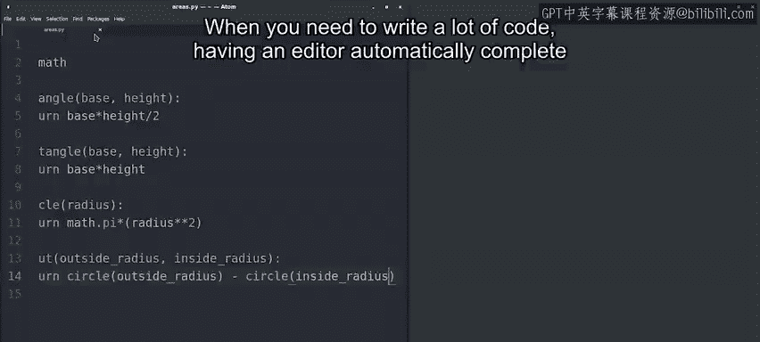
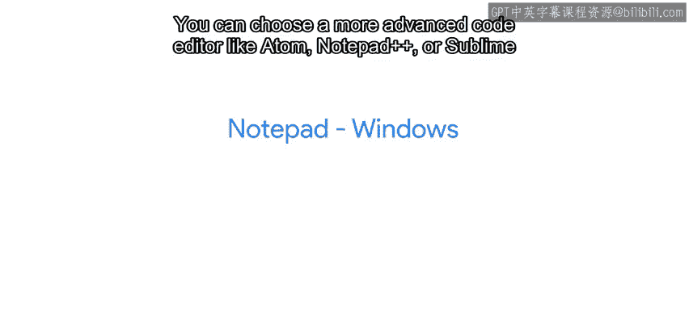

# 谷歌《用Python进行IT自动化办公1、2课（Python、控制操作系统）｜Google IT Automation with Python》中英字幕 - P84：10_什么是 IDE.zh_en - GPT中英字幕课程资源 - BV1gw411E7E1

🎼。う。

When you start writing your own scripts， you eventually come across these websites that mention IDEs。

 This term stands for integratedteg development Environment and usually refers to a code editor with some handy extra capabilities that make writing scripts a lot easier。

We do most of our programming work in code editors and IDEs。

 so it's important to find one where you feel most comfortable and productive。

It's a good idea to invest some time now and getting to know a few editors and IDs to find the one that you like best。

There's a bunch of different editors out there。 Some have only a few additional features。

 while others have a lot。One of the most basic extra features in code editors is called synyntax highlighting。

 This means that the editor recognizes the language we're writing our code in and highlights the pieces of code that make up the syntax of the language。

 Let's take a look at this in a text editor called Vm， which is available on Linux。

Then includes syntax highlighting， so if we open the areas pi file that we showed earlier inside Vim。

 we'll see that the code includes colors highlighting the syntax。

 We can see that reserved keywords like death or return are shown in one color while the names of the function are in a different color and even numbers are in another one to exit them type colon Q。

Another common feature offered by code editors is called code completion。

Let's check out the use of this feature with a different editor called Adam。

Here we have our areas module， open and atom。 We see that it also uses syntax highlighting。

The colors are different， but the idea is the same。Now， let's write a new function called。Donut。

 which will calculate the area of a 2D donut as the difference between two circles。 donuts。

When I typeDeaf， the editor tells me that this is a key word to write a new function。

After typing the name of the function， I write the opening parentheses and the editor knows that there will be a closing parentheses。

 so it writes it for me。After defining the function， when I press enter。

 the editor knows that the code needs to be indented to the right。

 So it automatically positions the cursor right there。 Pretty helpful， right。😊，Now， when I type RE。

 the editor suggests that I may want to typeReturn。 It's like it's reading my mind by pressing tab。

 I accept the suggestion， and so my RET gets completed to return。Nice。

Let's save with C S and close our program with control Q。

And that's the power of code completion when you need to write a lot of code。

 having an editor automatically complete the names of the variables and functions can save you a load of time。

How you write source code depends on your personal taste， your preferences。

 and the applications available for your platform。You can go with whatever is already installed on your computer like Noad。

 T Editor on Windows， T Edit on Mac OS， or Na on Linux。

You can choose a more advanced code editor like At， Noteepad++， or Sublime textex。

 or go for a fully featured graphical IDE like Eclipse or pie Char。

Once you've found your favorite one， it's a good idea to take the time to familiarize yourself with the editor's capabilities so that you can get the most out of it。

Feel free to experiment writing some scripts and executing them until you feel comfortable editing your Python scripts。

Now a word of caution。As an IT specialist， you don't want to be completely tied to just one editor。

It's possible you may need to debug a problem on a computer with a different editor installed and you don't want to waste time installing your preferred editor。

 so make sure you have a basic idea of how to use an editor that's installed by default on the computers you work with。

Graphical code editors with additional capabilities like atom or eclips are pretty nifty and can save us a lot of time。

 but you should also learn your way around at least one command line editor like Vim。

 Emax or nanono for the times you might not be able to use the graphical editor。 For example。

 you might need to connect to a remote server that's running on the cloud where you won't be able to use a graphical editor We've talked a lot about setting up your environment and you can now write and run your own Python scripts and Python modules up next。

 we have a supplemental reading with more info And then a quiz to double check that you're getting the hang of all these new concepts。

😊。