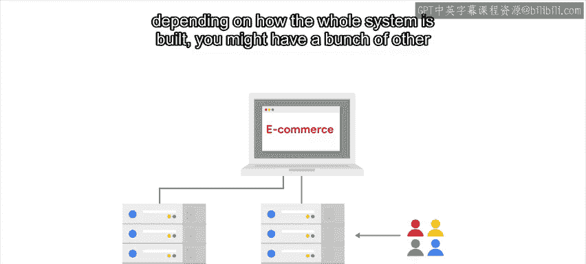
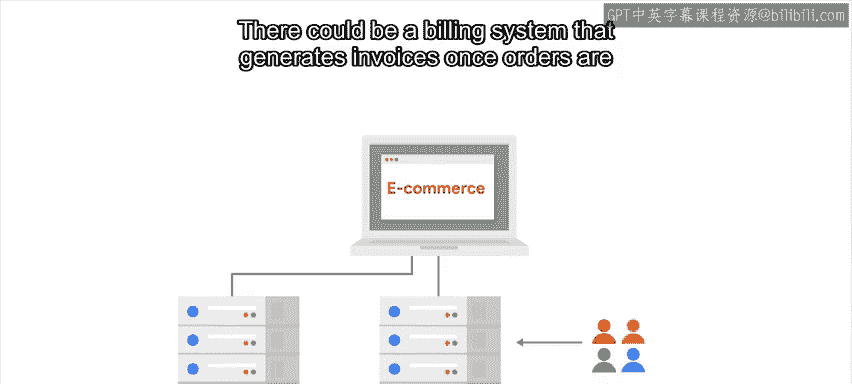
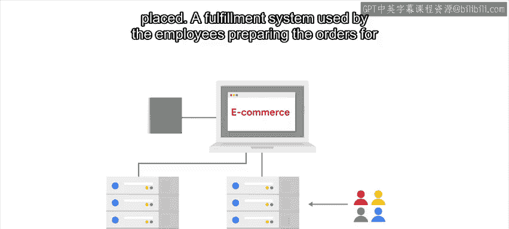
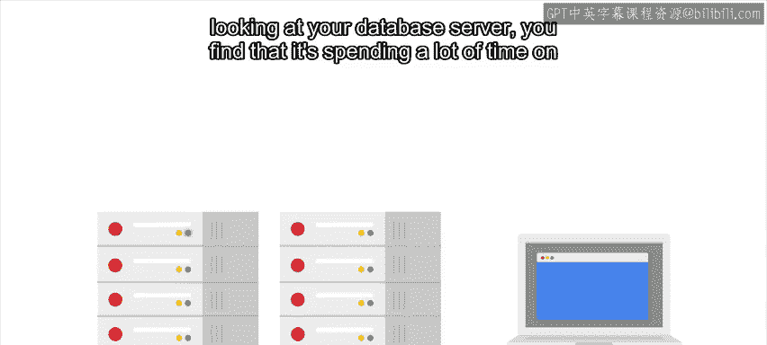
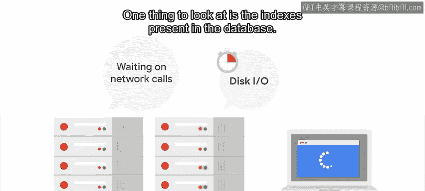
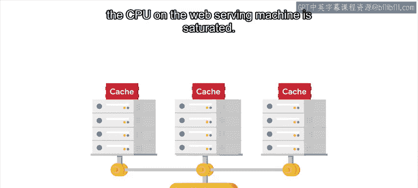

# 谷歌《用Python进行IT自动化办公3、4、5、6课（Git、debug、云端、实践）Google IT Automation with Python》中英字 - P84：26_处理复杂的缓慢系统.zh_en - GPT中英字幕课程资源 - BV1LW4y1F7XW

🎼Yeah。

In our last video， we discussed how systems that grow in usage also grow in complexity in large complex systems。

 we have lots of different computers involved。 Each one doing a part of the work and interacting with the others through the network。

 For example， think of an ecommerce-commerce site for your company。

 The web server is the part of the system that directly interacts with external users。

 Another component is the database server， which is accessed by the code that handles any requests generated from the website。

 and depending on how the whole system is built， you might have a bunch of other services involved。

 doing different parts of the work。

There could be a billing system that generates invoices once orders are placed。

 a fulfillment system used by the employees preparing the orders for customers。

 a reporting system that once a day creates a report of all the sales placed and possibly more。

On top of this， you should probably have backup， monitoring， testing infrastructure， and so on。

A system like this can be tricky to debug and understand。

What do you do if your complex system is slow， as usual。

 what you want to do is find the bottleneck that's causing your infrastructure to underperform。

Is it the generation of dynamic pages on the web server？Is it the queries to the database？

Is it doing the calculations for the fulfillment process， Figuring this out can be tricky。

 So one key piece is to have a good monitoring infrastructure that lets you know where the system is spending the most time。

 Sa you notice that getting the web pages is pretty slow。 But when you check the web server。

 you see that it's not overloaded。

Instead， most of the time is spent waiting on network calls。

 and when looking at your database server， you find that it's spending a lot of time on disko。

This shows that there's a problem with how the data is being accessed in the database。

 One thing to look at is the index is present in the database when a database server needs to find data。

 it can do it much faster if there's an index on the field that you're querying for。

On the flip side， if the database has too many indexes。

 adding or modifying entries can become really slow because all of the indexes need updating。

So we need to look for a good balance of having indexes for the fields that are actually going to be used if the problem is not solved by indexing。

 and there are too many queries for the server to reply to all of them on time。

 you might need to look into either caching the queries or distributing the data to separate database servers。

Now， what if when you try to figure out why the service is slow。

 you see that the CPU on the web serving machine is saturated。

The first step is to check if the code of the service can be improved using the techniques that we explained earlier。

If it's a dynamic website， we might try adding caching on top of it。

 but if the code is fine and the cache doesn't help because the problem is that there's just too many requests coming in for one machine to answer all of them。

 you'll need to distribute the load across more computers to make this possible you might need to reorganize the code so that it's capable of running in a distributed system instead of on a single computer。

This might take some work， but once you've done it。

 you can easily scale your application to as many requests as needed by adding more computers to the system and finally make sure that you actually need to do whatever you're doing lots of times as projects evolve we're left with a scary monster of layer after layer of complex code if we think about what our system is doing for a few minutes。

 we might end up discovering that there's a whole piece that wasn't needed at all and it was making our servers do unnecessary work all along。

If all of this is starting to sound too difficult and scary， don't worry。

Remember that if you ever need to deal with such complex systems。

 one of your best tools is to ask your colleagues for help。 Up next。

 we'll try our hand at solving a real life problem with something complex。

