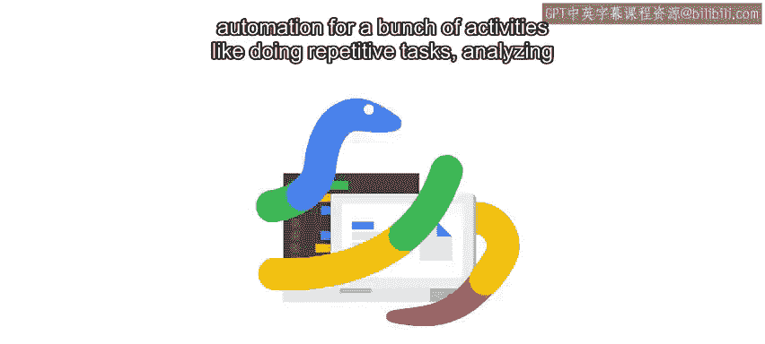
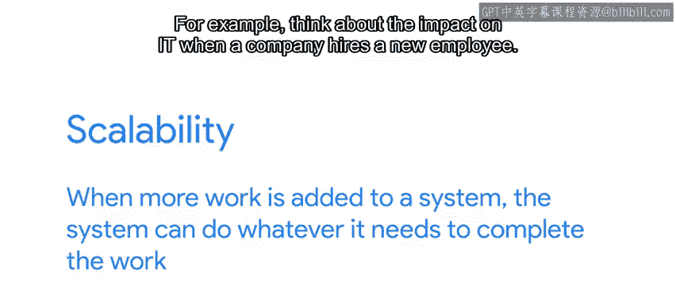
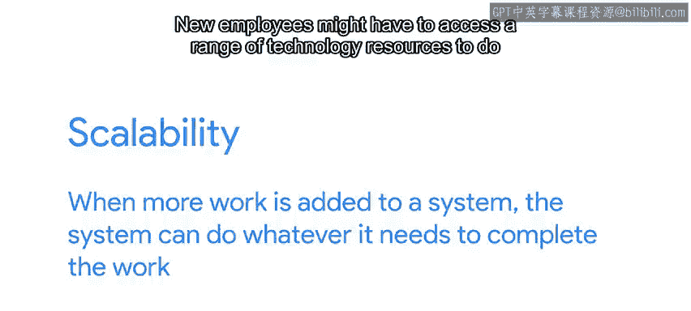
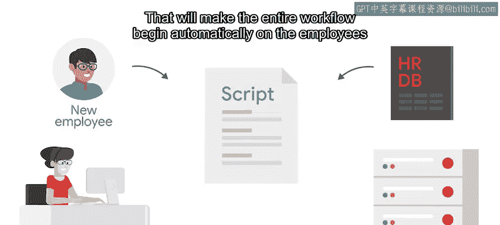
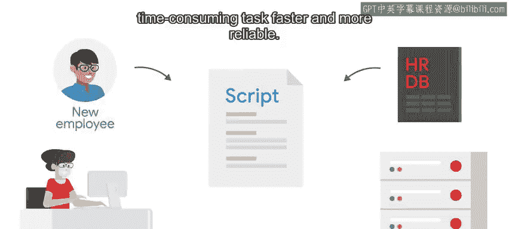

# 谷歌《用Python进行IT自动化办公1、2课（Python、控制操作系统）｜Google IT Automation with Python》中英字幕 - P85：11_自动化的好处.zh_en - GPT中英字幕课程资源 - BV1gw411E7E1

🎼。🎼う。

🎼。In the introduction of the Python course， we talked about the benefits of automation for a bunch of activities like doing repetitive tasks。

 analyzing text， generating reports， and a lot more and this course we'll build on these concepts by applying automation to more and more tasks。

As an IT specialist， thoughtfully applied automation can play an important role in your work。

Look at automation like an IT force multiplier， a tool that can increase the effectiveness of an IT team without needing to increase the number of team members。

In other words， automation can allow the I T infrastructure to scale。

 keeping pace with growth and demand。Scalability means that when more work is added to a system。

 the system can do whatever it needs to complete the work。

For example， think about the impact on IT when a company hires a new employee。

New employees might have to access a range of technology resources to do their job。

Onboarding tasks can include creating a user account， a mailbox and a home folder。

 and setting up the appropriate permissions to control access to various systems and resources。

 If the company doesn't hire a lot of employees over a given period。

 someone could manually do these tasks each time a new person is brought on board。

 although I'm willing to bet that that will get tedious real fast。

But as the number of new employees increases， so does the time it takes to set them all up in the system。

If a company hires 10 times its usual number of new employees in a week。

 the IT person in charge may find themselves performing nothing but the new employee account set up and going crazy at the same time。

They would probably have to put a bunch of other projects on hold until they've set up all the accounts as a human。

 they may also make some mistakes during the provisioning process， like misspelling a name。

 forget getting a SE， or giving a user account the wrong permissions。

They then have to fix these mistakes， which means even more work。 Yikes。 Now。

 imagine if the company continues to hire at this pace。

 They might need to assign another I T specialist to pick up the work that's being neglected because of all the new accounts to set up。

Or there might be so much to do that two IT specialists might need to be assigned to the account setup。

Basically， this doesn't scale well in terms of financial resources， mental investment or reliability。

 especially if the company continues to grow。What happens if the rate of new hires doubles triples。

 or grows even larger？Throwing more people at the problem quickly becomes impractical。Okay。

 so assuming that we're all on the same page about how manual onboarding has its issues。

 let's think about how we can improve the process with automation。Well。

 instead of having one person interact with each separate system to create a new user account。

 a mailbox， a shared folder， and permissions， it'd be more efficient if the IT specialist could write a script to all of this。

We could then have a computer do these tasks each time a new employee is hired。

When given initial information like the new employee's name and job function。

 this script could carry out each step automatically so humans would only need to intervene if a task failed for some reason。

The computer would execute each step in the script and in the given order and exactly the same way。

 it would never need to deviate from these instructions。

 we could even improve the script further instead of having the IT specialists enter a new employee's information into the script each time it's run。

 the script could just read the data from a company's human resources system。

That will make the entire workflow begin automatically on the employee's start date。

In this example of automation， we've made a repetitive time consuming task faster and more reliable。

 We've also freed up human resources， allowing I T specialists to focus on more strategic or creative work。

😊，Another subtle but super helpful benefit of automation is centralizing mistakes。

Which means if you find an error in a script， you can fix the error once and for all。

 which isn't the case from mistakes made by humans， of course。

Hopefully you're now even more sold on the benefits of automation than you already were。

But as we've said before， automation is not a fix all。 If badly executed。

 automation can cause as many problems as you can solve to avoid that。

 we need to know how it can go wrong。 So next， let's check out some ways automation can fail。

